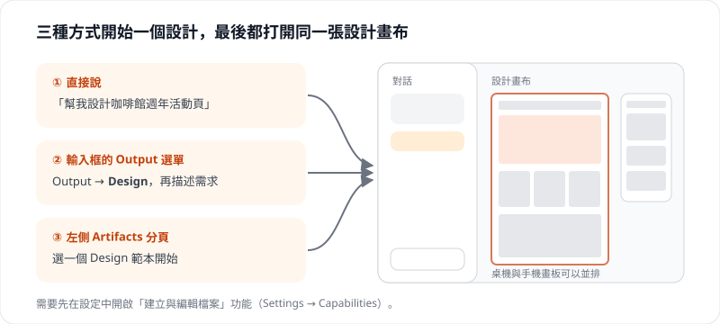
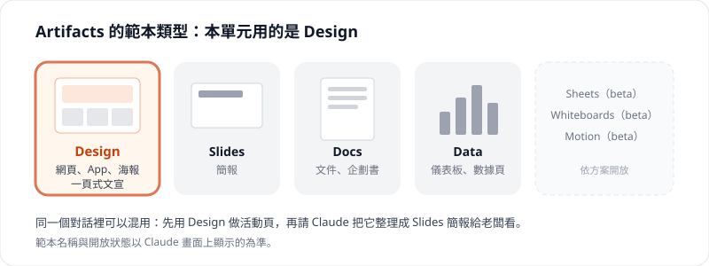

# 01. 認識 Claude Design：在對話裡直接做設計

> 這一章你會知道 Claude Design 是什麼、在哪裡打開，並完成第一個設計。

---

## Claude Design 是什麼？

**Claude Design** 是 Claude 的設計功能。你用對話描述需求，Claude 會在對話旁邊的**設計畫布**上做出網頁、App 畫面、一頁式文宣或海報，你可以接著用對話、留評論或直接拖曳來修改，最後匯出或交給 Claude Code 寫成程式。

它原本是一個獨立網站（claude.ai/design），**2026 年 9 月起已經併入一般的 Claude 對話**，變成 Artifacts（Claude 產生的作品）的其中一種類型。

| | 說明 |
| :--- | :--- |
| 在哪裡 | 一般的 Claude 對話裡（網頁版、桌面版；手機 App 可以產生與查看） |
| 誰能用 | 免費版、Pro、Max、Ultra、Team、Enterprise 都能用 |
| 用量 | 和 Claude 的其他功能共用同一份使用額度 |
| 設計系統 | 付費方案可以儲存品牌設計系統（第 04 章） |

> [!IMPORTANT]
> 舊的獨立網站 claude.ai/design 將在 **2026 年 12 月 14 日關閉**，舊網站上的對話與評論不會搬過來。如果你以前在那裡做過設計，請在關閉前把需要的檔案匯出保存。

---

## 觀念一：三種開始方式



1. **直接說**：在對話中說「幫我設計……」，Claude 會判斷要做成設計。
2. **Output 選單**：在輸入框按 **Output**，選擇 **Design**，再描述需求。這樣最明確，Claude 一定會做成設計。
3. **Artifacts 分頁**：在左側欄打開 **Artifacts**，選一個 **Design** 範本開始。

做好的設計會出現在對話右側的畫布上。畫布上可以有好幾個**畫板（artboard）**，例如桌機版和手機版並排。

### 開始前：確認功能已開啟

Claude Design 需要「建立與編輯檔案」的功能：

- **個人方案**（免費版、Pro、Max、Ultra）：到 **Settings → Capabilities**，開啟 **Create and edit files**（舊版名稱為 Cloud code execution and file creation）。
- **Team／Enterprise**：由組織管理員在 **Organization settings → Capabilities** 開啟。

---

## 觀念二：Artifacts 的範本類型



Design 只是 Artifacts 的一種。其他常見的還有 **Slides**（簡報）、**Docs**（文件）、**Data**（數據頁）。它們可以在同一個對話裡互相轉換，例如「把這個活動頁的重點整理成三頁簡報」。

本單元專注在 **Design**，並以 **RWD 網頁**為主。

---

## 觀念三：Claude Design 和其他工具的分工

| 工具 | 最擅長 |
| :--- | :--- |
| **Claude Design** | 用對話快速做出「看起來就是成品」的設計，文案、版面一起處理；可以直接交給 Claude Code 寫程式 |
| Google Stitch | 一次產生很多方向、串成多頁原型 |
| pen.dev | 精確到像素的元件、變數與 RWD 版面 |

Claude 本身很會寫文案、整理內容，所以 **Claude Design 特別適合「內容和設計要一起想」的頁面**，例如活動頁、產品介紹頁、一頁式提案。

---

## 本單元的專案

所有章節都用同一個專案練習：

> **《木日 Kibi》台南老宅精品咖啡館 一週年活動頁**
> 要有導覽列、主視覺、空間故事、週年優惠與三款限定咖啡豆、訂位抽屜、門市資訊。桌機與手機都要好用。

完整需求與文案在課程的〈[木日 Kibi 產品需求](../../產品需求實戰範例庫/01_Landing_Page單頁行銷與活動頁/01_木日Kibi_台南老宅咖啡一週年活動頁.md)〉。第 02 章會教你怎麼把它交給 Claude。

---

## 動手操作：第一個設計

1. 打開 [claude.ai](https://claude.ai/)，開一個新對話。
2. 在輸入框按 **Output → Design**。
3. 貼上下面的 Prompt：

<details>
<summary>📋 Prompt：第一個設計（暖身）</summary>

```text
幫我設計一張咖啡館的「營業時間公告」，尺寸適合放在 Instagram 貼文（正方形）。
店名「木日 Kibi」，台南老宅咖啡館。
內容：週三至週日 10:30–18:30，週一、週二公休。地址：台南市中西區信義街 88 巷 12 號。
風格：溫暖的木質調、簡潔、有老宅的感覺。
```

</details>

**換你觀察：**

1. 畫布出現在哪裡？試著放大、縮小、拖曳畫布。
2. 在對話框輸入「把背景改成深色，文字改成米白色」，看設計怎麼變化。
3. 點一下畫布上的店名文字，看看會出現什麼選項（第 03 章會詳細介紹）。

再試一個網頁：

<details>
<summary>📋 Prompt：第一個網頁</summary>

```text
幫我設計「木日 Kibi」咖啡館的網站首頁，桌機版。
要有：導覽列、大圖主視覺（標語「老宅裡的日常微光」）、三款招牌咖啡、門市資訊、頁尾。
風格溫暖、留白多，像一本生活雜誌。
```

</details>

---

## 常見錯誤

- **Claude 只回文字、沒有出現設計**：確認已開啟「建立與編輯檔案」功能，並改用 **Output → Design** 明確指定。
- **到舊網站 claude.ai/design 找新作品**：新的設計都在一般對話與 **Artifacts** 分頁裡。
- **一開始就想做完整網站**：先用小設計熟悉畫布，下一章再正式開始專案。

## 自我檢核

- [ ] 我知道 Claude Design 現在在一般 Claude 對話裡，不是獨立網站。
- [ ] 我會用三種方式開始一個設計，並確認功能已開啟。
- [ ] 我已經做出第一張公告圖與第一個網頁設計。

---

[下一章：02. 開始第一個設計：寫好設計需求 →](../02_開始第一個設計/README.md)
