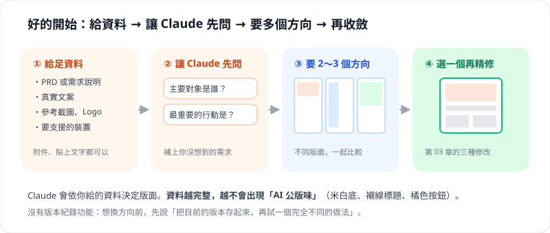

# 02. 開始第一個設計：寫好設計需求

> Claude 做出來的設計好不好，取決於你一開始給它什麼。這一章學會給足資料、讓 Claude 先問問題、一次要好幾個方向，正式開始「木日 Kibi」活動頁。

---

## 觀念：好的開始有四個步驟



1. **給足資料**：需求說明、真實文案、參考圖片、Logo、要支援哪些裝置。資料越完整，越不會出現 AI 常見的「公版味」。
2. **讓 Claude 先問**：請它開工前先問你幾個問題，常常會補上你沒想到的需求。
3. **要 2～3 個方向**：Claude Design 沒有「產生變體」按鈕，直接在 Prompt 裡要求不同版面就好。
4. **選一個再精修**：決定方向後，用第 03 章的方法慢慢改。

**一段好的設計需求包含：**

| 項目 | 例子 |
| :--- | :--- |
| 做什麼 | 咖啡館一週年活動頁，單頁式網站 |
| 給誰看 | 22–40 歲喜歡老宅與手沖咖啡的熟客 |
| 最重要的行動 | 點「立即訂位」完成預約 |
| 內容 | 區塊清單＋真實文案（不要讓 Claude 自己編） |
| 裝置 | 桌機 1440 寬＋手機 390 寬 |
| 風格 | 溫潤木質、雜誌感、留白多；或附上參考截圖 |
| 不要什麼 | 不要米白底配橘色按鈕的公版風格、不要 emoji 圖示 |

> [!TIP]
> Claude 沒有版本紀錄功能。想嘗試完全不同的方向前，先說：「**把目前的版本存起來，再試一個完全不同的做法。**」Claude 會先保存，再開始新方向。

---

## 範例 A：把需求文件交給 Claude，請它先問問題

1. 打開〈[木日 Kibi 產品需求](../../產品需求實戰範例庫/01_Landing_Page單頁行銷與活動頁/01_木日Kibi_台南老宅咖啡一週年活動頁.md)〉，複製「可直接複製的 PRD.md」整段內容。
2. 開新對話，選 **Output → Design**，貼上：

<details>
<summary>📋 Prompt</summary>

```text
我要設計一個咖啡館一週年活動頁，下面是完整的需求文件（PRD）。
請先不要開始設計，先問我 5 個你需要知道的問題（例如品牌感覺、照片來源、最重要的轉換目標），
等我回答後再開始。

（在這裡貼上 PRD.md 的內容）
```

</details>

3. 認真回答 Claude 的問題。不確定的可以說「你建議怎麼做？」。

**換你觀察：** Claude 問的問題中，有哪些是你原本沒想到的？

---

## 範例 B：一次要三個方向

回答完問題後，接著輸入：

<details>
<summary>📋 Prompt</summary>

```text
請依照需求，做出三個不同方向的桌機版首屏（導覽列＋主視覺＋週年優惠橫幅），並排放在畫布上：
方向一「老宅雜誌風」：大張照片、襯線標題、溫潤木色、大量留白。
方向二「手沖職人風」：深色背景、聚焦咖啡豆與水柱的特寫、精緻細線條。
方向三「活潑週年慶」：明亮配色、大字級的「第二杯半價」、有節慶感但不俗氣。
三個方向的文案都要使用 PRD 裡的真實文案。
```

</details>

**換你判斷：** 用這三個問題比較，選出一個方向：

1. 第一次看到的人，3 秒內知道這是「咖啡館週年活動」嗎？
2. 「立即訂位」按鈕夠明顯嗎？
3. 哪一個最符合「老宅裡的日常微光」這句標語的感覺？

選好後告訴 Claude：「我選方向一，請用它完成整頁。」

---

## 範例 C：附上參考截圖

找一個你喜歡的咖啡館或生活品牌網站，截圖下來，連同 Prompt 一起上傳：

<details>
<summary>📋 Prompt</summary>

```text
附件是我很喜歡的一個網站截圖。請參考它的「排版節奏」與「照片和文字的比例」，
不要照抄它的顏色、Logo 和文字。
用這種感覺重新設計木日 Kibi 的空間故事區塊（雙欄圖文，講老宅修復與慢手沖哲學）。
```

</details>

> [!WARNING]
> 參考是為了學習版面與節奏，不是複製別人的品牌。請明確告訴 Claude 不要照抄顏色、Logo 與文字。

---

## 範例 D：從店家給的資料開始

真實工作中，客戶常常只給你一份菜單照片、一份簡報或一份 Word 文件。把它上傳：

<details>
<summary>📋 Prompt</summary>

```text
附件是店家提供的限定咖啡豆介紹（照片／文件）。
請從裡面整理出三款咖啡豆的名稱、價格、烘焙度與風味描述，
設計成活動頁的「三款限定單品卡」區塊：桌機三欄、每張卡片有品名、價格、風味標籤、「加入預購」按鈕。
如果附件內容不清楚，請列出你不確定的地方問我，不要自己編造。
```

</details>

**重點：** 最後一句很重要。Claude 讀不清楚時會先問，而不是編造錯誤的價格。

---

## 範例 E：一開始就指定桌機與手機

<details>
<summary>📋 Prompt</summary>

```text
請把整個活動頁做成兩個畫板並排：
左邊「桌機 1440 寬」，右邊「手機 390 寬」。
手機版的調整：導覽列收成漢堡選單、三款咖啡豆改成可以左右滑動的卡片、
「立即訂位」按鈕固定在畫面底部、所有可點的按鈕至少 44px 高。
兩個版本的文案必須完全相同。
```

</details>

**換你檢查：** 手機版有沒有偷偷刪掉桌機版的內容？如果有，請 Claude 補回來。

---

## 範例 F：保存目前版本，再試一次

如果做到一半覺得方向不對：

<details>
<summary>📋 Prompt</summary>

```text
把目前的版本存起來，命名為「v1 老宅雜誌風」。
然後試一個完全不同的做法：以「一杯咖啡的時間軸」為主軸，
從推開老檜木門、點單、手沖、到坐下來喝第一口，用滾動的方式說故事。
```

</details>

做完後把兩個版本並排比較，決定要用哪一個繼續。

---

## 常見錯誤

- **只說「做一個咖啡館網站」**：Claude 只能用最常見的樣子補齊，結果就是公版。
- **讓 Claude 自己編文案與價格**：真實專案的文案要由你提供，或請它標示「待確認」。
- **一次改到底，沒保存好版本**：沒有版本紀錄，想換方向前一定要先說「存起來」。

想更深入了解怎麼避免 AI 設計的公版味，可以參考課程單元〈[讓 AI 做出不像 AI 的設計](../../讓AI做出不像AI的設計/README.md)〉。

## 自我檢核

- [ ] 我會把需求文件交給 Claude，並請它先問問題。
- [ ] 我能一次要求三個方向，並用三個問題選出最適合的。
- [ ] 我會一開始就指定桌機與手機兩個畫板。

---

[下一章：03. 修改設計：對話、評論與直接編輯 →](../03_修改設計_對話評論與直接編輯/README.md)
