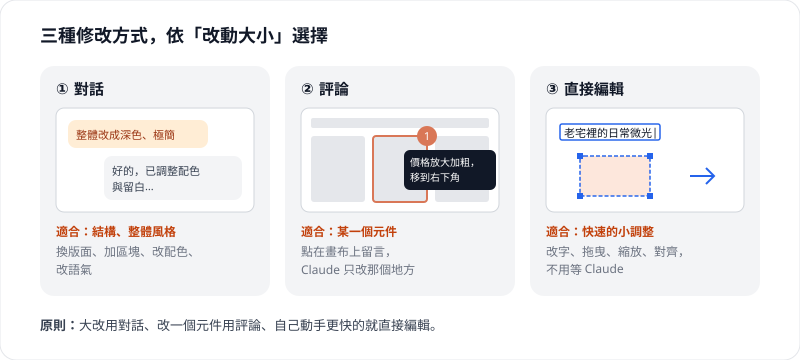
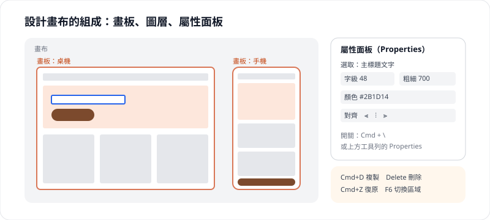

# 03. 修改設計：對話、評論與直接編輯

> 第一版不會完美。這一章學會三種修改方式，知道什麼時候該用哪一種，把木日 Kibi 活動頁改到可以交給客戶。

---

## 觀念一：三種修改方式



| 方式 | 怎麼做 | 適合 |
| :--- | :--- | :--- |
| ① **對話** | 在左邊的對話框輸入 | 換版面、加減區塊、整體配色、文案語氣 |
| ② **評論** | 在畫布上**點一下要改的地方**，留下評論 | 只改某一個元件：一張卡片、一顆按鈕、一段標題 |
| ③ **直接編輯** | 在畫布上直接改文字、拖曳、縮放、對齊 | 改錯字、微調位置與大小，自己動手比較快 |

**原則：** 大改用對話，改一個元件用評論，自己動手更快的就直接編輯。

> [!NOTE]
> 評論偶爾會在 Claude 讀到之前消失。如果 Claude 沒有回應你的評論，把評論內容複製貼到對話框就好。

---

## 觀念二：設計畫布的組成



- **畫板（artboard）**：一個畫面就是一個畫板，例如「桌機」、「手機」。
- **圖層（layer）**：畫板裡的文字、形狀、圖片，每一個都可以選取。
- **屬性面板（Properties）**：選取元素後按 `Cmd + \`（Windows 為 `Ctrl + \`），或按上方工具列的 **Properties**，就能直接調整字級、顏色、對齊等屬性。

**常用快捷鍵：**

| 動作 | 快捷鍵（Mac／Windows） |
| :--- | :--- |
| 開關屬性面板 | `Cmd + \`／`Ctrl + \` |
| 複製選取的元素 | `Cmd + D`／`Ctrl + D` |
| 刪除 | `Delete` 或 `Backspace` |
| 復原 | `Cmd + Z`／`Ctrl + Z` |
| 在畫面各區域之間切換 | `F6` |

新增圖層或形狀時，需要用滑鼠或觸控板操作。

---

## 範例 A：用對話做「大改」

以下 Prompt 都可以直接使用，一次只用一則，看完結果再下一則：

<details>
<summary>📋 Prompt：版面結構</summary>

```text
把「空間故事」區塊從左右雙欄，改成全寬大照片＋照片下方置中的兩段文字。
```

```text
在「週年優惠」與「限定單品」之間，加一個「客人怎麼說」區塊：三則短評，每則有暱稱與星等。
```

```text
把頁面順序調整為：主視覺 → 週年優惠 → 限定單品 → 空間故事 → 客人怎麼說 → 門市資訊。
優惠放前面，因為這是活動頁最重要的資訊。
```

</details>

<details>
<summary>📋 Prompt：整體風格</summary>

```text
整體改成深色模式：背景用深咖啡色 #2B1D14，文字用米白色，保留木質調的溫暖感。
```

```text
現在的留白太多，讓頁面顯得空。把區塊之間的上下間距縮小約三分之一，資訊再緊湊一點。
```

```text
標題字型換成更有手作感的中文字型，內文維持好讀的無襯線字型。
```

</details>

<details>
<summary>📋 Prompt：文案</summary>

```text
「空間故事」的文案太長了，請改寫成兩段，每段不超過 60 字，語氣像老朋友在說話。
```

```text
幫我想 5 個不同的主視覺副標語，列出來讓我選，先不要改設計。
```

</details>

---

## 範例 B：用評論做「精準修改」

在畫布上點一下要改的地方，輸入評論。比較下面兩種寫法：

| ❌ 太模糊 | ✅ 具體 |
| :--- | :--- |
| 這裡改好看一點 | 價格數字放大到 28px 並加粗，移到卡片右下角 |
| 按鈕不明顯 | 「立即訂位」按鈕改成深咖啡底、白字，左右內距加大 |
| 照片怪怪的 | 照片換成老宅木門的特寫，上方加一層由下往上的深色漸層，讓白字看得清楚 |
| 太擠了 | 三張卡片之間的間距從 16 加到 24 |

**換你練習：** 在你的設計上留下至少 5 則具體的評論：

1. 主視覺的標語。
2. 「第二杯半價」的優惠文字（讓它更醒目）。
3. 任一張咖啡豆卡片的風味標籤。
4. 門市資訊的營業時間（公休日要用不同顏色標示）。
5. 頁尾。

---

## 範例 C：自己動手直接編輯

不用每件事都請 Claude 做：

1. **改字**：直接點兩下主標語，把「一週年」改成「1 週年」，看看哪個比較好。
2. **調整大小**：選取主視覺的照片，拖曳邊角放大。
3. **對齊**：選取三張咖啡豆卡片，在屬性面板讓它們頂端對齊。
4. **複製**：選取一則客人評價，按 `Cmd + D` 複製一則，改成新的內容。
5. **復原**：故意刪掉頁尾，再按 `Cmd + Z` 救回來。

---

## 範例 D：要求幾種不同的做法

Claude Design 沒有「變體」按鈕，用說的就好：

<details>
<summary>📋 Prompt</summary>

```text
「週年優惠」區塊給我 3 種不同的版面，並排在畫布上讓我比較：
1. 一條醒目的橫幅
2. 左邊大字「第二杯半價」、右邊規則說明
3. 像一張實體優惠券的卡片設計
```

```text
「立即訂位」按鈕給我 3 種不同的樣式並排：實心圓角、外框線、帶咖啡杯圖示的膠囊形。
```

</details>

選定後說：「用第 2 種，其他刪掉。」

---

## 範例 E：讓 Claude 自己檢查

修改了很多次以後，請 Claude 用使用者的角度檢查一次：

<details>
<summary>📋 Prompt</summary>

```text
請用「第一次來的訪客」角度檢查這個活動頁，列出 5 個可能讓人困惑或不想訂位的問題，
依嚴重程度排序。先只列問題，不要修改。
```

```text
請檢查整頁的無障礙問題：文字與背景的對比是否足夠、按鈕是否夠大、圖片是否需要替代文字。列出問題並提出修改建議。
```

</details>

看完清單後，挑你同意的問題，用評論或對話逐一修正。

---

## 常見錯誤

- **一句話改五件事**：Claude 常常只改到幾件。一次改一件，或分成好幾則評論。
- **小事也一直請 Claude 改**：改錯字、移動位置，自己直接編輯更快。
- **評論沒有反應就一直重複留**：先把評論內容貼到對話框，通常就能解決。

## 自我檢核

- [ ] 我能分辨什麼時候用對話、評論、直接編輯。
- [ ] 我會寫出具體、可執行的評論，而不是「改好看一點」。
- [ ] 我會用屬性面板與快捷鍵直接修改設計。

---

[下一章：04. 設計系統：讓設計符合品牌 →](../04_設計系統_讓設計符合品牌/README.md)
