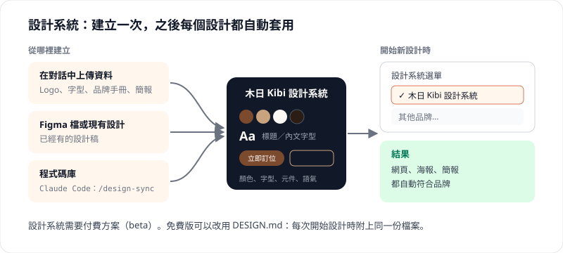

# 04. 設計系統：讓設計符合品牌

> 每次都重新描述「我們的顏色、字型、按鈕長這樣」太累了。這一章把木日 Kibi 的品牌規則做成設計系統，之後不管做網頁、海報還是簡報，都會自動符合品牌。

---

## 觀念：設計系統是什麼？



**設計系統（Design System）** 是一組品牌規則：顏色、字型、按鈕與卡片的樣式、文字語氣。在 Claude 裡建立一次後，開始新的設計或簡報時，從**設計系統選單**選它，Claude 就會自動遵守。

| | 說明 |
| :--- | :--- |
| 誰能用 | Pro、Max、Ultra、Team、Enterprise（beta）。Enterprise 需要管理員開啟 |
| 從哪裡建立 | 在對話中上傳資料（Logo、字型、品牌手冊、簡報、Figma 檔），或在 Claude Code 用 `/design-sync` 從程式碼庫建立 |
| 在哪裡管理 | **Settings → Design systems**（或 Settings → Capabilities，在 Design systems 旁按 **Manage**） |
| 怎麼使用 | 開始新設計或簡報時，從設計系統選單選取 |
| 怎麼修改 | 直接請 Claude 修改這套設計系統 |

> [!NOTE]
> **免費版怎麼辦？** 免費版不能儲存設計系統，但可以用 **DESIGN.md** 達到類似的效果：把品牌規則寫成一份 DESIGN.md，每次開始設計時附上它。範例 C 會示範。

> [!IMPORTANT]
> 如果你以前在舊的 claude.ai/design 建過設計系統，在 Design 分頁或 Artifacts 頁面上方的「Claude Design lives here now」橫幅中，按 **Move team design systems** 搬過來（舊網站 2026/12/14 關閉）。

---

## 範例 A：從品牌資料建立設計系統（付費方案）

準備木日 Kibi 的品牌資料：Logo 圖片、一張店內照片、你在第 03 章完成的活動頁設計（截圖），開新對話：

<details>
<summary>📋 Prompt</summary>

```text
請幫我為「木日 Kibi」建立一套設計系統，附件是我們的 Logo、店內照片和活動頁設計。
請包含：
1. 色彩：主色、輔色、背景色、文字色，並說明每個顏色的用途
2. 字型：標題與內文各一種，含字級階層（大標、中標、內文、小字）
3. 元件：主要按鈕、次要按鈕、卡片、標籤、輸入框的樣式
4. 語氣：文案的說話方式（例如：像老朋友、溫暖、不說教）
5. 不要做的事：三條品牌禁忌
建立完成後，用這套設計系統做一張示範頁，把所有顏色、字型、元件排在一起給我檢查。
```

</details>

**換你檢查：** 示範頁上的按鈕、卡片，和你原本的活動頁一致嗎？不一致的地方，請 Claude 修改設計系統。

---

## 範例 B：使用設計系統做新東西

設計系統建好後，開新對話，選 **Output → Design**，在設計系統選單選「木日 Kibi」，然後試著做完全不同類型的作品：

<details>
<summary>📋 Prompt</summary>

```text
做一張 Instagram 限時動態（直式），宣傳週年活動的最後三天。
```

```text
做一張可以印出來放在店內桌上的 A5 菜單，列出六款手沖咖啡與價格。
```

```text
做一張給熟客的電子會員卡，有會員編號與集點格。
```

</details>

也可以試試 **Slides**：選 **Output → Slides**，同樣選擇木日 Kibi 設計系統：

<details>
<summary>📋 Prompt</summary>

```text
做一份 5 頁的簡報，向房東說明我們一週年的成果與明年的計畫：
封面、一年來的數字、客人回饋、明年的三個計畫、謝謝頁。
```

</details>

**換你比較：** 四個作品放在一起，看起來像同一個品牌嗎？這就是設計系統的價值。

---

## 範例 C：免費版用 DESIGN.md 代替

〈[木日 Kibi 產品需求](../../產品需求實戰範例庫/01_Landing_Page單頁行銷與活動頁/01_木日Kibi_台南老宅咖啡一週年活動頁.md)〉已經準備了三種風格的 DESIGN.md，選一種複製存成 `DESIGN.md` 檔案。

<details>
<summary>📋 Prompt</summary>

```text
附件 DESIGN.md 是木日 Kibi 的設計規範。請嚴格遵守裡面的顏色、字型、圓角與元件設定，
不要自己新增規範以外的顏色。
請用它設計「門市資訊與交通指南」區塊：地址、營業時間、公休日、地圖區、三種交通方式（步行、公車、開車）。
```

</details>

**換你試試：** 換成另外兩種風格的 DESIGN.md，用同一段 Prompt 再做兩次，比較三種結果。只換一份檔案，整體風格就完全不同。

> 想學會從零寫一份 DESIGN.md，可以參考課程單元〈[建立自己的 DESIGN.md 與創意發想](../../建立自己的DESIGN_md/README.md)〉。

---

## 範例 D：從網站程式碼建立設計系統（進階）

如果你已經有網站的程式碼（例如用 pen.dev 或 Stitch 做出來的網站），可以在該專案資料夾打開 **Claude Code**，輸入：

```text
/design-sync
```

Claude Code 會讀取程式碼裡的顏色、字型等設定與元件，整理成設計系統並上傳到 Claude。之後在 Claude 對話中就能選用這套設計系統。程式碼庫很大時，從 Claude Code 連結會比在網頁上連結更穩定。

---

## 範例 E：修改設計系統

品牌規則改了（例如主色要換），不用重建：

<details>
<summary>📋 Prompt</summary>

```text
請修改「木日 Kibi」設計系統：
主色從深咖啡改成老檜木的紅褐色，所有按鈕與重點文字跟著更新；
新增一個「季節限定」用的強調色（冬季：暖橘色），只用在限時活動的標籤上。
改完後重新產生示範頁讓我確認。
```

</details>

---

## 常見錯誤

- **上傳的資料太少**：只給一個 Logo，Claude 只能猜其他規則。設計系統的品質取決於你給的資料。
- **建好了卻沒有選用**：開始新設計時，記得在設計系統選單選取。
- **每次對話都重新描述品牌**：付費方案就建立設計系統；免費版就固定附上同一份 DESIGN.md。

## 自我檢核

- [ ] 我能說出設計系統包含哪些內容，以及它的好處。
- [ ] 我會建立設計系統（付費方案），或用 DESIGN.md 達到相同效果（免費版）。
- [ ] 我用同一套品牌規則做出了至少三種不同類型的作品，而且看起來像同一個品牌。

---

[下一章：05. RWD 網頁 Prompt 範例庫 →](../05_RWD網頁Prompt範例庫/README.md)
