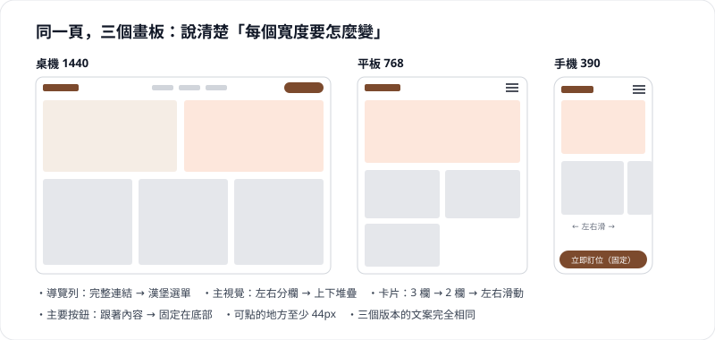

# 05. RWD 網頁 Prompt 範例庫

> 這一章是可以隨時回來翻的「Prompt 工具箱」。依照網頁的區塊與情境分類，每一則都可以直接複製使用。先用木日 Kibi 練習，之後換成你自己的專案。

---

## 怎麼使用這個範例庫

1. 找到你要做的區塊或情境。
2. 複製 Prompt，把 **【　】** 裡的內容換成你的專案。
3. 一次貼一則，看完結果再貼下一則。

範例裡已經填好木日 Kibi 的內容，可以直接貼上練習。

---

## 觀念：RWD 要說清楚「每個寬度怎麼變」



Claude 不會自動知道手機版要怎麼排。Prompt 裡要說清楚：

- **要做哪幾個寬度**：桌機 1440、平板 768、手機 390。
- **每個區塊怎麼變**：導覽列變漢堡選單、左右分欄變上下堆疊、三欄卡片變兩欄或左右滑動。
- **手機的特別需求**：主要按鈕固定在底部、可點的地方至少 44px、字不能太小。
- **內容一致**：三個版本的文案完全相同，只有版面不同。

---

## 一、開場與探索

**先問再做**

```text
我要設計【木日 Kibi 咖啡館一週年活動頁】。開始前，請先問我 5 個你需要知道的問題，
包括目標對象、最重要的行動、品牌感覺、照片來源和必須出現的內容。
```

**一次三個方向**

```text
請為【活動頁首屏】做三個方向，並排在畫布上：
方向一【老宅雜誌風】、方向二【手沖職人風】、方向三【活潑週年慶】。
三個方向使用相同的文案，只有視覺風格與版面不同。
```

**從參考截圖出發**

```text
附件是我喜歡的網站截圖。請參考它的【版面節奏與照片比例】，不要照抄顏色、Logo 和文字，
設計【木日 Kibi 的首屏】。
```

**一次規劃整頁**

```text
請先列出【活動頁】從上到下的區塊清單，每個區塊用一句話說明目的，
並標出「最重要的行動按鈕」要出現在哪幾個地方。先不要設計，等我確認。
```

---

## 二、導覽列

**桌機＋手機**

```text
設計導覽列，桌機與手機兩個版本：
桌機：左邊品牌名【木日 Kibi】，中間錨點連結【空間故事、限定風味、活動優惠、門市資訊】，右邊主要按鈕【立即訂位】。
手機：左邊品牌名、右邊漢堡選單圖示；點開後從右側滑出全高選單，主要按鈕放在選單最下面。
往下捲動時導覽列固定在頂部，背景加上淡淡的陰影。
```

**手機選單展開狀態**

```text
請在手機畫板旁邊，多畫一個「漢堡選單展開後」的畫面，讓我看到完整的選單內容與關閉按鈕。
```

---

## 三、主視覺（Hero）

**標準版**

```text
設計主視覺區塊：
活動期間標籤【2026.11.20 — 11.30】、主標語【老宅裡的日常微光：木日 Kibi 開店一週年】、
副標語【推開台南巷弄裡的五十歲老檜木門，在手沖水柱的蒸氣裡，與我們共度第一個冬日週年。】、
兩顆按鈕【立即訂位】（主要）與【探索限定豆】（次要）。
桌機：左文右圖。手機：圖片在上、文字在下，兩顆按鈕上下排列且寬度滿版。
```

**全版照片＋文字疊加**

```text
主視覺改成全寬大照片，文字疊在照片上。照片上加一層由下往上的深色漸層，確保白字清楚可讀。
手機版照片高度約為螢幕的 70%，文字靠下。
```

**強調倒數**

```text
在主視覺加上活動倒數：「活動倒數 6 天 12 小時」，用小卡片的形式放在按鈕下方，不要搶過主標語。
```

---

## 四、內容區塊

**圖文雙欄（品牌故事）**

```text
設計【空間故事】區塊：桌機為左圖右文雙欄，文字包含小標、標題與兩段內文；
手機改為圖片在上、文字在下。圖片使用【老宅木窗與手沖吧台】的照片風格。
```

**卡片列（商品）**

```text
設計【三款限定咖啡豆】卡片列。每張卡片：照片、品名、烘焙度標籤、價格【NT$ 420 / 半磅】、
三個風味標籤、【加入預購】按鈕。
桌機 3 欄、平板 2 欄、手機改成可以左右滑動的卡片（露出下一張的一部分，提示可以滑）。
卡片內容：
1.【冬日老宅配方・中深焙｜NT$ 420｜黑巧克力、烤核桃、焦糖尾韻】
2.【阿里山鄒築園水洗・淺焙｜NT$ 580｜白桃、烏龍茶感、蜂蜜甜感】
3.【衣索比亞日曬古吉・中淺焙｜NT$ 480｜藍莓果醬、玫瑰花香、可可】
```

**優惠橫幅**

```text
設計【週年優惠】橫幅：大字【全品項咖啡第二杯半價】，下方小字說明規則【11/20 至 11/30，內用外帶皆可，以價低者計】。
要醒目但不要像廉價的特賣廣告。手機版字級縮小但仍是整頁最醒目的文字之一。
```

**客人評價**

```text
設計【客人怎麼說】區塊：三則短評，每則有引言、暱稱與到訪次數。
桌機三欄並排，手機改為一次顯示一則、可以左右滑動，下方有小圓點指示目前是第幾則。
```

**常見問題（FAQ）**

```text
設計【常見問題】區塊，使用可以展開收合的手風琴樣式，5 個問題：
【需要先訂位嗎？／可以帶寵物嗎？／有提供插座嗎？／限定豆可以宅配嗎？／停車方便嗎？】
第一題預設展開。手機版每題的點擊區域至少 48px 高。
```

**門市資訊與地圖**

```text
設計【門市資訊】區塊：地址【台南市中西區信義街 88 巷 12 號】、營業時間【週三至週日 10:30–18:30】、
公休日【週一、週二】（用不同顏色標示）、地圖區（灰色佔位）、「開啟 Google 地圖」按鈕。
桌機左資訊右地圖，手機地圖在下。
```

**頁尾**

```text
設計頁尾：品牌名與一句話介紹、社群連結（Instagram、Facebook、LINE）、版權文字。
深色背景，手機版所有內容置中、上下堆疊。
```

---

## 五、表單與互動狀態

**訂位抽屜（Drawer）**

```text
設計「立即訂位」的滑出式抽屜：點擊頁面任何「立即訂位」按鈕，從右側滑出訂位面板（不換頁）。
欄位：日期、時段【11:00／13:30／15:30】（用按鈕選擇，不用下拉選單）、人數（加減按鈕）、姓名、手機。
桌機抽屜寬 420；手機改成從底部滑上來、佔滿全螢幕。
請把「抽屜開啟」的畫面畫在旁邊。
```

**表單的各種狀態**

```text
請把訂位表單的這些狀態都畫出來，並排在畫布上：
1. 空白狀態 2. 輸入中（欄位有焦點框） 3. 錯誤狀態（手機號碼格式錯誤，紅字說明在欄位下方）
4. 送出中（按鈕顯示載入中） 5. 成功狀態（顯示預約編號【KB-1120-08】與「加入行事曆」按鈕）
```

**按鈕狀態**

```text
把主要按鈕與次要按鈕的這些狀態畫成一張對照表：預設、滑鼠移上（hover）、按下、停用、鍵盤焦點（focus）。
```

**空狀態與錯誤狀態**

```text
如果【所選時段已額滿】，訂位面板要怎麼顯示？請畫出這個狀態，並提供「選擇其他時段」的建議。
```

---

## 六、RWD 與手機專屬

**一次做三個寬度**

```text
請把整頁做成三個畫板並排：桌機 1440、平板 768、手機 390。
平板：導覽列改漢堡選單、卡片 2 欄、主視覺上下堆疊。
手機：卡片可左右滑動、主要按鈕固定在底部。三個版本的文案必須完全相同。
```

**從桌機版做出手機版**

```text
根據目前的桌機版，在旁邊新增一個手機 390 寬的畫板。內容不能刪減，只能調整版面：
單欄排列、字級適合單手閱讀（內文至少 16px）、所有按鈕至少 44px 高、主要按鈕固定在畫面底部。
```

**手機底部固定按鈕**

```text
手機版底部加上固定的行動列：左邊顯示【第二杯半價・活動倒數 6 天】，右邊是【立即訂位】按鈕。
確認它不會擋住頁面最下方的內容（頁尾要多留空間）。
```

**檢查手機版**

```text
請檢查手機畫板：有沒有文字太小、按鈕太小、元素太擠、或需要左右捲動才看得到的內容？
列出問題並直接修正。
```

---

## 七、文案與在地化

```text
把整頁文案改寫成【像老朋友聊天】的語氣，避免「立即購買」、「限時搶購」這類推銷用語。
```

```text
所有標題控制在 15 個字以內，內文每段不超過 3 行（手機版）。改完列出修改前後的對照。
```

```text
檢查整頁：日期、價格、時間格式是否一致（例如都用 11/20、NT$ 420、10:30）。統一後告訴我改了哪些地方。
```

---

## 八、檢查與收尾

**易用性檢查**

```text
請用「第一次來的訪客」角度檢查整頁，列出 5 個可能讓人困惑或不想訂位的問題，依嚴重程度排序，先不要修改。
```

**無障礙檢查**

```text
請檢查：文字與背景對比是否達到 WCAG AA（4.5:1）、按鈕是否至少 44px、圖片是否有替代文字、
錯誤訊息是否只用顏色表達。列出問題並修正。
```

**一致性檢查**

```text
請檢查整頁的按鈕、卡片、圓角、間距是否一致。把不一致的地方列出來，統一成最常用的那一種。
```

---

## 九、一次產生整頁（綜合範例）

熟悉以上區塊後，可以用一則完整的 Prompt 產生整頁，再用第 03 章的方法逐一精修：

<details>
<summary>📋 Prompt：木日 Kibi 一週年活動頁（完整版）</summary>

```text
請設計「木日 Kibi 台南老宅咖啡館一週年活動頁」，做成兩個畫板並排：桌機 1440、手機 390。

【對象】22–40 歲喜歡老宅與手沖咖啡的熟客與台南慢旅遊客。
【最重要的行動】點「立即訂位」，從側邊（手機為底部）滑出訂位面板完成預約，不換頁。
【風格】溫潤木質、生活雜誌感、留白充足。不要米白底配橘色按鈕的公版風格、不要 emoji 圖示。

【區塊，由上到下】
1. 固定導覽列：品牌名、錨點連結（空間故事、限定風味、活動優惠、門市資訊）、「立即訂位」按鈕。手機改漢堡選單。
2. 主視覺：活動期間 2026.11.20 — 11.30、主標語「老宅裡的日常微光：木日 Kibi 開店一週年」、
   副標語「推開台南巷弄裡的五十歲老檜木門，在手沖水柱的蒸氣裡，與我們共度第一個冬日週年。」、
   「立即訂位」與「探索限定豆」兩顆按鈕。
3. 空間故事：雙欄圖文，老宅修復與慢手沖哲學。
4. 週年優惠：全品項咖啡第二杯半價（11/20 至 11/30，以價低者計），購買限定豆加贈濾紙。
5. 三款限定豆卡片：
   冬日老宅配方・中深焙 NT$ 420／阿里山鄒築園水洗・淺焙 NT$ 580／衣索比亞日曬古吉・中淺焙 NT$ 480。
   桌機 3 欄，手機左右滑動。
6. 門市資訊：台南市中西區信義街 88 巷 12 號，週三至週日 10:30–18:30，週一、二公休。
7. 頁尾。

【手機版】主要按鈕固定在底部、所有可點的地方至少 44px、內文至少 16px、文案與桌機版完全相同。
另外在旁邊畫出「訂位面板開啟」與「預約成功」兩個狀態。
```

</details>

---

## 常見錯誤

- **一次貼好幾則 Prompt**：Claude 會混在一起處理。一則做完、看完，再貼下一則。
- **【　】沒有換掉**：換成你自己的專案內容時，記得檢查每一個括號。
- **只做桌機版**：每個區塊的 Prompt 都要說明手機版怎麼變。

## 自我檢核

- [ ] 我能用這個範例庫，逐區塊完成木日 Kibi 的桌機版與手機版。
- [ ] 我會把 Prompt 改成自己專案的內容。
- [ ] 我的設計包含互動狀態（抽屜開啟、表單錯誤、預約成功），而不只是靜態畫面。

---

[下一章：06. 分享、匯出與交給 Claude Code →](../06_分享匯出與交給Claude_Code/README.md)
