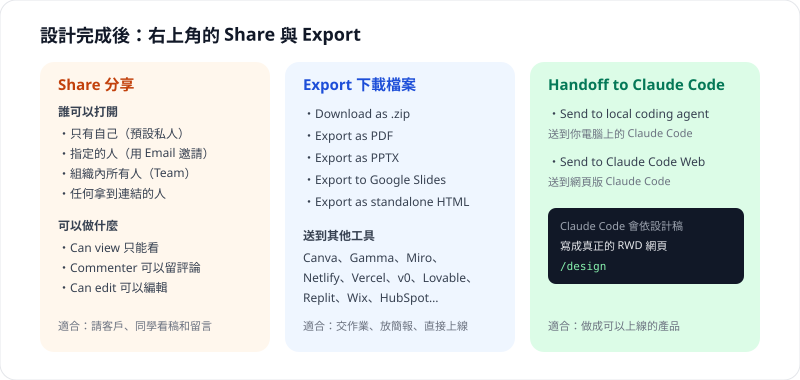

# 06. 分享、匯出與交給 Claude Code

> 設計完成後，要讓別人看到、讓它真的上線。這一章學會分享給客戶留評論、匯出成各種檔案，以及交給 Claude Code 寫成真正的 RWD 網頁。

---

## 觀念：三個出口



設計畫布右上角有 **Share** 與 **Export** 兩個按鈕：

### Share：分享給別人

設計預設是**私人的**，只有你看得到。按 **Share** 後可以設定：

| 設定 | 選項 |
| :--- | :--- |
| 誰可以打開 | 個人方案：只有自己、任何拿到連結的人。Team／Enterprise：指定的人、組織內所有人、任何拿到連結的人 |
| 可以做什麼 | **Can view**（只能看）、**Commenter**（可以留評論）、**Can edit**（可以編輯） |
| 用 Email 邀請 | 付費方案可以邀請指定的人（beta），對方需要用同一個 Email 的 Claude 帳號 |

分享設定要在網頁版或桌面版調整，手機 App 不能改。

### Export：下載或送到其他工具

| 選項 | 用途 |
| :--- | :--- |
| **Download as .zip** | 下載完整的設計檔案 |
| **Export as PDF** | 交作業、列印、寄給客戶 |
| **Export as PPTX**／**Export to Google Slides** | 放進簡報 |
| **Export as standalone HTML** | 一個可以直接用瀏覽器打開的網頁檔 |
| 送到其他工具 | Canva、Gamma、Miro、Netlify、Vercel、v0、Lovable、Replit、Wix、HubSpot 等 |

### Handoff to Claude Code：交給 Claude Code 寫程式

在 Export 選單中的 **Handoff to Claude Code**：

- **Send to local coding agent**：送到你電腦上的 Claude Code。
- **Send to Claude Code Web**：送到網頁版的 Claude Code。

Claude Code 會依照設計稿寫出真正的網頁程式碼。在 Claude Code 裡也可以用 `/design` 指令，把設計放進現有的程式專案，或做成可以運作的原型。

> [!WARNING]
> 設成「任何拿到連結的人」時，連結轉傳出去任何人都能打開。設計稿裡不要放真實的個人資料。

---

## 範例 A：請客戶留評論

1. 打開木日 Kibi 活動頁，按 **Share**。
2. 設定為「任何拿到連結的人」、權限 **Commenter**，複製連結。
3. 把連結傳給一位同學（扮演咖啡館老闆），請他直接在畫布上留下至少 3 則評論。
4. 回到你的對話，請 Claude 處理這些評論：

<details>
<summary>📋 Prompt</summary>

```text
客戶在設計上留了幾則評論。請逐一讀取並修改，每處理完一則，在對話裡告訴我你改了什麼。
如果有評論的意思不清楚，或和其他評論互相矛盾，先問我，不要自己決定。
```

</details>

---

## 範例 B：匯出交作業與提案

<details>
<summary>📋 Prompt：做一頁提案說明</summary>

```text
請在畫布上新增一個 A4 直式的「設計提案說明」畫板，內容包含：
專案目標、目標對象、主要設計決策（3 點，各一句話說明理由）、桌機與手機版的縮圖。
風格沿用活動頁的設計。
```

</details>

1. 按 **Export → Export as PDF**，把活動頁與提案說明一起匯出。
2. 按 **Export → Export as PPTX**，用 PowerPoint 或 Keynote 打開，確認能正常顯示。

也可以把設計直接轉成簡報：開新對話，選 **Output → Slides**：

<details>
<summary>📋 Prompt</summary>

```text
請根據我剛完成的「木日 Kibi 一週年活動頁」設計，做一份 6 頁的提案簡報給咖啡館老闆：
封面、問題（傳統活動只有一張海報）、我們的解法、桌機版畫面、手機版畫面、下一步。
```

</details>

---

## 範例 C：交給 Claude Code，做成真正的 RWD 網頁

1. 按 **Export → Handoff to Claude Code**，選 **Send to local coding agent**（需要電腦已安裝 Claude Code），或 **Send to Claude Code Web**。
2. 在 Claude Code 中接著輸入：

<details>
<summary>📋 Prompt（在 Claude Code 中使用）</summary>

```text
請依照剛剛收到的木日 Kibi 活動頁設計，做成一個響應式網站：
1. 使用 HTML、CSS 與少量 JavaScript，不使用框架。
2. 手機優先（mobile first），在 768px 與 1024px 加上斷點，對照設計的手機版與桌機版。
3. 顏色、字型、圓角、間距都寫成 CSS 變數，名稱要有意義（例如 --color-primary）。
4. 「立即訂位」打開的訂位面板要真的能運作：桌機從右側滑出、手機從底部滑上；
   送出後顯示預約成功與一組預約編號。資料先存在 localStorage。
5. 使用語意化 HTML，圖片要有 alt，所有按鈕都能用鍵盤操作。
完成後告訴我怎麼在瀏覽器打開檢查。
```

</details>

3. 用瀏覽器打開網站，**慢慢拖曳視窗寬度**，從最寬縮到最窄，確認每個寬度都沒有跑版。
4. 用手機打開，實際點一次「立即訂位」到「預約成功」。

**換你比較：** 把網站和設計稿並排，列出三個不一樣的地方，再請 Claude Code 修正。

---

## 範例 D：直接發布上網

如果只需要一個可以分享的網址，可以在 **Export** 的送出選項中選 **Netlify** 或 **Vercel** 發布（第一次使用需要登入並授權該服務）。

**換你思考：** 直接發布設計稿，和範例 C 交給 Claude Code 做成網站，結果有什麼差別？（提示：訂位功能能不能真的使用？手機和平板的版面是否都正確？）

---

## 常見錯誤

- **把「可以編輯」的連結傳給客戶**：客戶不小心改到設計就麻煩了。請客戶看稿時用 **Commenter**。
- **只交出桌機版的 PDF**：手機版的畫板也要一起匯出。
- **以為設計稿就是網站**：設計稿上的按鈕不一定真的能用，要經過 Claude Code 做成網站才算完成。

## 自我檢核

- [ ] 我會設定分享對象與權限，並請別人在設計上留評論。
- [ ] 我能把設計匯出成 PDF 與 PPTX，或轉成簡報。
- [ ] 我能把設計交給 Claude Code，做出在任何寬度都正常、訂位功能可以運作的網站。

---

🎉 **恭喜完成 Claude Design 單元！** 你已經能用對話完成一個品牌一致、桌機與手機都好用的活動頁，並把它變成真正的網站。接著可以挑〈產品需求實戰範例庫〉的其他題目，從第 02 章重新走一次完整流程。
