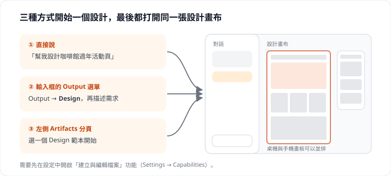
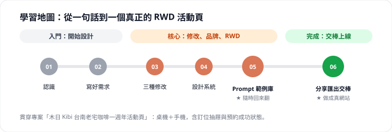

# Claude Design 實戰：在 Claude 對話裡設計 RWD 網頁

## Claude Design 是什麼？

**Claude Design** 是 Claude 的設計功能。你在一般的 Claude 對話中描述需求，Claude 就會在旁邊的設計畫布上做出網頁、App 畫面、海報或一頁式文宣，接著可以用對話、評論或直接拖曳來修改，最後分享、匯出，或交給 Claude Code 寫成真正的網站。

- 2026 年 9 月起，Claude Design 已經併入一般的 Claude 對話，是 **Artifacts** 的一種類型。
- **免費版也能使用**；儲存品牌設計系統需要付費方案。
- 舊的獨立網站 claude.ai/design 將在 2026 年 12 月 14 日關閉。

---

## 這套教材怎麼學？

Claude Design 主要靠**對話**操作，所以這個單元特別提供**大量可以直接複製的 Prompt**。每一章都有：

1. **觀念圖**：先看懂這個功能在做什麼。
2. **可複製的 Prompt**：貼上就能用，【　】裡的內容換成自己的專案即可。
3. **換你動手**：要你親自比較、判斷、修改的練習。

第 05 章是完整的 **RWD 網頁 Prompt 範例庫**，依網頁區塊分類，做任何專案時都可以回來翻。

---

## 學習地圖

全部章節都用同一個專案練習：**「木日 Kibi 台南老宅咖啡一週年活動頁」**。

### 入門：開始設計

- [01. 認識 Claude Design](./01_認識Claude_Design/README.md)：在哪裡打開、三種開始方式、做出第一個設計。
- [02. 開始第一個設計](./02_開始第一個設計/README.md)：給足資料、讓 Claude 先問問題、一次要三個方向。

### 核心：修改、品牌、RWD

- [03. 修改設計：對話、評論與直接編輯](./03_修改設計_對話評論與直接編輯/README.md)：三種修改方式，以及畫布、屬性面板與快捷鍵。
- [04. 設計系統：讓設計符合品牌](./04_設計系統_讓設計符合品牌/README.md)：建立品牌規則，網頁、海報、簡報都自動一致。
- [05. RWD 網頁 Prompt 範例庫](./05_RWD網頁Prompt範例庫/README.md)：★ 導覽列、主視覺、卡片、表單、手機版等數十則 Prompt。

### 完成：交棒上線

- [06. 分享、匯出與交給 Claude Code](./06_分享匯出與交給Claude_Code/README.md)：★ 請客戶留評論、匯出 PDF 與簡報、做成真正的 RWD 網站。

---

## 開始前的準備

- [ ] 一個 Claude 帳號（免費版即可；第 04 章的設計系統需要付費方案，免費版有替代做法）。
- [ ] 在 **Settings → Capabilities** 開啟 **Create and edit files**。
- [ ] 電腦版瀏覽器或 Claude 桌面版（分享設定無法在手機 App 修改）。
- [ ] （第 06 章）安裝 Claude Code，用來把設計做成網站。

> [!TIP]
> Claude 的功能更新很快。按鈕名稱或位置和講義不同時，以畫面上顯示的為準，也可以直接問 Claude：「怎麼把這個設計匯出成 PDF？」
