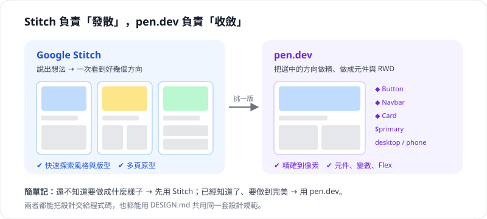
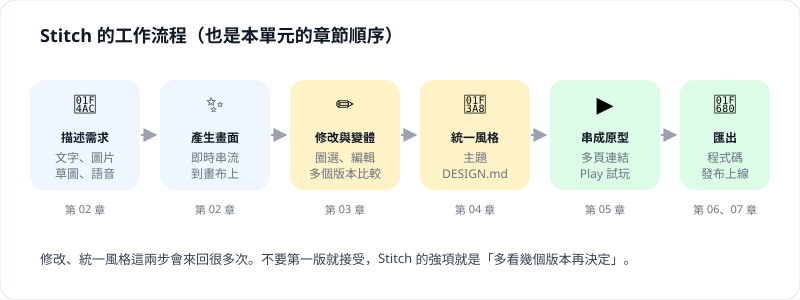

# 01. 認識 Google Stitch：用說的就能產生介面

> 這一章你會知道 Stitch 是什麼、它和 pen.dev 怎麼分工，並產生你的第一個畫面。

---

## Stitch 是什麼？

**Google Stitch**（[stitch.withgoogle.com](https://stitch.withgoogle.com/)）是 Google Labs 推出的 AI 介面設計工具。你用文字、圖片、草圖或語音描述想要的畫面，它會在一張無限畫布上直接產生網頁或 App 的設計稿，還可以串成能點擊的原型、匯出程式碼。

Google 稱這種做法為 **vibe design**：不從線框圖開始，而是從「想讓使用者有什麼感覺」、「要達成什麼目的」開始，讓 AI 先畫出好幾個方向，你再挑選和修改。

Stitch 目前的主要能力：

- **無限畫布**：所有畫面攤在同一張畫布上，可以並排比較。
- **設計代理（Stitch Agent）**：產生畫面時會即時串流到畫布上，你可以在它還沒畫完時就插話調整。
- **多種輸入**：文字、圖片、手繪草圖、語音、現有程式碼與設計檔。
- **變體**：同一個畫面一次產生好幾個不同版本。
- **設計系統與 DESIGN.md**：統一顏色、字型、圓角，還能匯入匯出給其他工具使用。
- **互動原型**：把畫面串起來，按 **Play** 直接試玩。
- **匯出與發布**：下載程式碼、用 Google AI Studio 產生分享連結、送到 Google Antigravity 接後端、用 Netlify 直接發布上網。
- **MCP 與 SDK**：讓 Claude Code、Gemini CLI 等 AI 工具直接控制 Stitch。

---

## 觀念一：Stitch 和 pen.dev 怎麼分工？



兩個工具都能「AI 產生設計」，但擅長的事不同：

| | Google Stitch | pen.dev |
| :--- | :--- | :--- |
| 最擅長 | 快速發想、多個方向比較、做出可點擊的原型 | 精確修改、元件與變數、RWD 版面 |
| 手動操作 | 少，主要靠對話、圈選和面板調整 | 多，每個屬性都能手動改 |
| 適合的階段 | 還不知道要做成什麼樣子 | 已經決定方向，要做到完美 |

**手動操作少，不代表不用動手。** 在 Stitch 裡，你的「手動操作」是：寫出好的 Prompt、圈選要改的地方、比較變體、調整主題、檢查原型動線。這些判斷才是設計師的工作。

---

## 觀念二：Stitch 的工作流程



本單元就照這個流程，用同一個專案從頭做到尾：

> **本單元專案「山城小旅行」**：一個預約新竹、苗栗山城一日遊的網站。要有首頁、路線列表、路線介紹、預約表單、預約完成頁，桌機與手機都要能用。

---

## 動手操作：開始使用

### 步驟 1：登入並建立專案

1. 用 Chrome 打開上面的 Stitch 網址，用 Google 帳號登入。
2. 第一次使用會看到首頁的輸入框。先不要急著輸入，看看畫面上有哪些選項：**裝置類型**（手機、平板、桌機等）、**模型或模式**選擇、上傳圖片的按鈕、麥克風按鈕。

> [!NOTE]
> Stitch 更新非常頻繁，按鈕與選單的名稱、位置可能和講義不同。講義會描述「功能是什麼」，請以你畫面上的實際名稱為準。目前透過 Google Labs 可以免費使用，但有使用額度限制，額度用完要等重置。

### 步驟 2：產生第一個畫面

裝置類型選**桌機（Web／Desktop）**，貼上這段 Prompt：

<details>
<summary>📋 Prompt：第一個畫面</summary>

```text
為「山城小旅行」設計一個桌機版首頁。這是預約新竹、苗栗山城一日遊的網站，
對象是想在週末帶家人放鬆的上班族。首頁要有：導覽列、大圖 Hero（標題＋預約按鈕）、
三條熱門路線卡片、旅客評價、頁尾。風格溫暖自然、留白多，主色森林綠。
```

</details>

**換你觀察：**

1. 畫面是一塊一塊串流出來的嗎？趁它還在產生時，試著在對話框補一句「Hero 的標題改成『週末，去山裡走走』」，看它會不會即時調整。
2. 產生完成後，在畫布上**縮放與拖曳**，找到這個畫面。
3. 點一下畫面，看看出現了哪些選單（修改、產生變體、匯出等）。先記住位置，第 03 章會一一使用。

### 步驟 3：再產生一個手機版

裝置類型改成**手機（Mobile）**，貼上同一段 Prompt，把「桌機版」改成「手機版」。兩個畫面並排，比較它們的差異：導覽列、Hero、卡片排法怎麼變了？

---

## 常見錯誤

- **一次 Prompt 想做完整個網站**：先做一頁，滿意後再加頁面，風格會比較一致。
- **同一個專案混用手機和桌機**：要做 RWD 時，請分清楚哪幾個畫面是桌機、哪幾個是手機，名稱也要標清楚。
- **第一版就接受**：Stitch 產生新版本的成本很低，至少看三個方向再決定。

## 自我檢核

- [ ] 我能說出 Stitch 和 pen.dev 各自擅長的事。
- [ ] 我已經登入 Stitch，產生了「山城小旅行」桌機版與手機版首頁。
- [ ] 我知道畫面產生時可以即時插話調整。

---

[下一章：02. 輸入與 Prompt：從一句話到整頁 →](../02_輸入與Prompt_從一句話到整頁/README.md)
