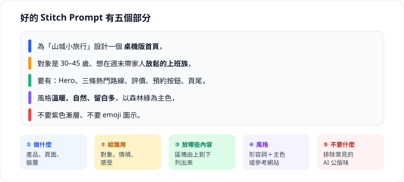
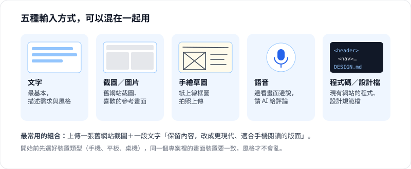

# 02. 輸入與 Prompt：從一句話到整頁

> Stitch 產生的畫面好不好，九成取決於你給它什麼。這一章學會寫好 Prompt，以及善用截圖、草圖、語音等不同輸入。

---

## 觀念一：好 Prompt 的五個部分



一句「幫我做一個旅遊網站」，Stitch 只能猜，結果通常是千篇一律的公版。把這五件事說清楚，結果會差很多：

1. **做什麼**：產品名稱、哪一頁、什麼裝置。
2. **給誰用**：對象、使用情境、希望他們有什麼感覺。
3. **放哪些內容**：區塊由上到下列出來。
4. **風格**：二到三個形容詞＋主色，或「參考某某網站的感覺」。
5. **不要什麼**：排除 AI 常見的壞習慣，例如紫色漸層、每個東西都包成卡片、用 emoji 當圖示。

> [!TIP]
> 文字內容請盡量用**真實的內容**（真的路線名稱、真的價格），不要讓 AI 填「Lorem ipsum」或「標題一」。內容真實，版面才會真實。

---

## 觀念二：五種輸入方式



| 輸入 | 怎麼做 | 適合 |
| :--- | :--- | :--- |
| 文字 | 在輸入框打字 | 所有情況 |
| 截圖／圖片 | 用上傳按鈕附加圖片，再補一段文字 | 改版舊網站、參考別人的版型 |
| 手繪草圖 | 紙上畫線框圖，拍照上傳 | 你已經想好版面配置 |
| 語音 | 按麥克風直接說話 | 邊看畫面邊討論、請 AI 評論 |
| 程式碼／設計檔 | 上傳現有網站程式或 DESIGN.md | 延續既有產品的風格 |

### 裝置類型：先選好再產生

產生前要選裝置類型（手機、平板、桌機，或不指定）。**做 RWD 網站時，同一頁要分別產生桌機版與手機版**，並且：

- 兩個版本的文字內容要一樣，只有版面不同。
- 畫面名稱標清楚，例如「首頁 - 桌機」、「首頁 - 手機」。
- 產生手機版時，可以先選取桌機版畫面，再說「把這個畫面做成手機版，內容不變」。

**手機版常用的 Prompt 句型：**

- 「單欄排列，卡片上下堆疊」
- 「導覽列改成漢堡選單」
- 「主要按鈕滿版寬度，固定在畫面底部」
- 「字級與留白適合單手閱讀」

---

## 範例 A：同一頁，好 Prompt 與壞 Prompt

先體驗一次差異。在兩個畫面分別輸入：

<details>
<summary>📋 Prompt：壞的版本</summary>

```text
幫我做一個旅遊路線列表頁。
```

</details>

<details>
<summary>📋 Prompt：好的版本</summary>

```text
為「山城小旅行」設計桌機版的「路線列表頁」。
對象是週末想帶家人出遊的上班族，他們想快速比較路線的時間、難度與價格。
由上到下：導覽列、頁面標題「全部路線」、篩選列（地區：新竹／苗栗、時間：半天／一天、適合：親子／長輩）、
路線卡片三欄排列（照片、路線名稱、地區標籤、所需時間、難度、每人價格、「查看行程」按鈕），共 6 張、
分頁、頁尾。
路線範例：內灣老街與合興車站、南庄桂花巷與向天湖、司馬庫斯神木步道、勝興車站與龍騰斷橋、大湖草莓園與酒莊、北埔老街擂茶體驗。
風格溫暖自然、留白多，主色森林綠 #2F6B4F。不要紫色漸層、不要 emoji 圖示。
```

</details>

**換你比較：** 兩個畫面並排，列出好的版本贏在哪三個地方。然後選取好的版本，產生一個**手機版**（卡片單欄、篩選列收進「篩選」按鈕）。

---

## 範例 B：上傳舊網站截圖，改成現代 RWD

1. 找一個你覺得「有點舊」的網站（例如學校社團、社區、地方小店），把首頁截圖存下來。
2. 新增一個桌機畫面，上傳截圖，輸入：

<details>
<summary>📋 Prompt</summary>

```text
這是一個現有網站的首頁截圖。請保留它的品牌名稱、主要內容與功能，
重新設計成現代、清爽、容易閱讀的桌機版首頁：
資訊層級要清楚、主要行動按鈕要明顯、去掉多餘的裝飾。
```

</details>

3. 再請 Stitch 產生同一頁的手機版。

**換你檢查：** 舊網站裡最重要的三個資訊，在新設計裡是不是更容易找到了？有沒有被 AI 刪掉的重要內容？

---

## 範例 C：手繪草圖變成預約表單頁

1. 在紙上畫一個「預約表單頁」的線框：上方是行程摘要（照片＋路線名稱＋日期），下方是表單（人數、日期、聯絡人、電話、備註），最下面一顆大按鈕。用方框代表圖片、橫線代表文字就好。
2. 拍照，新增一個**手機**畫面，上傳照片，輸入：

<details>
<summary>📋 Prompt</summary>

```text
這是我手繪的預約表單頁線框圖，請依照這個版面配置產生「山城小旅行」的手機版預約頁。
路線是「南庄桂花巷與向天湖」，價格每人 NT$ 1,280。
表單欄位要有清楚的標籤與錯誤提示樣式，「確認預約」按鈕固定在畫面底部。
沿用之前畫面的森林綠風格。
```

</details>

**換你檢查：** AI 有沒有照你的版面配置？如果它自作主張改了位置，用一句話指正它，例如「照我的草圖，行程摘要要在表單上方」。

---

## 範例 D：用語音請 AI 評論

> 語音功能如果你的帳號還沒有開放，或教室環境不方便說話，可以改用文字輸入同樣的內容。

選取「首頁 - 桌機」畫面，按麥克風，直接說：

- 「從第一次來的訪客角度，評論這個首頁，列出三個最大的問題。」
- 「給我看三種不同的導覽列設計。」
- 「把這個畫面換成三種不同的配色看看。」

**換你判斷：** AI 的評論你同意幾項？把你同意的問題寫下來，第 03 章修改時會用到。

---

## 常見錯誤

- **Prompt 太短**：Stitch 會用最常見的樣子補齊，結果就是公版。至少寫出五個部分中的四個。
- **桌機版和手機版內容不一致**：產生手機版時，記得說「內容與桌機版相同」。
- **一次上傳好幾張風格不同的參考圖**：AI 會混在一起。一次給一個主要參考就好。

## 自我檢核

- [ ] 我能寫出包含五個部分的 Prompt。
- [ ] 我會用截圖、草圖產生畫面，並檢查 AI 有沒有遺漏重要內容。
- [ ] 我知道做 RWD 時要分別產生桌機版與手機版，而且內容要一致。

---

[下一章：03. 修改畫面：對話、圈選與變體 →](../03_修改畫面_對話圈選與變體/README.md)
