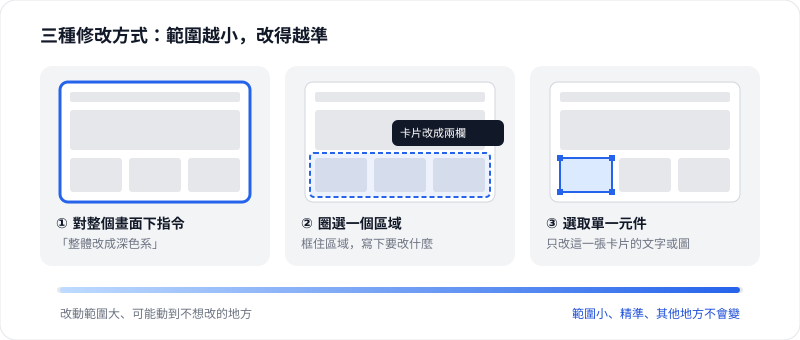
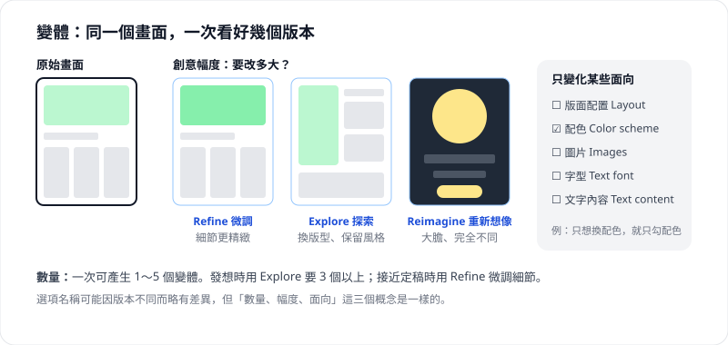

# 03. 修改畫面：對話、圈選與變體

> 產生畫面只是開始。這一章學會三種修改方式，以及用「變體」一次比較好幾個版本，把畫面改到你真的滿意。

---

## 觀念一：三種修改方式，範圍越小改得越準



| 方式 | 怎麼做 | 適合 |
| :--- | :--- | :--- |
| ① 對整個畫面下指令 | 選取畫面，在對話框輸入修改需求 | 整體風格、配色、語氣 |
| ② 圈選一個區域（**Annotate**） | 選擇圈選工具，在畫面上框出區域，在出現的輸入框寫下修改需求，按套用 | 某一個區塊的版面 |
| ③ 選取單一元件（**Edit**） | 選取畫面上的某個元件，用編輯功能只修改它 | 一顆按鈕、一張卡片、一段文字 |

**原則：能用小範圍改，就不要用大範圍改。** 對整個畫面下「把卡片改成兩欄」，AI 可能順便把導覽列、配色也改掉；圈選卡片區再下同一句話，其他地方就不會動。

> [!NOTE]
> 選取畫面後，上方工具列或畫面旁的選單中可以找到 **Modify**（修改）、**Edit**、**Annotate** 等選項。名稱與位置可能隨版本更新而不同，找不到時看看畫面上的工具列或右鍵選單。

### 其他你會常用的操作

- **即時插話**：畫面還在產生時，就可以在對話框補充或修正，不用等它畫完。
- **回答 AI 的問題**：需求不清楚時，Stitch 有時會反問你（例如「這個按鈕要連到哪一頁？」），回答後它才繼續。
- **整理畫布**：拖曳畫面調整位置，把同一頁的桌機版、手機版放在一起；不要的版本刪掉，留下的畫面取好名字。

---

## 觀念二：變體，一次看好幾個版本



選取畫面後選擇**產生變體（Variants）**，可以設定三件事：

1. **數量**：一次 1～5 個。
2. **創意幅度**：
   - **Refine（微調）**：保留版面，把細節做得更精緻。
   - **Explore（探索）**：換不同版型，但保留整體風格。
   - **Reimagine（重新想像）**：大膽嘗試完全不同的方向。
3. **面向**：只讓某些部分變化，例如只換**配色**、只換**版面配置**、只換**字型**、只換**圖片**或**文字內容**。

**什麼時候用哪一種？**

- 剛開始、還沒方向 → **Explore** 或 **Reimagine**，數量 3～5。
- 版面滿意了，只是顏色不對 → 只勾**配色**。
- 接近定稿 → **Refine**，數量 2～3，挑最精緻的一個。

---

## 範例 A：用圈選修正首頁的問題

延續第 02 章範例 D，你已經列出了首頁的三個問題。現在一個一個修：

1. 選擇圈選工具（Annotate），框住第一個問題所在的區域。
2. 在輸入框寫下具體的修改，例如：

<details>
<summary>📋 圈選後輸入的修改需求範例</summary>

```text
（框住 Hero）主標題太長，改成「週末，去山裡走走」，副標題一行就好，
預約按鈕放大並加上「查看本週可預約路線」的次要文字連結。
```

```text
（框住熱門路線卡片）每張卡片加上「所需時間」與「適合親子／長輩」的標籤，價格放到右下角並加粗。
```

```text
（框住頁尾）加上 LINE 官方帳號與客服電話，版權文字縮小。
```

</details>

3. 每改完一處，確認**其他區域沒有被動到**。如果被動到了，先復原（undo）回到上一版，再用更小的範圍重試。

**換你判斷：** 三個問題都修好後，和修改前的畫面並排比較，用一句話寫下「哪裡變好了」。

---

## 範例 B：Hero 區塊的三種方向

1. 選取「首頁 - 桌機」，產生變體：數量 **3**、幅度 **Explore**、面向只勾**版面配置**。
2. 三個版本並排，回答下面三個問題，選出一個：
   - 第一次來的人，3 秒內看得懂這是什麼網站嗎？
   - 「預約」按鈕夠明顯嗎？
   - 照片和文字有沒有互相干擾？
3. 對選中的版本再產生變體：數量 **2**、幅度 **Refine**，挑最精緻的一個。
4. 刪掉沒選中的版本，把定稿的畫面重新命名為「首頁 - 桌機 v2」。

---

## 範例 C：手機版只換配色

1. 選取「路線列表 - 手機」，產生變體：數量 **4**、幅度 **Explore**，面向只勾**配色**。
2. 四個版本的版面應該一模一樣，只有顏色不同。如果版面也變了，表示面向沒有設定好，重做一次。
3. 選一個最適合「溫暖自然」的配色，記下它的主色與輔色色碼，第 04 章建立設計系統時會用到。

---

## 範例 D：單一元件的精修

用 **Edit** 選取單一元件，練習只改一個小地方：

1. 選取路線卡片上的「查看行程」按鈕，請它改成「立即預約」，並加上向右箭頭圖示。
2. 選取第一張卡片的照片，請它換成「內灣老街的紅燈籠夜景」。
3. 選取導覽列的 Logo 文字，請它改成「山城小旅行」並換成手寫感字型。

**換你檢查：** 每一次修改後，其他卡片和區塊都沒有變化嗎？這就是小範圍修改的好處。

---

## 常見錯誤

- **一句話要改五件事**：AI 常常只改到其中幾件。一次改一件，或分區域圈選。
- **一直在同一版上修修補補**：修了三次還不滿意，就產生變體，讓 AI 換個方向重新來。
- **變體產生太多沒整理**：畫布很快就會亂掉。每輪選完就刪掉沒用的版本，並重新命名留下的畫面。

## 自我檢核

- [ ] 我知道什麼時候該對整個畫面下指令、什麼時候該圈選或選取單一元件。
- [ ] 我會設定變體的數量、創意幅度與面向。
- [ ] 我能用三個問題比較變體，並說出選擇的理由。

---

[下一章：04. 主題、設計系統與 DESIGN.md →](../04_主題設計系統與DESIGN_md/README.md)
