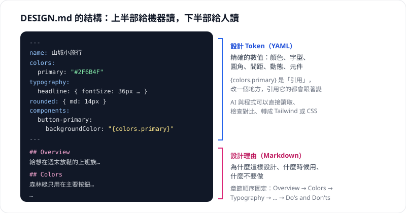
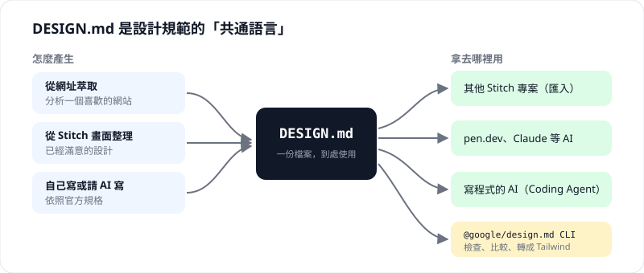

# 04. 主題、設計系統與 DESIGN.md

> 畫面一多，風格很容易跑掉。這一章學會用主題面板快速調整風格，用 DESIGN.md 把設計規範寫下來，讓每個畫面、每個工具都遵守同一套規則。

---

## 觀念一：主題面板，不用 Prompt 也能改風格

Stitch 的每個專案都有一套「主題」，決定全部畫面的基本樣子。在**設計系統（Design System）面板**或**編輯主題（Edit Theme）**中，可以直接調整：

- **淺色／深色模式**
- **強調色**（主色）
- **圓角**大小
- **字型**

這些設定會套用到選取的畫面，比用文字描述「顏色深一點」準確得多。**先用主題面板定好大方向，再用 Prompt 處理細節。**

> [!NOTE]
> 主題面板的入口可能在畫面上方的工具列、選取畫面後的選單，或側邊的設計系統面板，依版本而定。找不到時，也可以直接對 Stitch 說「打開主題設定」。

---

## 觀念二：DESIGN.md 的結構



**DESIGN.md** 是 Google 為 Stitch 制定、並開放成公開規格的設計規範檔，是一個普通的文字檔，分成兩部分：

**上半部：設計 Token（夾在兩行 `---` 之間的 YAML）**

| 欄位 | 內容 | 例子 |
| :--- | :--- | :--- |
| `name` | 設計系統名稱 | `山城小旅行` |
| `colors` | 顏色 | `primary: "#2F6B4F"` |
| `typography` | 字型組合 | `headline: { fontFamily, fontSize, fontWeight, lineHeight }` |
| `rounded` | 圓角 | `md: 14px` |
| `spacing` | 間距 | `section: 96px` |
| `motion` | 動態 | `quick: { duration: 150ms }` |
| `components` | 元件樣式 | `button-primary: { backgroundColor: "{colors.primary}" }` |

`"{colors.primary}"` 這種寫法叫做**引用**：按鈕不寫死色碼，而是「使用 primary 這個顏色」，改一個地方，引用它的元件全部跟著變。元件的狀態用不同名稱表示，例如 `button-primary` 和 `button-primary-hover`。

**下半部：設計理由（Markdown）**

用 `##` 標題寫下「為什麼這樣設計」，章節順序是固定的：Overview → Colors → Typography → Layout → Elevation & Depth → Shapes → Motion & Micro-interaction → Voice & Content Strategy → Components → Do's and Don'ts。不需要每一節都寫，但寫了就要照這個順序。

完整範例：[examples/DESIGN.md](./examples/DESIGN.md)（山城小旅行的設計規範，可以直接下載使用）。

> 想更深入學習怎麼從零寫出一份好的 DESIGN.md，可以參考課程單元〈[建立自己的 DESIGN.md 與創意發想](../../建立自己的DESIGN_md/README.md)〉。

---

## 觀念三：DESIGN.md 在工具之間流動



**怎麼產生：**

- **從網址萃取**：給 Stitch 一個你喜歡的網站網址，它會分析並整理出設計系統。
- **從畫面整理**：對已經滿意的 Stitch 畫面匯出 DESIGN.md。
- **自己寫或請 AI 寫**：照著官方規格撰寫。

**拿去哪裡用：**

- **其他 Stitch 專案**：匯入後，新產生的畫面都會遵守它。
- **pen.dev、Claude 等 AI**：把檔案交給它們，風格就能延續（pen.dev 可以把它轉成變數）。
- **寫程式的 AI**：讓產生的網頁程式碼使用同一套顏色與字型。
- **官方命令列工具 `@google/design.md`**：檢查錯誤、比較版本、轉成 Tailwind 設定（範例 D）。

---

## 範例 A：手動調整主題，比較四種風格

1. 選取「首頁 - 桌機 v2」，打開主題面板。
2. 依序嘗試，每次調整後把畫面複製一份留下來比較：
   - 淺色＋森林綠＋小圓角＋襯線標題字型
   - 淺色＋柿橘色＋大圓角＋無襯線字型
   - 深色＋森林綠＋小圓角
   - 你自己的組合
3. 四個版本並排，選出最符合「溫暖自然、讓人想出門」的一個，把它套用到所有畫面。

**換你檢查：** 深色模式下，照片上的文字、灰色的次要文字還看得清楚嗎？

---

## 範例 B：從參考網站萃取設計系統

1. 找一個你覺得「質感很好」的旅遊或戶外品牌網站。
2. 請 Stitch 從這個網址萃取設計系統：

<details>
<summary>📋 Prompt</summary>

```text
請分析這個網站的設計系統（顏色、字型、圓角、間距、元件風格）：https://（換成你選的網址）
整理成 DESIGN.md，然後用這套設計系統重新產生「山城小旅行」的桌機版首頁，內容維持不變。
```

</details>

3. 和原本的首頁並排比較。

> [!WARNING]
> 參考別人的網站是為了**學習**它的配色比例與字型搭配，不是複製別人的品牌。正式作品請調整成自己的顏色與 Logo。

---

## 範例 C：匯入 DESIGN.md，讓所有畫面統一

1. 下載上面的範例 DESIGN.md，用文字編輯器打開讀一遍，看懂每個 Token 的用途。
2. 在 Stitch 的設計系統面板匯入（或直接貼上）這份 DESIGN.md。
3. 套用到專案中所有畫面（桌機與手機都要）。
4. 產生一個**全新的畫面**「路線介紹頁 - 手機」，不用描述風格，看它是否自動遵守 DESIGN.md。

**換你修改：** 在 DESIGN.md 把 `rounded.md` 從 `14px` 改成 `4px`、`primary` 改成深藍色 `#1F4E79`，重新匯入並套用。所有卡片和按鈕是不是一起變了？

---

## 範例 D：用官方工具檢查與轉換（選做）

需要電腦已安裝 Node.js。在 DESIGN.md 所在的資料夾打開終端機：

```bash
# 檢查格式與顏色對比（有錯誤時會列出原因）
npx @google/design.md lint DESIGN.md

# 比較兩個版本差在哪裡
npx @google/design.md diff DESIGN.md DESIGN-v2.md

# 轉成 Tailwind CSS v4 的 @theme 設定，給網頁程式使用
npx @google/design.md export --format css-tailwind DESIGN.md > theme.css
```

**換你試試：** 故意把 `button-primary` 的 `textColor` 改成淺灰色 `#DDDDDD`，再執行 `lint`，看它是否警告「對比不足」（WCAG AA 要求 4.5:1）。

---

## 常見錯誤

- **每個畫面各自描述風格**：畫面一多風格就會跑掉。先做好 DESIGN.md，所有畫面都套用它。
- **DESIGN.md 只有顏色**：至少要有顏色、字型、圓角與主要按鈕的元件設定，AI 才知道怎麼用。
- **按鈕直接寫色碼**：請用 `"{colors.primary}"` 引用，之後才能一次修改。

## 自我檢核

- [ ] 我會用主題面板調整淺深色、主色、圓角與字型。
- [ ] 我看得懂 DESIGN.md 的 Token 與引用寫法，也知道章節順序。
- [ ] 我能把 DESIGN.md 匯入 Stitch，讓新畫面自動遵守同一套風格。

---

[下一章：05. 多頁網站與互動原型 →](../05_多頁網站與互動原型/README.md)
