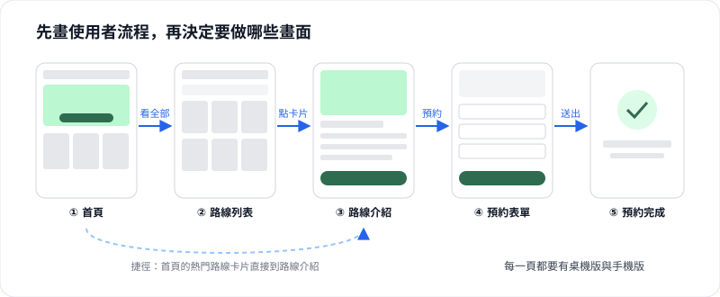
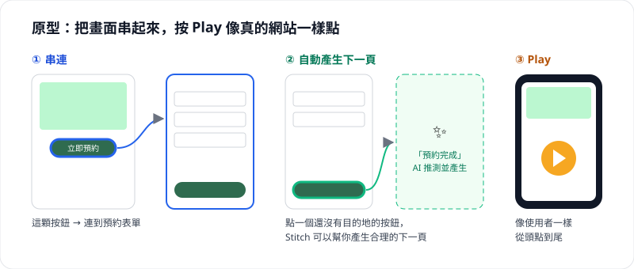

# 05. 多頁網站與互動原型

> 一個網站不只一頁。這一章把「山城小旅行」做成五頁的完整網站，串成可以點擊的原型，按 Play 實際走一遍預約流程，再找同學試用。

---

## 觀念一：先畫流程，再做畫面



做多頁網站時，不要想到一頁做一頁。先在紙上畫出**使用者要完成的任務**經過哪些頁面：

> 使用者想「預約下週六的南庄路線」：首頁 → 路線列表 → 路線介紹 → 預約表單 → 預約完成。

流程畫好，要做哪些畫面就很清楚了。也要想想**捷徑**：首頁的熱門路線卡片，應該可以直接點到路線介紹，不必經過列表。

**讓多頁風格一致的三個方法：**

1. 專案已經套用第 04 章的 DESIGN.md。
2. 產生新頁面時，先**選取已完成的頁面**再下 Prompt，例如「沿用這個畫面的導覽列與頁尾，產生路線介紹頁」。
3. 同一頁的桌機版與手機版放在一起，並用一致的名稱。

---

## 觀念二：原型，讓畫面可以點



**原型（Prototype）**是「可以點的設計稿」。不用寫程式，就能讓別人像使用真的網站一樣操作。

1. **串連**：把畫面上的按鈕或連結，連到它應該前往的畫面。可以在原型模式中手動連接，也可以直接請 Stitch 串連（例如「把所有『立即預約』按鈕連到預約表單頁」）。
2. **自動產生下一頁**：點一個還沒有目的地的按鈕，Stitch 可以依照按鈕的意思，自動產生一個合理的下一頁。
3. **Play**：按下 **Play** 預覽，從第一頁開始一路點下去，檢查流程有沒有斷掉。

> [!TIP]
> 原型的目的是**找出問題**，不是展示漂亮的畫面。試玩時最該注意的是：有沒有點了沒反應的按鈕、有沒有回不去的頁面、表單送出後使用者知不知道成功了。

---

## 觀念三：同時探索好幾個方向

Stitch 的設計代理可以理解整個專案的發展脈絡，**Agent manager（代理管理）**會記錄你的進度，並讓你**同時發展好幾個想法**。例如同一個網站，一條線做「親子家庭風」，另一條線做「文青慢旅風」，兩條線各自發展，最後再比較。

---

## 範例 A：完成桌機版五個頁面

依照流程，逐頁產生（每一頁都先選取上一頁，讓 AI 沿用風格）：

<details>
<summary>📋 Prompt：路線介紹頁（選取「路線列表 - 桌機」後輸入）</summary>

```text
沿用這個畫面的導覽列、頁尾與設計系統，產生「路線介紹 - 桌機」：
路線是「南庄桂花巷與向天湖」。由上到下：大張照片輪播、路線名稱與地區標籤、
重點資訊列（所需時間 6 小時、難度輕鬆、適合親子與長輩、每人 NT$ 1,280）、
行程時間軸（09:00 集合 → 10:00 桂花巷 → 12:00 客家午餐 → 14:00 向天湖 → 16:00 賦歸）、
費用包含與不包含、注意事項、旅客評價、右側固定的「預約這條路線」卡片（日期選擇＋人數＋預約按鈕）。
```

</details>

<details>
<summary>📋 Prompt：預約表單頁與預約完成頁</summary>

```text
沿用相同風格，產生「預約表單 - 桌機」：左側是表單（出發日期、大人人數、孩童人數、聯絡人姓名、手機、Email、備註），
右側是行程摘要與費用明細（自動計算總價），底部「確認預約」按鈕。表單欄位要有錯誤提示樣式。

再產生「預約完成 - 桌機」：成功圖示、「預約成功！」、預約編號、行程摘要、
「加入行事曆」與「回到首頁」兩個按鈕、集合地點的地圖區塊。
```

</details>

**換你整理：** 五個頁面在畫布上由左到右排好，名稱依序為「01 首頁 - 桌機」到「05 預約完成 - 桌機」。

---

## 範例 B：串成原型並試玩

1. 進入原型模式，依照流程圖串連：
   - 首頁「查看全部路線」→ 路線列表
   - 首頁的熱門路線卡片 → 路線介紹（捷徑）
   - 路線列表的路線卡片 → 路線介紹
   - 路線介紹「預約這條路線」→ 預約表單
   - 預約表單「確認預約」→ 預約完成
   - 預約完成「回到首頁」→ 首頁
2. 試試**自動產生下一頁**：點導覽列的「常見問題」（還沒有這一頁），讓 Stitch 產生常見問題頁。
3. 按 **Play**，從首頁開始完整走一次預約流程。

**換你檢查：** 走完一次，記下所有「點了沒反應」或「到錯地方」的按鈕，回到原型模式修正。

---

## 範例 C：手機版的完整流程

手機的操作方式和桌機不同，不能只是把桌機版縮小。

<details>
<summary>📋 Prompt（選取「路線介紹 - 桌機」後輸入）</summary>

```text
把這個畫面做成手機版，內容不變：
照片改成可左右滑動、重點資訊用兩欄小格子、行程時間軸改成直向、
桌機右側的預約卡片改成「固定在畫面底部的預約列」（左邊顯示價格，右邊是「立即預約」按鈕）。
```

</details>

1. 用同樣的方式完成其他四頁的手機版。
2. 串成手機版原型，按 **Play** 試玩。
3. 特別檢查：底部固定按鈕會不會擋住內容？表單欄位在手機上好不好填？

---

## 範例 D：找同學做一次簡短試用

這是原型最有價值的用法。找一位**沒看過你設計**的同學：

1. 把手機版原型交給他（用 Play 模式，或第 06 章的分享連結）。
2. 只給他一個任務，不要提示怎麼做：

   > 「你想帶爸媽在下週六去南庄，請預約一個適合長輩的行程，2 位大人。」

3. 請他**邊做邊說出想法**，你只觀察、不說話，記下他在哪裡猶豫、點錯或找不到。
4. 結束後把問題整理成清單，用第 03 章的圈選功能逐一修正。

> 想更完整地學易用性測試，可以參考課程的易用性測試單元。

---

## 範例 E：兩個方向同時發展（選做）

用 Agent manager 開兩條線：

<details>
<summary>📋 Prompt</summary>

```text
請幫我同時發展兩個設計方向，各自產生首頁與路線介紹頁（桌機）：
方向一「親子家庭風」：明亮、活潑、大圓角、強調安全與親子設施。
方向二「文青慢旅風」：沉穩、大量留白、襯線字、強調在地故事與照片。
內容與頁面結構保持一致，方便比較。
```

</details>

**換你判斷：** 依照第 01 章設定的目標使用者（想帶家人放鬆的上班族），哪個方向比較適合？把理由寫在畫布旁邊。

---

## 常見錯誤

- **每一頁各做各的**：導覽列、頁尾每頁都不一樣。產生新頁面前，一定要先選取已完成的頁面。
- **只做「順利」的流程**：表單填錯、沒有空位、網路錯誤時畫面長怎樣？至少補一個錯誤狀態。
- **自己試玩就算數**：設計者永遠知道按鈕在哪裡，一定要找沒看過的人試用。

## 自我檢核

- [ ] 我會先畫使用者流程，再決定要做哪些頁面。
- [ ] 我能完成桌機與手機各五頁，並串成可以 Play 的原型。
- [ ] 我找過至少一位同學試用，並依照發現的問題修改。

---

[下一章：06. 匯出、發布與交棒 →](../06_匯出發布與交棒/README.md)
