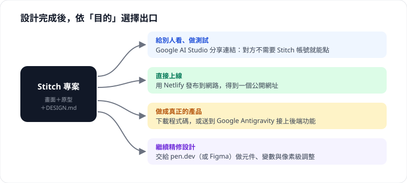
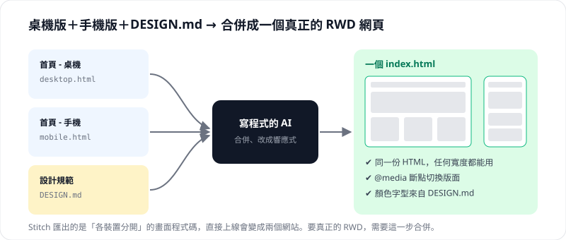

# 06. 匯出、發布與交棒

> 設計做好了，接下來要讓它「被看到、被使用」。這一章依目的選擇出口：分享原型、直接發布、交給工程，或交給 pen.dev 繼續精修，並學會把桌機版與手機版合併成真正的 RWD 網頁。

---

## 觀念一：依目的選擇出口



選取畫面後打開**匯出（Export）**選單，會看到幾種出口。先問自己「我要做什麼」：

| 目的 | 出口 | 結果 |
| :--- | :--- | :--- |
| 給老師、客戶、受測者試用 | **Google AI Studio 分享連結** | 一個網址，對方不需要 Stitch 帳號就能點擊操作 |
| 直接上線 | **Netlify 發布** | 一個公開網址的網站 |
| 交給工程師或自己寫程式 | **下載程式碼**（HTML，樣式使用 Tailwind CSS）或送到 **Google Antigravity** | 可以繼續開發、接上後端功能的程式碼 |
| 繼續精修設計 | 程式碼交給 **pen.dev**（部分版本也能送到 Figma） | 可以做元件、變數、像素級調整的設計稿 |

另外，每個畫面也可以下載成圖片，方便放進簡報或報告。

> [!WARNING]
> 分享連結與 Netlify 發布出去的網址是**公開的**，任何拿到網址的人都看得到。不要在設計稿裡放真實的個人資料、電話或帳號。

---

## 觀念二：Stitch 的程式碼不是 RWD，要合併



Stitch 的每個畫面都是**依裝置分開產生**的：「首頁 - 桌機」和「首頁 - 手機」是兩份不同的程式碼。直接上線的話，等於有兩個網站，平板寬度可能兩個都不好看。

要做成**真正的 RWD 網頁**，要再多一步：把桌機版、手機版的程式碼與 DESIGN.md 一起交給寫程式的 AI（例如 Claude Code、Gemini CLI、Antigravity），請它**合併成一份**，用 CSS 斷點（`@media`）切換版面。

---

## 範例 A：產生分享連結，請別人試用

1. 選取第 05 章完成的手機版首頁，在匯出選單選擇 **Google AI Studio**，產生分享連結。
2. 用自己的手機打開連結，從首頁走一次預約流程。
3. 把連結傳給一位同學，請他完成第 05 章範例 D 的任務，並把問題回報給你。

**換你檢查：** 在手機上實際操作，和在電腦上 Play 有什麼不同的感受？（例如按鈕夠不夠大、字會不會太小。）

---

## 範例 B：用 Netlify 發布上線

1. 選取首頁，在匯出選單選擇 **Netlify** 發布。第一次使用時，可能需要登入並授權 Netlify 帳號。
2. 發布完成後會得到一個網址，用電腦與手機分別打開。
3. 把網址記錄下來，放進你的作品集或報告。

**換你思考：** 用手機打開「桌機版」的網址會怎樣？這正是範例 C 要解決的問題。

---

## 範例 C：合併成真正的 RWD 網頁

1. 在 Stitch 下載「首頁 - 桌機」與「首頁 - 手機」的程式碼，分別存成 `desktop.html` 與 `mobile.html`。
2. 把第 04 章的 `DESIGN.md` 放在同一個資料夾。
3. 在該資料夾開啟寫程式的 AI，輸入：

<details>
<summary>📋 Prompt</summary>

```text
這個資料夾裡有：
- desktop.html：Stitch 產生的桌機版首頁
- mobile.html：Stitch 產生的手機版首頁（內容相同，版面不同）
- DESIGN.md：設計規範

請合併成一個響應式的 index.html（＋ styles.css）：
1. 以 mobile.html 的版面為基礎（mobile first），在 768px 與 1024px 加上斷點，逐步變成 desktop.html 的版面。
2. 顏色、字型、圓角、間距全部使用 DESIGN.md 的 Token，轉成 CSS 變數（例如 --color-primary）。
3. 卡片列用 CSS grid，讓它在任何寬度都能自動調整欄數。
4. 使用語意化 HTML（header、nav、main、section、footer），圖片要有 alt。
5. 手機版的導覽列改成可以展開的漢堡選單。
完成後告訴我如何在瀏覽器打開檢查。
```

</details>

4. 用瀏覽器打開 `index.html`，**慢慢拖曳視窗寬度**，從最寬縮到最窄，檢查每一個寬度都沒有跑版。

**換你檢查：** 在 768px 到 1024px 之間（平板寬度），版面看起來合理嗎？這是 Stitch 沒有畫、要靠程式補上的寬度。

---

## 範例 D：交給 pen.dev 精修（搭配 pen.dev 單元）

Stitch 適合發想，定稿後如果要做成元件庫、精確調整每個間距，可以交給 pen.dev：

1. 把範例 C 合併好的網頁用瀏覽器打開（或使用 Netlify 的網址）。
2. 在 pen.dev 對 AI 說：

<details>
<summary>📋 Prompt（在 pen.dev 中使用）</summary>

```text
請用 browser 工具載入（貼上網址），把整個頁面用 import-to-canvas 匯入畫布。
然後讀取我提供的 DESIGN.md，把顏色、字型、圓角建立成變數，並把匯入的圖層改成綁定這些變數。
```

</details>

3. 接著依照 pen.dev 單元的元件庫流程，把按鈕、卡片、導覽列做成元件。

> pen.dev 的完整操作請見〈[pen.dev 實戰：AI 輔助的 RWD 網頁設計畫布](../../pen_dev實戰與AI設計畫布/README.md)〉。

---

## 範例 E：送到 Antigravity 加上真正的功能（選做）

如果你有使用 Google Antigravity，可以從匯出選單把畫面直接送過去，接著請它加上功能：

<details>
<summary>📋 Prompt（在 Antigravity 中使用）</summary>

```text
這是從 Stitch 匯入的「山城小旅行」預約表單頁。請幫我：
1. 加上表單驗證（必填、手機格式、Email 格式），錯誤訊息顯示在欄位下方。
2. 根據人數自動計算總價（大人 NT$ 1,280、孩童 NT$ 880）。
3. 送出後切換到預約完成頁，顯示一組隨機的預約編號。
資料先存在瀏覽器的 localStorage，不需要後端。
```

</details>

---

## 常見錯誤

- **直接把桌機版的程式碼上線**：手機上會很難用。真正的網站一定要做範例 C 的合併。
- **分享前沒有用 Play 檢查流程**：對方點到斷掉的按鈕，測試就白做了。
- **在設計稿放真實個資**：分享連結與發布網址都是公開的，請用假資料。

## 自我檢核

- [ ] 我能依目的選擇匯出方式：分享、發布、程式碼、精修。
- [ ] 我產生過分享連結，並請別人用手機試用。
- [ ] 我知道 Stitch 的程式碼是依裝置分開的，並能請 AI 合併成真正的 RWD 網頁。

---

[下一章：07. 用 MCP 讓 AI 控制 Stitch →](../07_用MCP讓AI控制Stitch/README.md)
