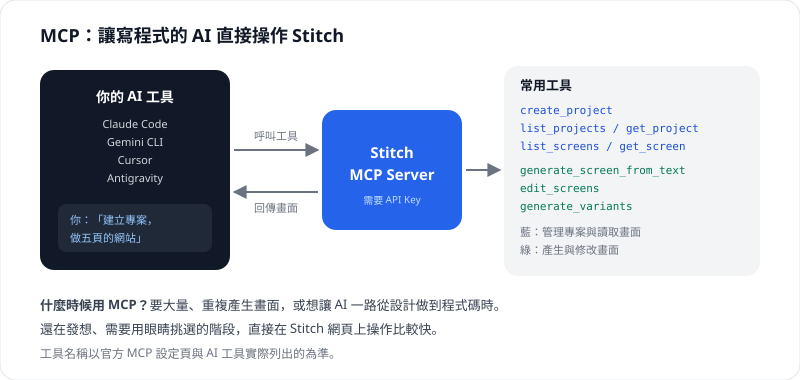

# 07. 用 MCP 讓 AI 控制 Stitch

> 前面都是你在 Stitch 網頁上操作。這一章把 Stitch 接上 Claude Code、Gemini CLI 等寫程式的 AI，讓它們幫你建立專案、批次產生畫面，一路從設計做到程式碼。

---

## 觀念：MCP 是什麼？



**MCP**（Model Context Protocol）是讓 AI 使用外部工具的標準介面。Stitch 提供官方的 **Stitch MCP Server**，接上之後，你在 Claude Code 裡說「建立一個專案、產生五個頁面」，AI 就會自己呼叫 Stitch 的工具完成，不用打開 Stitch 網頁。

**常用工具：**

| 工具 | 做什麼 |
| :--- | :--- |
| `create_project` | 建立新專案 |
| `list_projects`、`get_project` | 列出專案、讀取專案內容 |
| `list_screens`、`get_screen` | 列出畫面、讀取單一畫面（含圖片與程式碼） |
| `generate_screen_from_text` | 用文字產生新畫面，可指定裝置類型（手機、平板、桌機） |
| `edit_screens` | 用文字修改既有畫面 |
| `generate_variants` | 產生變體，可設定數量、創意幅度與面向（同第 03 章） |

除了這些，設計系統的建立與套用（第 04 章）也能透過 MCP 完成。實際能用的工具，以你的 AI 工具連線後列出的清單為準。

**什麼時候用 MCP，什麼時候用網頁？**

- **用網頁**：還在發想、需要用眼睛比較和挑選的時候。
- **用 MCP**：要大量產生畫面（例如十個頁面的桌機＋手機版）、要把設計直接轉成程式碼，或想讓整個流程自動化的時候。

---

## 動手操作：連接 Stitch MCP

### 步驟 1：取得 API Key

1. 登入 Stitch，在設定中找到 **API Key**，建立一組金鑰。
2. **把金鑰當成密碼保管**：不要貼在聊天室、不要放進 GitHub、不要寫在講義或截圖裡。

### 步驟 2：在你的 AI 工具中設定

打開官方的 [Stitch MCP 設定說明](https://stitch.withgoogle.com/docs/mcp/setup)，選擇你使用的工具（Claude Code、Gemini CLI、Cursor、Antigravity 等），照著複製設定。設定時會需要填入剛剛的 API Key。

> [!TIP]
> 建議把 API Key 存成環境變數 `STITCH_API_KEY`，設定檔裡只引用變數名稱，這樣分享專案設定時才不會不小心把金鑰一起分享出去。

### 步驟 3：確認連線成功

重新啟動 AI 工具，輸入：

```text
請列出我在 Stitch 上的所有專案，以及每個專案有幾個畫面。
```

如果 AI 列出了你在前面章節建立的「山城小旅行」，就成功了。

### 步驟 4（建議）：安裝官方 Stitch Skills

Google 提供一組搭配 Stitch MCP 使用的技能包 [stitch-skills](https://github.com/google-labs-code/stitch-skills)，教 AI 用更好的方式使用 Stitch，例如把模糊的想法改寫成好的 Prompt、從設計稿產生 React 元件、從現有程式碼整理出 DESIGN.md。以 Claude Code 為例，在專案資料夾執行：

```bash
npx plugins add google-labs-code/stitch-skills --scope project --target claude-code
```

其他工具的安裝方式請見該頁面的說明。

---

## 範例 A：讓 AI 讀取並整理你的專案

<details>
<summary>📋 Prompt</summary>

```text
請讀取我 Stitch 上的「山城小旅行」專案：
1. 列出所有畫面的名稱與裝置類型（桌機／手機）。
2. 找出只有桌機版、還沒有手機版的頁面。
3. 檢查各畫面的導覽列與頁尾是否一致，列出不一致的地方。
只要回報，先不要修改任何東西。
```

</details>

**換你判斷：** AI 找到的問題，你在第 05 章有發現嗎？哪些是你漏掉的？

---

## 範例 B：批次補齊手機版

<details>
<summary>📋 Prompt</summary>

```text
請在「山城小旅行」專案中，為每一個還沒有手機版的桌機頁面，產生對應的手機版（裝置類型 MOBILE）：
- 內容與桌機版完全相同，只調整版面：單欄、導覽列改漢堡選單、主要按鈕固定在畫面底部。
- 畫面名稱用「頁面名稱 - 手機」。
每完成一頁就告訴我，並附上畫面的預覽圖。
```

</details>

完成後回到 Stitch 網頁，**用眼睛檢查**每一個新的手機畫面。AI 批次產生的結果，一定要人看過才算完成。

---

## 範例 C：一句話從新專案做到 RWD 網頁

這是 MCP 最強大的用法：讓 AI 把第 02～06 章的流程一次跑完。挑一個新題目試試，例如「社區咖啡廳」或你自己的作品題目。

<details>
<summary>📋 Prompt</summary>

```text
請用 Stitch MCP 幫我完成以下流程，每一步完成後先停下來給我看結果，等我說「繼續」再往下：
1. 建立新專案「（你的題目）」。
2. 依照我資料夾裡的 DESIGN.md 建立設計系統（如果沒有，先問我幾個問題再幫我寫一份）。
3. 產生首頁的桌機版，並用 generate_variants 產生 3 個 Explore 變體讓我挑選。
4. 依我選的版本，產生其餘頁面（關於我們、商品／服務、聯絡我們）的桌機版與手機版。
5. 下載所有畫面的程式碼，把桌機版與手機版合併成一個響應式網站（mobile first、CSS 變數來自 DESIGN.md、語意化 HTML）。
6. 告訴我怎麼在瀏覽器打開檢查。
```

</details>

**換你把關：** 注意 Prompt 裡的「每一步先停下來給我看」。讓 AI 自動化不代表放手不管，**挑選變體、檢查手機版、最後驗收**這三個判斷，一定要由你來做。

---

## 範例 D：從現有網站程式碼建立 Stitch 設計（選做）

如果你已經有一個網站的程式碼（例如 pen.dev 單元做出來的 LearnHub 網頁），可以反過來把它變成 Stitch 的設計，再用 Stitch 快速發想改版方向：

<details>
<summary>📋 Prompt（需要已安裝 stitch-skills）</summary>

```text
請使用 stitch-skills 的 code-to-design，把這個資料夾的網站首頁轉成 Stitch 的設計畫面，
放進一個新專案「LearnHub 改版發想」。
接著用 generate_variants 產生 3 個 Reimagine 變體，讓我看看完全不同的改版方向。
```

</details>

---

## 常見錯誤

- **API Key 外流**：寫進設定檔後推上 GitHub，等於把帳號交給別人。用環境變數，並確認 `.gitignore` 有排除設定檔。
- **讓 AI 一次跑完、自己不看**：批次產生的畫面常有小問題，每一步都要人檢查。
- **用 MCP 做發想**：挑選設計需要用眼睛看，發想階段回到 Stitch 網頁比較有效率。

## 自我檢核

- [ ] 我已經取得 API Key，並安全地設定在環境變數中。
- [ ] 我的 AI 工具能列出我的 Stitch 專案。
- [ ] 我能用 MCP 批次產生畫面，並且在每一步親自檢查結果。

---

🎉 **恭喜完成 Google Stitch 單元！** 你已經能從一句話開始，產生多頁設計、串成原型、找人測試，並發布成網站。接著可以把定稿交給 pen.dev 做成元件庫，或挑一個新題目，從第 02 章重新走一次完整流程。
