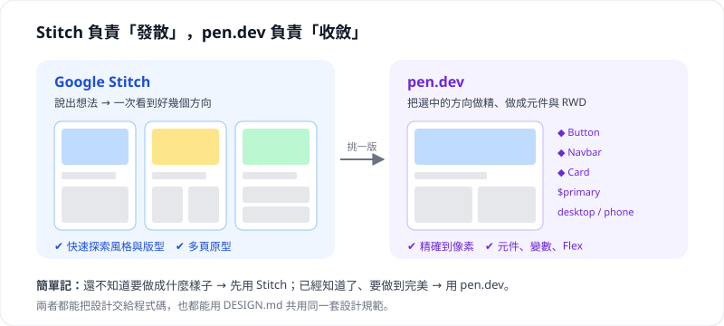
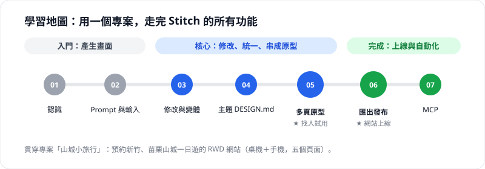

# Google Stitch 實戰：用說的就能產生 RWD 網站

## Google Stitch 是什麼？

**Google Stitch** 是 Google Labs 推出的 AI 介面設計工具。你用文字、圖片、手繪草圖或語音描述想要的畫面，它就會在一張無限畫布上產生網頁設計稿，還能串成可以點擊的原型，最後匯出程式碼或直接發布上網。

它和 pen.dev 的分工是：

- **Stitch 負責發散**：還不知道要做成什麼樣子時，快速看到好幾個方向。
- **pen.dev 負責收斂**：方向決定後，精確地做成元件、變數與 RWD 版面。

---

## 這套教材怎麼學？

Stitch 的手動操作比 pen.dev 少，**你的工作是「判斷」**：

1. **說清楚**：寫出好的 Prompt，給對參考資料。
2. **選得準**：比較好幾個版本，挑出最適合使用者的一個。
3. **改得精**：圈選要修改的地方，而不是整頁重來。
4. **測得真**：串成原型，找真的人來試用。

每一章都有可以直接複製的 Prompt，以及要你親手完成的操作與判斷。

---

## 學習地圖

全部章節都用同一個專案練習：**「山城小旅行」**，一個預約新竹、苗栗山城一日遊的 RWD 網站。

### 入門：產生畫面

- [01. 認識 Google Stitch](./01_認識Google_Stitch/README.md)：Stitch 是什麼、和 pen.dev 怎麼分工、產生第一個畫面。
- [02. 輸入與 Prompt](./02_輸入與Prompt_從一句話到整頁/README.md)：好 Prompt 的五個部分，以及截圖、草圖、語音等輸入方式。

### 核心：修改、統一、串成原型

- [03. 修改畫面：對話、圈選與變體](./03_修改畫面_對話圈選與變體/README.md)：三種修改方式，以及一次比較好幾個版本。
- [04. 主題、設計系統與 DESIGN.md](./04_主題設計系統與DESIGN_md/README.md)：讓所有畫面遵守同一套風格。
- [05. 多頁網站與互動原型](./05_多頁網站與互動原型/README.md)：★ 做出五頁網站，按 Play 試玩，找同學試用。

### 完成：上線與自動化

- [06. 匯出、發布與交棒](./06_匯出發布與交棒/README.md)：★ 分享連結、發布上網，合併成真正的 RWD 網頁。
- [07. 用 MCP 讓 AI 控制 Stitch](./07_用MCP讓AI控制Stitch/README.md)：讓 Claude Code 等 AI 批次產生畫面、一路做到程式碼。

---

## 開始前的準備

- [ ] 一個 Google 帳號。
- [ ] 電腦版 Chrome 瀏覽器（語音功能需要麥克風）。
- [ ] 一支手機，用來測試手機版原型。
- [ ] （第 06、07 章）一個寫程式的 AI 工具，例如 Claude Code、Gemini CLI 或 Antigravity。

> [!TIP]
> Stitch 更新很快，按鈕名稱和位置可能和講義不同。講義會說明「功能是什麼」，請以你畫面上的實際名稱為準。
