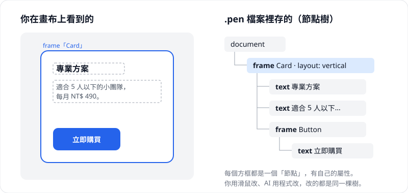
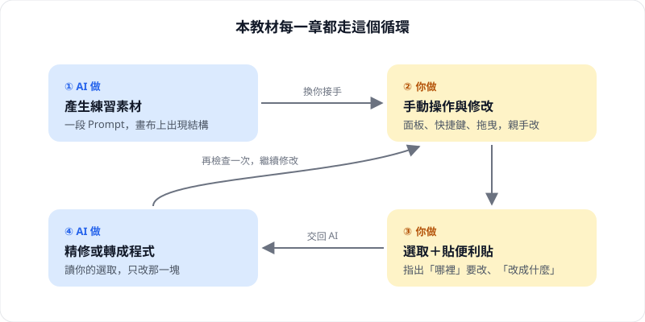

# 01. 認識 pen.dev：一張 AI 和你都能改的設計畫布

> 這一章你會知道 pen.dev 是什麼、它和 Figma 有什麼不同，並完成安裝、連上 AI，畫出第一張卡片。

---

## 觀念一：設計稿其實是一棵「節點樹」



pen.dev 是一套**無限畫布的介面設計工具**，可以用來畫網頁、App 畫面與儀表板。本教材以 **RWD 網頁**為主軸。外觀和 Figma 很像：左邊是圖層、中間是畫布、右邊是屬性面板。

差別在於檔案本身。pen.dev 的設計稿存成 `.pen` 檔，內容是一棵結構清楚的**節點樹**：一張卡片是一個 `frame`，裡面的標題是一個 `text`，按鈕又是一個 `frame` 包著一個 `text`。每個節點都有清楚的屬性，例如 `layout: vertical`、`gap: 16`、`fill: #2563EB`。

這件事對 AI 很重要。AI 不用「看截圖猜」，而是直接讀、直接改這棵樹。所以：

- **AI 改的東西，你一定改得動。** AI 產生的每個元素都是真的節點，不是一張圖片。
- **你改的東西，AI 一定看得懂。** 你手動把 `gap` 從 16 改成 24，AI 下一次讀取就會知道。
- **它很接近程式碼。** pen.dev 的排版規則就是 CSS 的 Flexbox。在 pen.dev 排好的版面，轉成 RWD 網頁時幾乎可以一對一對應（最後一章也會示範轉成 PyQt 桌面程式）。

> [!NOTE]
> `.pen` 檔是加密的，不能用文字編輯器打開。AI 必須透過 pen.dev 提供的 **MCP 工具**讀寫它（MCP 是讓 AI 使用外部工具的標準介面，後面會設定）。

---

## 觀念二：AI 負責起頭，你負責判斷與修改



這套教材**不要求你從空白畫布一筆一筆畫**。每一章都是：

1. **AI 做**：你貼一段 Prompt，AI 在畫布上產生練習用的設計。
2. **你做**：用面板、快捷鍵、拖曳，親手把它改好。這是本教材的重點，所有功能都要你自己操作過一次。
3. **你做**：用滑鼠選取要再調整的區塊，旁邊貼一張便利貼（`note`）寫清楚要改什麼。
4. **AI 做**：AI 讀取你的選取範圍與便利貼，只修改那一塊，或把設計轉成 RWD 網頁程式碼。

為什麼要手動？因為 AI 做錯時你要能自己看出來、自己修好。只會下 Prompt 的人，遇到「差一點點」的設計就卡住了。

---

## 觀念三：pen.dev 和其他工具的差別

| | pen.dev | Figma | Google Stitch |
| :--- | :--- | :--- | :--- |
| 主要用途 | 介面設計＋直接交給 AI 與程式碼 | 團隊協作的介面設計 | AI 一鍵產生畫面 |
| 手動編輯能力 | 完整（圖層、Flex、元件、變數） | 完整 | 有限 |
| AI 怎麼讀寫設計 | 本機 MCP 直接改節點樹 | 透過 Figma MCP（部分功能需付費席位） | 對話產生，較難精細修改 |
| 檔案在哪 | 你電腦上的 `.pen` 檔，可以放進 Git | 雲端 | 雲端 |

如果你要的是「AI 幫忙開頭、自己能精修、最後轉成程式」，pen.dev 是最直接的選擇。

---

## 動手操作：安裝與連線

### 步驟 1：安裝 pen.dev

擇一即可：

- **桌面版（建議）**：從 [pen.dev 下載頁](https://www.pen.dev/downloads) 下載。macOS 開啟 DMG 拖進「應用程式」，Windows 執行安裝程式。桌面版才有內建 AI 對話與畫布上的瀏覽器節點。
- **VS Code / Cursor 擴充套件**：在擴充套件市集搜尋 **pen.dev** 安裝，之後建立或打開 `.pen` 檔即可。

### 步驟 2：建立練習檔

1. 打開 pen.dev，按 `Cmd/Ctrl + Shift + N` 建立新檔案。
2. 按 `Cmd/Ctrl + S` 存到你的課程資料夾，命名為 `practice.pen`。

> 之後每一章都會用這個習慣：**一章一個 `.pen` 檔**，例如 `ch03.pen`、`ch04.pen`。

### 步驟 3：讓 AI 連上畫布

你有兩種 AI 可以用：

- **pen.dev 內建 AI 對話（最簡單）**：桌面版按 `Cmd/Ctrl + K` 打開 AI 對話面板，直接打字即可。
- **外部 AI（Claude Code、Codex、Gemini CLI、Antigravity 等）**：
  1. 在 pen.dev 打開 **Settings → MCP**，啟用你使用的 AI 工具（例如 Claude Code CLI）。
  2. 重新啟動該 AI 工具。以 Claude Code 為例，輸入 `/mcp`，看到 `pencil` 顯示已連線就成功了。
  3. **pen.dev 要保持開著，而且你的 `.pen` 檔要是目前開啟的分頁。** AI 改的是「目前打開的那個檔案」。

### 步驟 4：第一次試跑

把下面的 Prompt 貼給 AI：

<details>
<summary>📋 Prompt：畫第一張卡片</summary>

```text
請在我目前開啟的 .pen 檔中，找一塊空白位置，畫一張寬 320 的方案卡片：
- 外層 frame 命名為「Card」，vertical 排版，padding 24，gap 12，白底，圓角 16
- 標題 text「專業方案」，字級 20、粗體、深灰色
- 說明 text「適合 5 人以下的小團隊，每月 NT$ 490。」，自動換行
- 一個藍色按鈕（frame 包 text），文字「立即購買」
每個節點都要取有意義的名稱。完成後存檔。
```

</details>

AI 完成後，**換你動手**：

1. 在畫布上**雙擊**「專業方案」這幾個字，改成「團隊方案」。
2. 看左側 **Layers（圖層）面板**，找到 `Card`，點一下展開，對照上面的節點樹圖，確認結構一樣。
3. 按 `Cmd/Ctrl + S` 存檔。

恭喜，你已經完成第一個「AI 起頭 → 你修改」的循環。

---

## 常見錯誤

- **AI 說「找不到開啟的文件」**：pen.dev 沒開，或目前分頁不是 `.pen` 檔。先在 pen.dev 點一下你的檔案分頁再試。
- **外部 AI 看不到 `pencil` 工具**：在 Settings → MCP 啟用後，要**重新啟動** AI 工具。
- **用文字編輯器打開 `.pen` 看到亂碼**：正常，`.pen` 只能透過 pen.dev 或它的 MCP 工具讀寫。

## 自我檢核

- [ ] 我能用一句話說明：pen.dev 的設計稿是一棵節點樹，AI 和我改的是同一棵樹。
- [ ] 我已經安裝 pen.dev，並建立 `practice.pen`。
- [ ] AI 能在我的畫布上畫出卡片，我也能手動改它的文字。

---

[下一章：02. 介面與畫布基本操作 →](../02_介面與畫布基本操作/README.md)
