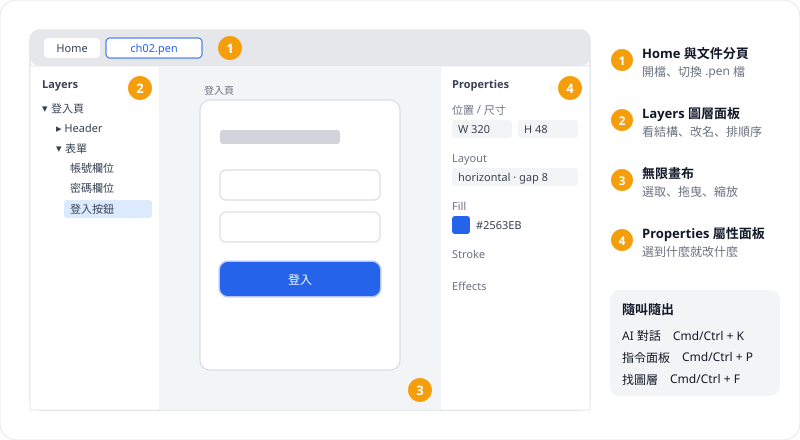

# 02. 介面與畫布基本操作

> 學會在 pen.dev 裡「走路」：找到東西、選對東西、移動與整理圖層。後面每一章都會用到這些操作。

---

## 觀念：四個區域，各管一件事



| 區域 | 用途 | 你最常做的事 |
| :--- | :--- | :--- |
| ① Home 與文件分頁 | 開檔、切換檔案 | 確認目前開的是哪個 `.pen` 檔（AI 也只會改這一個） |
| ② Layers 圖層面板 | 顯示整棵節點樹 | 看結構、改名、拖曳調整順序 |
| ③ 無限畫布 | 擺放所有畫面 | 選取、拖曳、縮放檢視 |
| ④ Properties 屬性面板 | 顯示選取節點的屬性 | 改尺寸、排版、顏色、陰影 |

有一個原則要先記住：**屬性面板永遠只顯示「目前選到的東西」**。改錯地方，九成是因為選錯了節點。所以這章大部分時間都在練「選取」。

另外三個面板不用時是隱藏的，按快捷鍵才會出現：AI 對話（`Cmd/Ctrl + K`）、指令面板（`Cmd/Ctrl + P`，忘記快捷鍵時可以在這裡搜尋指令名稱）、找圖層（`Cmd/Ctrl + F`，可以用名稱、文字或 ID 搜尋）。

> [!TIP]
> 在畫布上按 `?`，或點工具列的鍵盤圖示，可以打開 App 內建的完整快捷鍵表。以下快捷鍵以 Mac 的 `Cmd` / `Option` 表示，Windows 請改按 `Ctrl` / `Alt`。

---

## 必學快捷鍵（只列本章會用到的）

**畫布移動與縮放**

| 動作 | 快捷鍵 |
| :--- | :--- |
| 平移畫布 | 按住 `Space` 拖曳，或滑鼠中鍵拖曳 |
| 縮放 | `Cmd/Ctrl + 滾輪`，或 `Cmd/Ctrl + +` / `Cmd/Ctrl + -` |
| 顯示全部內容 | `Shift + 1` |
| 放大到目前選取 | `Shift + 2`（AI 剛畫好東西時最常用） |
| 100% 實際大小 | `Cmd/Ctrl + 0` |

**選取**

| 動作 | 快捷鍵 |
| :--- | :--- |
| 移動工具 | `V` |
| 加選 | `Shift + 點擊` |
| 直接選到深層的元素 | `Cmd/Ctrl + 點擊` |
| 選子層／選父層 | `Enter` ／ `Shift + Enter` |
| 取消選取 | `Esc` |

**編輯與整理**

| 動作 | 快捷鍵 |
| :--- | :--- |
| 複製一份 | `Cmd/Ctrl + D` |
| 微調位置 | 方向鍵（1px）、`Shift + 方向鍵`（10px） |
| 上移一層／下移一層 | `Cmd/Ctrl + ]` ／ `Cmd/Ctrl + [` |
| 對齊左／右／上／下 | `Option/Alt + A` / `D` / `W` / `S` |
| 群組／包進 frame | `Cmd/Ctrl + G` ／ `Cmd/Ctrl + Option/Alt + G` |
| 復原／重做 | `Cmd/Ctrl + Z` ／ `Cmd/Ctrl + Shift + Z` |
| 存檔 | `Cmd/Ctrl + S` |

---

## 範例 A：RWD 登入頁（桌機＋手機兩個畫面）

### AI 先產生練習素材

開一個新檔 `ch02.pen`，把 Prompt 貼給 AI：

<details>
<summary>📋 Prompt：登入頁兩種尺寸</summary>

```text
請在目前開啟的 .pen 檔畫兩個登入頁畫面，並排放在畫布最上方：
1. 「登入頁 - Desktop」：寬 1440、高 900。左半邊是品牌形象區（深藍底＋白色大標「歡迎回到學習平台」），右半邊置中放登入表單。
2. 「登入頁 - Phone」：寬 390、高 844。只有表單，品牌標題縮小放在表單上方。
表單內容：標題「登入」、帳號輸入框、密碼輸入框、「忘記密碼？」文字連結、藍色「登入」按鈕。
所有節點都用中文命名（例如：表單、帳號欄位、登入按鈕），全部使用 Flex 排版。完成後存檔。
```

</details>

### 換你動手

1. **全覽與聚焦**：按 `Shift + 1` 看到兩個畫面。在 Desktop 畫面點一下「登入」按鈕，按 `Shift + 2` 放大到它。
2. **練習選對層級**：
   - 直接點按鈕，看看選到的是按鈕還是外層的「表單」？（看左側圖層哪一列被反白。）
   - 按 `Shift + Enter` 往上選到父層，再按 `Enter` 回到子層。
   - 用 `Cmd/Ctrl + 點擊` 直接點到按鈕裡的文字。
3. **改名**：在圖層面板雙擊「登入按鈕」的名稱，改成 `btn-login`。圖層名稱之後會變成程式碼裡的 class 或元件名稱，命名要有意義。
4. **調整順序**：在 Phone 畫面的圖層裡，把「忘記密碼？」拖到「登入按鈕」下方，看畫面怎麼變。這是 Flex 排版：圖層順序就是畫面順序。
5. **對照兩個尺寸**：切換看 Desktop 與 Phone，列出哪些東西在手機版「消失」、「變小」或「改成直排」。這就是 RWD 要處理的事，第 04 章會教你怎麼做。

---

## 範例 B：長頁面導覽（部落格文章頁）

網頁設計稿常常很長，這個範例練習「在大量圖層中找東西」。

<details>
<summary>📋 Prompt：部落格文章頁</summary>

```text
請畫一個寬 1440 的部落格文章頁，命名「文章頁 - Desktop」，由上到下的區塊依序是：
導覽列、文章標題區（分類標籤、標題、作者與日期）、封面圖區（灰色佔位）、內文（5 段文字與 2 個小標）、
作者介紹卡、相關文章（3 張卡片橫排）、留言區、頁尾。
每個區塊都是一個 frame，用中文命名。全部使用 Flex 排版。完成後存檔。
```

</details>

1. 按 `Cmd/Ctrl + F`，搜尋「作者」，看看找到幾個結果，點選跳過去。
2. 在圖層面板把「相關文章」整個區塊拖到「作者介紹卡」上方。
3. 選取「留言區」，在屬性面板找到眼睛圖示或「隱藏」選項，把它隱藏起來（之後 AI 讀到它時屬性是 `enabled: false`）。
4. 選取三張相關文章卡片，用 `Option/Alt + W` 讓它們向上對齊。如果沒反應，表示外層已經有 Flex 排版在管位置。想想為什麼（答案在第 04 章）。

---

## 常見錯誤

- **改了屬性卻沒變化**：選到的是外層 frame，而不是你想改的那個元素。看左側圖層哪一列被反白。
- **拖曳元素時它「彈回去」**：它的父層有 Flex 排版，位置由排版決定。要改位置請改圖層順序，或改父層的對齊方式。
- **AI 改到別的檔案**：AI 只改「目前開啟中的分頁」。下 Prompt 前先點一下要改的檔案分頁。

## 自我檢核

- [ ] 我能用 `Shift + 1`、`Shift + 2` 快速找到 AI 剛畫好的東西。
- [ ] 我知道 `Enter` / `Shift + Enter` 可以在父層、子層之間切換選取。
- [ ] 我會在圖層面板改名和調整順序，也知道順序會影響 Flex 排版的畫面。

## 延伸閱讀與影片教學

- **官方操作指南**
  - [認識介面與四大區域（pen.dev Interface）](https://docs.pen.dev/core-concepts/pencil-interface)：分頁、圖層面板、無限畫布、屬性面板與搜尋圖層的操作說明。
  - [完整快捷鍵一覽表（Keyboard Shortcuts）](https://docs.pen.dev/core-concepts/keyboard-shortcuts)：Mac 與 Windows 的畫布縮放、選取、圖層整理快捷鍵對照表。
  - [畫出第一個設計（Create Your First Design）](https://docs.pen.dev/getting-started/create-your-first-design)：練習在畫布上建立形狀、切換選取範圍與存檔。
- **YouTube 操作影片**
  - [Pencil.dev Walkthrough 2026: AI Design on Canvas, Land in Code](https://www.youtube.com/watch?v=Y0TWX46vWxA)：實際操作無限畫布的縮放、多畫面並排檢視與圖層管理。
  - [How I Turned Claude Into a Design Tool with Pencil.dev](https://www.youtube.com/watch?v=DFcvz2kcR74)：示範 AI 生成畫面後，如何自己手動點選圖層與微調細節。

---

[下一章：03. 形狀、文字與圖示 →](../03_形狀文字與圖示/README.md)
