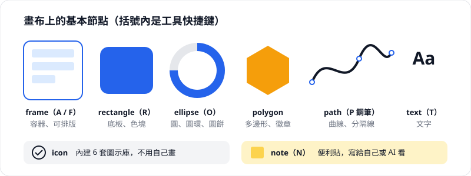
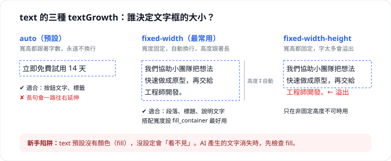
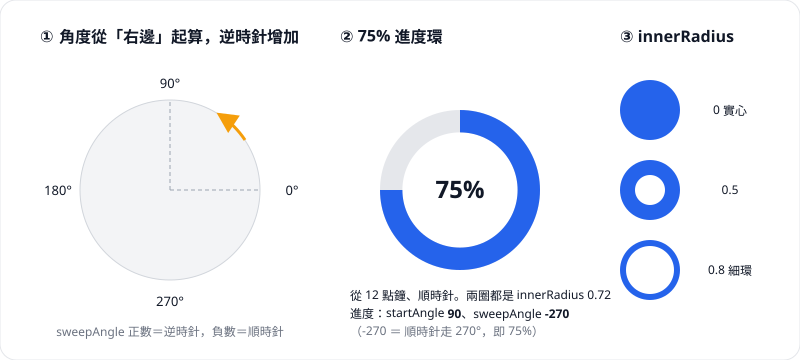

# 03. 形狀、文字與圖示

> 網頁上看得到的東西，幾乎都是由這幾種節點組成的：色塊、圓、文字、圖示。學會它們的屬性，才看得懂 AI 做了什麼，也才改得動。

---

## 觀念一：認識基本節點



| 節點 | 工具 | 網頁上用來做 | 重要屬性 |
| :--- | :--- | :--- | :--- |
| `frame` | `A` 或 `F` | 區塊、卡片、按鈕外框 | 可以放子元素、可以排版（第 04 章） |
| `rectangle` | `R` | 色塊、分隔線、圖片框 | `cornerRadius`（圓角，可四角分別設定） |
| `ellipse` | `O` | 頭像、圓點、進度環、圓餅圖 | `innerRadius`、`startAngle`、`sweepAngle` |
| `polygon` | 工具列 | 徽章、三角箭頭 | `polygonCount`（邊數） |
| `path` | `P` 鋼筆 | 波浪分隔線、自訂曲線 | `geometry`（SVG 路徑）、`viewBox` |
| `text` | `T` | 所有文字 | `textGrowth`、`fill`、字型、字級、行高 |
| `icon` | 屬性面板選取 | 所有 UI 圖示 | `library`、`icon`、`weight` |
| `note` | `N` | 便利貼（不是網頁內容） | `content`、`color` |

**`frame` 和 `group`（`Cmd/Ctrl + G`）的差別**：`group` 只是把東西綁在一起方便移動，不能設背景、不能排版。做網頁時幾乎都用 `frame`。選取多個元素後按 `Cmd/Ctrl + Option/Alt + G`，就能把它們包進一個 frame。

**線段沒有專用節點**：分隔線請用高度 1 的 `rectangle`，或用 `path` 畫。

---

## 觀念二：文字框的大小由誰決定？



`text` 最容易出問題的就是 `textGrowth`：

- **`auto`**：文字有多長，框就有多寬，**永遠不換行**。用在按鈕文字、標籤。
- **`fixed-width`**：寬度固定，文字自動換行，高度自己長。**段落、標題都用這個**，寬度設 `fill_container`（填滿父層）最適合 RWD，第 04 章會詳細說明。
- **`fixed-width-height`**：寬高都固定，字太多會溢出。很少用。

在屬性面板的文字區塊裡可以切換這三種模式（通常是三個小圖示：自動寬度、自動高度、固定大小）。

> [!WARNING]
> `text` 預設**沒有顏色**。AI 產生的文字「不見了」，九成是忘了設 `fill`。

---

## 觀念三：用一個 ellipse 做出進度環



`ellipse` 有三個網頁設計很常用的屬性：

- **`innerRadius`**：0 是實心圓，0.5 是粗圓環，0.8 是細圓環。
- **`startAngle`**：從哪裡開始畫。**0° 在右邊（3 點鐘），90° 在上面（12 點鐘）**，逆時針增加。
- **`sweepAngle`**：畫多少度。**正數逆時針、負數順時針**。

所以網頁常見的「從 12 點鐘開始、順時針、75%」進度環，設定是 `startAngle: 90`、`sweepAngle: -270`（270 = 360 × 75%）。做法是兩個一樣大的 ellipse 疊在一起：底下一圈灰色 360°，上面一圈藍色 -270°。

---

## 觀念四：圖示不用自己畫

`icon` 節點內建 6 套圖示庫，在屬性面板選擇即可：

| `library` | 風格 | 適合 |
| :--- | :--- | :--- |
| `lucide` | 細線、現代 | SaaS、後台、大部分網站（最推薦） |
| `feather` | 細線、極簡 | 和 lucide 很像，圖示較少 |
| `phosphor` | 多種粗細 | 活潑的品牌網站 |
| `Material Symbols Outlined` / `Rounded` / `Sharp` | Google 風格 | 可用 `weight`（100–700）調粗細 |

`icon` 屬性填圖示名稱，例如 lucide 的 `arrow-right`、`check`、`menu`，Material 的 `home`、`search`。**同一個網站請只用一套圖示庫**，混用會讓畫面看起來很亂。

---

## 範例 A：網站「功能特色」區塊

<details>
<summary>📋 Prompt</summary>

```text
請在目前開啟的 .pen 檔畫一個寬 1200 的「功能特色」區塊（frame 命名為 Features），白底，padding 64：
- 上方置中：小標「為什麼選擇我們」（藍色、14px）、大標「三個步驟，做出你的第一個原型」（36px 粗體）
- 下方三欄卡片橫排，每張卡片包含：lucide 圖示（放在 48x48 淺藍圓角底板中）、標題（20px 粗體）、說明（16px 灰色，兩到三行）
  三張的圖示與標題：lightbulb「整理想法」、pen-tool「快速設計」、rocket「上線測試」
- 所有說明文字用 textGrowth: fixed-width，寬度 fill_container。所有 text 都要設定 fill。
完成後存檔。
```

</details>

**換你動手：**

1. 點第一張卡片的圖示，在屬性面板把 `library` 換成 `Material Symbols Rounded`，`icon` 換成 `emoji_objects`，`weight` 調成 300。觀察風格差異，然後按 `Cmd/Ctrl + Z` 復原（記住：同一頁只用一套圖示）。
2. 把第二張卡片的說明文字加長到四行，觀察：文字有換行嗎？卡片有跟著變高嗎？
3. 選取大標，把 `textGrowth` 切成 `auto`，看到標題變成一行衝出去了嗎？再切回 `fixed-width`。
4. 改大標的 `lineHeight`（行高）為 1.2、`letterSpacing`（字距）為 -0.5，大標題用略緊的字距通常比較好看。
5. 把圖示底板的 `cornerRadius` 改成 24（變成圓形），再改成 `[12, 12, 12, 0]`（右下角直角）。

---

## 範例 B：後台儀表板的統計卡

<details>
<summary>📋 Prompt</summary>

```text
請畫一排三張統計卡（frame 命名為 KPI Row，horizontal 排版，gap 24），每張卡片寬 320、白底、圓角 16、淺灰框線：
- 左邊：一個 72x72 的進度環。底圈是灰色 ellipse（innerRadius 0.75），上層是藍色 ellipse（innerRadius 0.75、startAngle 90、sweepAngle 為負數表示順時針）。環中央放百分比文字。
- 右邊：指標名稱（14px 灰色）、數值（28px 粗體）、趨勢（lucide trending-up 綠色圖示＋「較上月 +12%」）
三張分別是：課程完成率 75%、作業繳交率 60%、出席率 90%。sweepAngle 要依百分比正確計算。完成後存檔。
```

</details>

**換你動手：**

1. 選第一張卡片上層的藍色 ellipse，把 `sweepAngle` 從 -270 改成 -324，中間文字改成 90%。
2. 把 `sweepAngle` 改成 270（正數），觀察它變成逆時針方向，再改回負數。
3. 把底圈的 `innerRadius` 改成 0.9，上層也改成 0.9，變成細環風格。
4. 把第三張卡片的趨勢改成下降：圖示換成 `trending-down`，顏色（`fill`）改成紅色。

---

## 範例 C：區塊之間的波浪分隔與「NEW」徽章

<details>
<summary>📋 Prompt</summary>

```text
請畫一個寬 1200、高 120 的 frame（命名 Wave Divider），裡面用一個 path 畫平滑的波浪，填滿下半部，顏色 #EFF6FF，path 要設定 viewBox。
旁邊再畫一個 64x64 的六邊形 polygon 徽章（橘色、cornerRadius 6），中間白色文字「NEW」。完成後存檔。
```

</details>

**換你動手：**

1. 選取波浪 path，按 `Enter` 進入節點編輯模式，拖曳任一個錨點改變波浪形狀，按 `Enter` 完成。
2. 在編輯模式中，雙擊一個錨點，在「平滑」與「尖角」之間切換。
3. 把徽章的 `polygonCount` 改成 8（八邊形），再改成 3（三角形）。
4. 按 `N` 在徽章旁貼一張便利貼，寫「這個徽章要放在價格卡右上角」，下一章之後會用便利貼和 AI 溝通。

---

## 常見錯誤

- **文字不見了**：`text` 沒有設 `fill`。
- **段落文字一行衝出畫面**：`textGrowth` 是 `auto`，改成 `fixed-width`。
- **進度環方向反了**：`sweepAngle` 正數是逆時針，網頁常見的順時針要用負數。

## 自我檢核

- [ ] 我能說出 `frame` 和 `group` 的差別，並知道做網頁要用 `frame`。
- [ ] 我知道段落文字要用 `fixed-width`，也知道文字不見時要先查 `fill`。
- [ ] 我能自己算出任一百分比進度環的 `startAngle` 與 `sweepAngle`。
- [ ] 我會在屬性面板切換圖示庫與圖示名稱。

---

[下一章：04. Flex 自動排版：RWD 的核心 →](../04_Flex自動排版_RWD的核心/README.md)
