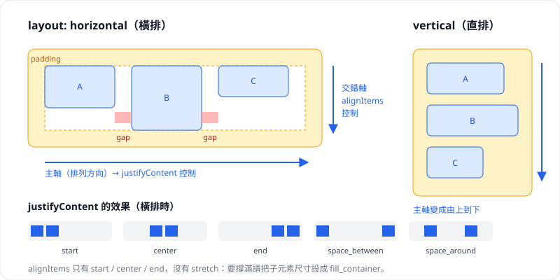
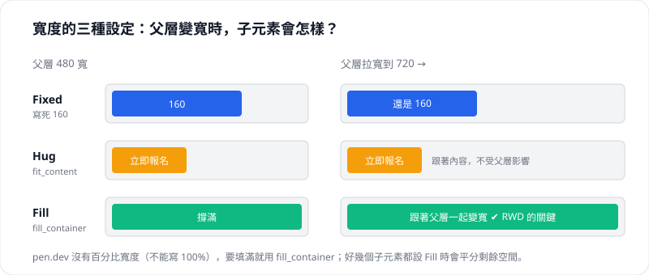
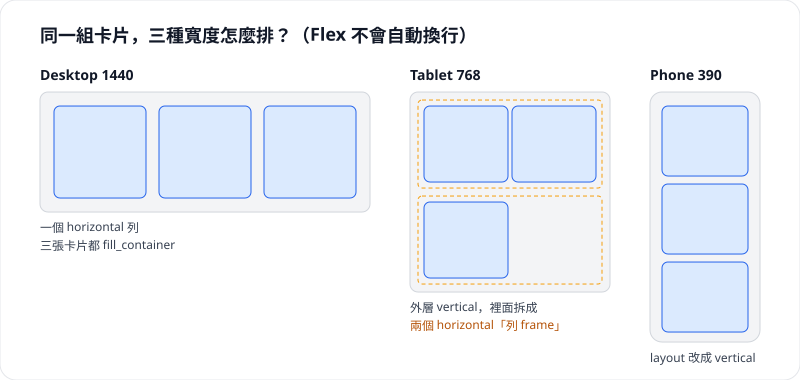

# 04. Flex 自動排版：RWD 的核心

> 這是整套教材最重要的一章。學會 Flex 排版，你的設計稿就能「跟著螢幕寬度變化」，轉成 RWD 網頁時幾乎可以一對一對應到 CSS。

---

## 觀念一：方向、間距、內距、對齊



選取一個 frame 按 **`Shift + A`**，就會幫它加上 Flex 排版（`Shift + Option/Alt + A` 移除）。加上後，屬性面板的 **Layout** 區塊會出現這些設定：

| 屬性 | 意思 | 可選值 |
| :--- | :--- | :--- |
| `layout` | 子元素排列方向 | `horizontal` 橫排、`vertical` 直排、`none` 自由擺放 |
| `gap` | 子元素之間的距離 | 數字，例如 `24` |
| `padding` | 邊框到內容的距離 | `24`（四邊）、`[16, 24]`（上下, 左右）、`[16, 24, 32, 24]`（上, 右, 下, 左） |
| `justifyContent` | **主軸**（排列方向）上怎麼分配 | `start`、`center`、`end`、`space_between`、`space_around` |
| `alignItems` | **交錯軸**上怎麼對齊 | `start`、`center`、`end` |

一旦父層有 Flex 排版，**子元素的位置就由排版決定**，你不能再隨便拖曳它。要換順序，選取子元素後按**方向鍵**就能和隔壁交換位置，或在圖層面板拖曳。

> [!IMPORTANT]
> **pen.dev Flex 排版的三個限制（和 CSS 不同）**
> 1. **沒有 `margin`**：元素之間的距離一律用父層的 `gap` 和 `padding`。某個元素需要額外空間時，就再包一層 frame，用 padding 撐開。
> 2. **沒有百分比**：不能寫 `width: 100%`，要用 `fill_container`。
> 3. **沒有自動換行（wrap）**：一列放不下不會自動折行。要做「一列三張、平板一列兩張」，就要自己拆成多個列 frame（看觀念三）。

---

## 觀念二：寬度的三種設定（RWD 的關鍵）



屬性面板的 W（寬）和 H（高）旁邊可以切換三種模式：

- **Fixed（固定）**：寫死數字，例如 `320`。父層怎麼變它都不動。
- **Hug（`fit_content`）**：跟著內容大小。按鈕最常用：字多按鈕就寬。
- **Fill（`fill_container`）**：撐滿父層剩下的空間。**RWD 的關鍵**：父層變窄，它就跟著變窄。好幾個兄弟元素都設 Fill，就會平分空間。

**實務口訣：外層畫面寫死寬度（1440／768／390），裡面的區塊、欄位、段落文字幾乎都用 Fill，按鈕和標籤用 Hug。**

這樣做有個好處：**拉動外層畫面的寬度，就能直接預覽 RWD 效果。** 選取最外層畫面，拖曳右邊邊框變窄，看看裡面哪裡先壞掉。

> [!WARNING]
> 父層設 Hug、子元素又全部設 Fill，會互相等待對方決定大小，結果寬度變成 0。遇到元素「縮成一條線」時，先檢查是不是這個問題。

---

## 觀念三：Flex 不會換行，RWD 要自己拆列



因為沒有自動換行，同一個區塊在不同寬度要用不同結構：

- **桌機**：一個 `horizontal` 列，三張卡片都 `fill_container`。
- **平板**：外層改 `vertical`，裡面放兩個 `horizontal` 列 frame，第一列兩張、第二列一張。
- **手機**：直接把外層改成 `vertical`，卡片寬度 `fill_container`，就變成上下堆疊。

在 pen.dev 裡做 RWD 的流程通常是：**先把桌機版做好 → `Cmd/Ctrl + D` 複製整個畫面 → 把寬度改成 768 或 390 → 只調整需要改的 `layout` 和字級。**

---

## 觀念四：浮在上面的元素（`layoutPosition: absolute`）

有時候某個元素要「脫離排版」，例如卡片右上角的「熱門」徽章、Hero 圖片上的浮動標籤。選取它，在屬性面板把位置模式改為 **Absolute**（`layoutPosition: "absolute"`），它就可以用 x / y 自由擺放，不會推擠其他元素。

---

## 對照表：pen.dev → CSS

學完這章，你已經會寫 CSS Flexbox 了，只是換了個介面：

| pen.dev | CSS |
| :--- | :--- |
| `layout: horizontal` / `vertical` | `display: flex; flex-direction: row` / `column` |
| `gap: 24` | `gap: 24px` |
| `padding: [16, 24]` | `padding: 16px 24px` |
| `justifyContent: space_between` | `justify-content: space-between` |
| `alignItems: center` | `align-items: center` |
| `fill_container`（在橫排父層裡的寬度） | `flex: 1` |
| `fill_container`（在直排父層裡的寬度） | `align-self: stretch` 或 `width: 100%` |
| `fit_content` | `width: fit-content`（預設行為） |
| `layoutPosition: absolute` | `position: absolute` |
| 桌機／平板／手機三個畫面 | `@media (max-width: …)` 斷點 |

---

## 範例 A：RWD 導覽列

<details>
<summary>📋 Prompt</summary>

```text
請畫兩個導覽列：
1. 「Navbar - Desktop」寬 1440、高 72，horizontal 排版，padding [0, 48]，justifyContent space_between，alignItems center。
   左：Logo 文字「LearnHub」；中：連結群組（horizontal，gap 32）「課程、講師、價格、部落格」；右：按鈕群組「登入」(外框按鈕) +「免費試用」(藍底按鈕)。
2. 「Navbar - Phone」寬 390、高 64，左 Logo、右 lucide 的 menu 圖示。
按鈕寬度都用 fit_content。只用 Flex 排版，不可以用 x/y 定位。完成後存檔。
```

</details>

**換你動手：**

1. 選取 Desktop 導覽列，把 `justifyContent` 依序切換成 `start`、`center`、`space_around`，觀察三個群組怎麼移動，最後改回 `space_between`。
2. 選中間的連結群組，把 `gap` 從 32 改成 20。
3. 選最外層導覽列，拖曳右邊框把寬度縮到 1000，看連結群組有沒有擠到按鈕？再拉回 1440。
4. 在「免費試用」按鈕的文字後面加字，變成「免費試用 14 天」，確認按鈕自動變寬（因為它是 Hug）。
5. 選 Phone 導覽列的 Logo，按右方向鍵，讓它和 menu 圖示交換位置。觀察後再換回來。

---

## 範例 B：三欄卡片，做出三種寬度

<details>
<summary>📋 Prompt</summary>

```text
請畫「課程卡片區 - Desktop」寬 1440，vertical 排版，padding 80，gap 40：
- 上方區塊標題「熱門課程」
- 下方一個 horizontal 列（命名 Card Row），gap 24，寬度 fill_container，放三張課程卡片，每張寬度 fill_container。
  卡片內容：灰色圖片佔位（高 180）、課程名稱、講師名、價格。
只要做 Desktop 版，平板和手機版我要自己做。完成後存檔。
```

</details>

**換你動手（重點練習）：**

1. **做平板版**：選取整個畫面，按 `Cmd/Ctrl + D` 複製一份，命名為「課程卡片區 - Tablet」，寬度改成 768、padding 改成 40。看三張卡片是不是擠得太窄了？
2. 選取 Card Row 按 `Cmd/Ctrl + D` 複製一列。把第一列的第三張卡片刪除，再把第二列的前兩張刪除，變成「兩張＋一張」。
3. 第二列只剩一張卡片會被撐到全寬。把這張卡片寬度改成 Fixed（數值跟上面一張一樣），或在它旁邊放一個空的 frame 設 Fill 當佔位。
4. **做手機版**：再複製一份 Desktop，命名「- Phone」，寬度 390、padding 20，選 Card Row 把 `layout` 改成 `vertical`。三張卡片變成上下堆疊了嗎？
5. 手機版的區塊標題字級從 36 改成 28。

---

## 範例 C：Hero 左右分欄 → 手機上下堆疊

<details>
<summary>📋 Prompt</summary>

```text
請畫「Hero - Desktop」寬 1440、高 640，horizontal 排版，padding [80, 80]，gap 64，alignItems center：
- 左欄（寬度 fill_container，vertical，gap 24）：小標籤「2026 秋季班開課」、大標「讓 AI 成為你的設計夥伴」（56px）、
  說明段落（fixed-width、fill_container）、按鈕群組（「立即報名」主按鈕＋「看課程大綱」次要按鈕）
- 右欄：寬度 fill_container、高 480 的灰色圖片佔位，圓角 24。
- 在圖片右下角放一個浮動小卡片「已有 3,200 位學員」，使用 layoutPosition absolute。
完成後存檔。
```

</details>

**換你動手：**

1. 複製成 Phone 版（寬 390），把最外層 `layout` 改成 `vertical`、padding 改成 `[48, 20]`、gap 改成 32。
2. 手機上圖片太高，把高度改成 240。大標改成 32px。
3. 手機版的按鈕群組也改成 `vertical`，兩個按鈕寬度都設 `fill_container`，變成兩顆滿版按鈕。
4. 檢查浮動小卡片：在手機版有沒有跑到奇怪的位置？用 x / y 重新擺好。
5. 想一想：如果要讓手機版圖片在文字**上方**，要怎麼做？（提示：圖層順序。）

---

## 常見錯誤

- **元素拖不動**：父層有 Flex 排版，位置由排版決定。用方向鍵換順序，或把它設成 absolute。
- **元素寬度變成 0**：父層是 Hug、子元素全是 Fill，互相依賴。把父層改成 Fixed 或 Fill。
- **想要換行卻一直往右擠**：Flex 不會換行，請拆成多個列 frame。

## 自我檢核

- [ ] 我能說出 `justifyContent` 與 `alignItems` 分別管哪個方向。
- [ ] 我知道 Fixed、Hug、Fill 的差別，也知道 RWD 為什麼主要靠 Fill。
- [ ] 我能把一個桌機版區塊，自己改出平板版與手機版。
- [ ] 我能把 pen.dev 的排版設定，對照說出 CSS 的寫法。

---

[下一章：05. 元件、實例與變體 →](../05_元件實例與變體/README.md)
