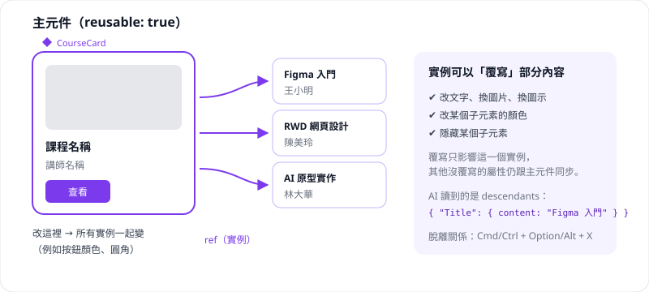
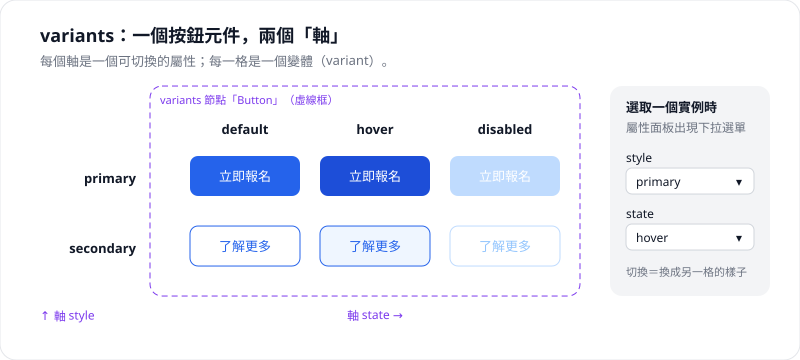

# 05. 元件、實例與變體

> 一個網站有幾十顆按鈕、十幾張卡片。做成「元件」之後，改一次就能全部一起更新。這章先學觀念與操作，下一章再用它們做出一整套網頁元件庫。

---

## 觀念一：主元件與實例



- **主元件（Component）**：選取一個做好的 frame，按 **`Cmd/Ctrl + Option/Alt + K`**，它就變成主元件（底層屬性是 `reusable: true`），圖層上會出現菱形圖示。再按一次可以變回一般元素。
- **實例（Instance）**：複製主元件（`Cmd/Ctrl + D`，或複製貼上）得到的分身，底層類型是 `ref`。實例會**跟著主元件同步**：主元件改圓角、改顏色，所有實例一起變。
- **覆寫（Override）**：在實例裡直接改文字、換圖示、改某個子元素顏色，只影響這一個實例。AI 讀到的是實例的 `descendants`（子元素覆寫清單）。
- **脫離（Detach）**：`Cmd/Ctrl + Option/Alt + X` 把實例變回一般元素，從此不再同步。除非真的必要，盡量不要脫離。

> [!TIP]
> 想在實例裡「整個換掉」某個子元素（例如把卡片裡的圖片區換成影片區），選取那個子元素按 `Option/Alt + Shift + R`（Replace inside instance）。

---

## 觀念二：變體（variants）



同一個元件常常有好幾種樣子：主要／次要按鈕、預設／滑鼠移上／停用狀態。把它們放進一個 **`variants` 節點**，就變成一組變體：

- **軸（axis）**：一個可以切換的屬性，例如 `style`、`state`、`size`。
- **變體**：每個軸組合出來的一種樣子。
- 選取一個實例時，屬性面板會出現每個軸的**下拉選單**，切換就等於換成另一個變體，而且你覆寫過的文字會保留。

**變體軸的命名建議（之後轉成網頁程式碼時會直接用到）：**

| 軸 | 常見值 | 對應網頁 |
| :--- | :--- | :--- |
| `style` / `variant` | primary、secondary、ghost、danger | CSS class 或元件的 `variant` prop |
| `size` | sm、md、lg | `size` prop |
| `state` | default、hover、focus、disabled | CSS 的 `:hover`、`:focus`、`:disabled` |
| `device` | desktop、phone | RWD 斷點（下一章會用到） |

---

## 觀念三：插槽（slot）

有些元件是「外框」：對話框、卡片、區塊容器，每次放進去的內容都不一樣。在元件裡把某個 frame 標記為 **slot**，使用實例時就能把這個區域換成任何內容，外框（標題、關閉按鈕、陰影）仍然和主元件同步。網頁上的 Modal 對話框、Tab 內容區、側邊欄面板都很適合這樣做。

---

## 範例 A：課程卡片元件（覆寫練習）

<details>
<summary>📋 Prompt</summary>

```text
請在目前的 .pen 檔畫面最上方建立一個主元件「CourseCard」（寬 320，vertical，圓角 16，白底，淺灰框線）：
圖片區（高 180，灰色）、內容區（padding 20，gap 8）：分類標籤、課程名稱、講師名稱、價格與「查看」按鈕。
每個子元素都要有清楚名稱（Image、Tag、Title、Teacher、Price、Button）。
在下方建立「課程列表」frame（寬 1440，horizontal 排版，gap 24，padding 40），放三個 CourseCard 實例，
並用 descendants 覆寫成三門不同課程的名稱、講師與價格。完成後存檔。
```

</details>

**換你動手：**

1. 在圖層面板找到主元件（有菱形圖示），把它的圓角從 16 改成 4。三個實例是不是一起變了？
2. 在主元件裡把「查看」按鈕的顏色改成綠色。再看實例。
3. 選第二個實例，雙擊課程名稱改成「pen.dev 實戰」。**覆寫只影響它自己。**
4. 在第三個實例裡把 Tag 隱藏。然後回主元件把 Tag 顏色改掉，觀察：第三個實例的 Tag 還是隱藏的（覆寫會保留）。
5. 選取一個實例，按 `Cmd/Ctrl + D` 再複製一張，改成第四門課。這就是做列表最快的方法。

---

## 範例 B：按鈕變體（style × state）

<details>
<summary>📋 Prompt</summary>

```text
請建立一個 variants 元件「Button」，軸為 style: [primary, secondary, ghost]、state: [default, hover, disabled]，共 9 個變體。
- 每個變體都是 horizontal frame，padding [12, 20]，gap 8，圓角 10，寬度 fit_content，內含 lucide 圖示（arrow-right，16px）與文字「立即報名」。
- primary：藍底白字；hover 底色加深；disabled 用淺藍、文字透明度降低。
- secondary：白底藍框藍字；ghost：無底無框藍字。
- 所有變體的文字節點都命名為「Label」、圖示都命名為「Icon」，這樣切換變體時覆寫會保留。
在旁邊放 3 個 Button 實例，文字分別是「立即報名」、「了解更多」、「取消」，style 分別是 primary、secondary、ghost。完成後存檔。
```

</details>

**換你動手：**

1. 選取「了解更多」實例，在屬性面板的下拉選單把 `state` 切成 `hover`，再切成 `disabled`。文字有被保留嗎？
2. 把「取消」的 `style` 從 ghost 改成 secondary。
3. 進到 variants 裡面，把 primary / default 這個變體的圓角改成 999（膠囊形）。只有這一格會變。想讓全部變體一起改，該怎麼做？（提示：逐一選取 9 格一起改，或請 AI 批次修改。）
4. 在「立即報名」實例裡把圖示換成 `sparkles`。

---

## 範例 C：表單欄位元件＋對話框插槽

<details>
<summary>📋 Prompt</summary>

```text
1. 建立 variants 元件「TextField」，軸 state: [default, focus, error]：
   vertical frame（gap 6，寬 360）內含 Label 文字、輸入框（高 44，圓角 8，框線）、Helper 說明文字。
   focus 時框線變藍色並加粗；error 時框線與 Helper 變紅色，Helper 文字為「此欄位為必填」。
2. 建立元件「Modal」：寬 480，白底，圓角 16，陰影。包含標題列（標題文字＋lucide x 圖示）、一個標記為 slot 的「Content」frame、底部按鈕列（取消、確認）。
3. 放一個 Modal 實例，把 Content slot 換成兩個 TextField 實例（姓名、Email），其中 Email 是 error 狀態。完成後存檔。
```

</details>

**換你動手：**

1. 把 Email 欄位從 error 切回 default，再切到 focus。
2. 修改 Modal 主元件的圓角與標題字級，確認實例同步，但 Content 內的表單不受影響。
3. 再放一個 Modal 實例，自己把 Content 換成一段確認文字「確定要刪除這門課程嗎？」，並把確認按鈕改成紅色（覆寫）。

---

## 常見錯誤

- **改了實例，其他實例沒有一起變**：你改的是實例（只影響自己），要改主元件才會全部同步。
- **切換變體後文字跑回預設**：各變體裡同一個部位的名稱不一樣。統一命名（例如都叫 Label）就能保留覆寫。
- **不小心按了 Detach**：`Cmd/Ctrl + Z` 復原。

## 自我檢核

- [ ] 我能建立主元件，並用複製的方式產生實例。
- [ ] 我分得清楚「改主元件」與「覆寫實例」的差別。
- [ ] 我會用屬性面板切換變體，也知道為什麼各變體要統一子元素名稱。
- [ ] 我能說出 slot 適合用在哪一種網頁元件。

---

[下一章：06. 網頁元件庫實戰 →](../06_網頁元件庫實戰/README.md)
