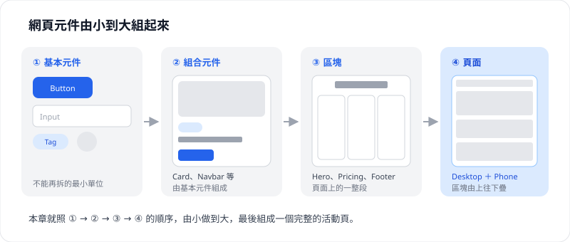
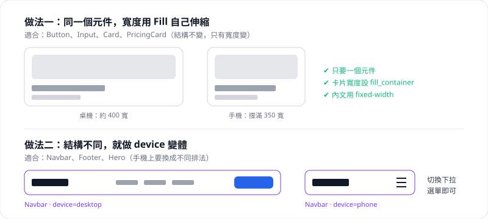
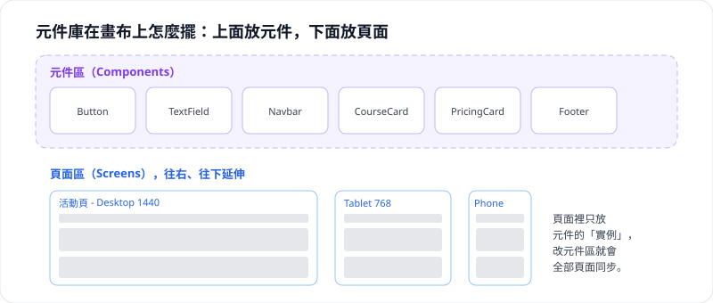

# 06. 網頁元件庫實戰：從按鈕做到整頁 RWD 活動頁

> 這一章把前面學的形狀、Flex 排版、元件與變體全部用上，從零建立一套**可以重複使用的網頁元件庫**，最後組成桌機、平板、手機三種尺寸的活動頁。下一章把它轉成真正的網頁程式碼。

**本章專案**：「LearnHub 線上課程平台」秋季招生活動頁。新開一個檔案 `ch06_learnhub.pen`，從頭到尾都在這個檔案裡做。

---

## 觀念一：元件由小到大組起來



一個網站的介面可以拆成四層：

1. **基本元件**：Button、TextField、Tag、Avatar、IconButton，不能再拆。
2. **組合元件**：由基本元件組成，例如 Navbar（Logo＋連結＋Button）、CourseCard（圖片＋Tag＋文字＋Button）。
3. **區塊**：頁面上的一整段，例如 Hero、Features、Pricing、FAQ、Footer。
4. **頁面**：區塊由上往下疊起來，並且有 Desktop／Tablet／Phone 三種尺寸。

**一定要從小做到大。** 先把 Button 做好，Navbar 和卡片裡用的都是 Button 的實例。之後要改按鈕圓角，只改一個地方，整個網站都會更新。

---

## 觀念二：RWD 元件的兩種做法



設計每個元件前，先問自己：**「手機上它只是變窄，還是排法整個不一樣？」**

- **只是變窄 → 做法一：一個元件，寬度用 `fill_container`。** Button、TextField、CourseCard、PricingCard 都是這種。放在桌機三欄裡它約 400 寬，放在手機裡它就撐滿 350 寬。
- **排法不同 → 做法二：做 `device` 變體（desktop／phone）。** Navbar（手機要變成漢堡選單）、Footer（四欄變成直排）、Hero（左右分欄變成上下）。

### 本章元件清單

| 層級 | 元件 | 變體軸 | RWD 做法 | 對應 HTML |
| :--- | :--- | :--- | :--- | :--- |
| 基本 | Button | style × size × state | Hug（按鈕）／手機可設 Fill | `<button>` / `<a>` |
| 基本 | TextField | state（default／focus／error） | Fill | `<label>` + `<input>` |
| 基本 | Tag | tone（blue／green／orange） | Hug | `<span>` |
| 組合 | Navbar | device（desktop／phone） | 變體 | `<header><nav>` |
| 組合 | CourseCard | 無 | Fill | `<article>` |
| 組合 | PricingCard | featured（no／yes） | Fill | `<article>` |
| 組合 | FAQItem | open（no／yes） | Fill | `<details>` |
| 區塊 | Footer | device（desktop／phone） | 變體 | `<footer>` |

---

## 觀念三：元件庫在畫布上怎麼擺



- **元件區在上**：所有主元件和 variants 排在畫布最上方，一目了然。
- **頁面區在下**：每個畫面是一個最上層 frame（1440／768／390），往右、往下延伸。
- **頁面裡只放實例**：不要在頁面裡複製一份「長得像」的按鈕，一律從元件區複製實例過來。

---

## 步驟 0：準備基本變數（顏色與圓角）

元件要用一致的顏色，所以先請 AI 建立幾個變數。變數的完整觀念在下一章，這裡先會用就好：屬性值寫 `$primary`，代表「使用名為 primary 的變數」。

<details>
<summary>📋 Prompt</summary>

```text
請在目前的 .pen 檔建立以下變數（SetVariables），先不要畫任何東西：
color：primary #2563EB、primary-hover #1D4ED8、primary-soft #DBEAFE、text #111827、text-muted #6B7280、
       border #E5E7EB、surface #FFFFFF、surface-alt #F9FAFB、danger #DC2626、success #16A34A
number：radius-sm 8、radius-md 12、radius-lg 20
string：font-body "Noto Sans TC"
完成後列出所有變數給我看。
```

</details>

**換你動手：** 選取任何節點，在屬性面板的 Fill 色票旁找到變數選單，確認看得到剛剛建立的變數。

---

## 步驟 1：Button（基本元件）

<details>
<summary>📋 Prompt</summary>

```text
在畫布最上方的元件區建立 variants 元件「Button」：
- 軸：style: [primary, secondary, ghost]、size: [md, lg]、state: [default, hover, disabled]
- 結構：horizontal frame，alignItems center，gap 8，寬度 fit_content；子元素 Label（text）與 Icon（lucide arrow-right）。
  Icon 預設隱藏（enabled false），需要時在實例裡打開。
- md：padding [10, 18]、字級 15；lg：padding [14, 24]、字級 17。圓角 $radius-sm。
- primary：底色 $primary、白字；hover 底色 $primary-hover；disabled 底色 $primary-soft。
- secondary：白底、$primary 框線與文字；hover 底色 $primary-soft。
- ghost：無底無框、$primary 文字；hover 底色 $surface-alt。
- 所有變體的子元素名稱一律是 Label、Icon。
完成後截圖給我看。
```

</details>

**換你動手：**

1. 放一個 Button 實例在空白處，用下拉選單逐一切換 style、size、state，確認 18 種組合都正確。
2. 在實例中打開 Icon（取消隱藏），把文字改成「開始學習」。
3. 檢查 disabled 狀態的文字對比是否太低、看不清楚？自己調整成你覺得清楚的顏色。

---

## 步驟 2：TextField 與 Tag（基本元件）

<details>
<summary>📋 Prompt</summary>

```text
在元件區建立：
1. variants 元件「TextField」，軸 state: [default, focus, error]。vertical frame，gap 6，寬度 320。
   子元素：Label（14px）、Input（高 44，圓角 $radius-sm，框線 $border，內含 Placeholder 灰字）、Helper（13px，$text-muted）。
   focus：Input 框線 $primary、寬 2；error：Input 框線與 Helper 都是 $danger，Helper 為「此欄位為必填」。
2. variants 元件「Tag」，軸 tone: [blue, green, orange]。膠囊形（圓角 999），padding [4, 10]，12px 粗體文字 Label。
   blue 用 $primary-soft 底與 $primary 字；green、orange 自行搭配淺底深字。
```

</details>

**換你動手：**

1. 把 TextField 的主元件寬度改成 `fill_container`。為什麼這樣比較好？（提示：放到手機版時。）
2. 新增一個 Tag 實例，文字改成「熱門」，tone 設 orange。

---

## 步驟 3：Navbar（組合元件，device 變體）

<details>
<summary>📋 Prompt</summary>

```text
在元件區建立 variants 元件「Navbar」，軸 device: [desktop, phone]：
- desktop：寬 1440、高 72，horizontal，padding [0, 48]，justifyContent space_between，alignItems center，白底，底部 1px $border 框線。
  左：Logo（lucide graduation-cap 圖示＋「LearnHub」粗體）；中：Links 群組（課程、講師、價格、常見問題，gap 32）；
  右：Actions 群組（Button 實例 ghost「登入」＋ Button 實例 primary「免費試用」）。
- phone：寬 390、高 60，padding [0, 20]，左 Logo、右 MenuButton（lucide menu 圖示，24px）。
按鈕一定要使用 Button 元件的實例，不要另外畫。
```

</details>

**換你動手：**

1. 回到 Button 主元件，把 primary / md / default 的圓角改成 999。Navbar 裡的「免費試用」有跟著變嗎？（這就是先做基本元件的好處。）改完記得復原。
2. 在 Navbar desktop 的 Links 群組加第五個連結「部落格」：選取「常見問題」按 `Cmd/Ctrl + D`，改文字。
3. 把 Navbar 寬度改成 `fill_container`，之後放進 768 的平板畫面時才會自動變窄。

---

## 步驟 4：CourseCard 與 PricingCard（組合元件）

<details>
<summary>📋 Prompt</summary>

```text
在元件區建立：
1. 元件「CourseCard」：vertical，寬 360，白底，圓角 $radius-md，$border 框線，clip true。
   Image（高 200，寬 fill_container，灰色佔位）、Body（vertical，padding 20，gap 10）：
   Tag 實例、Title（18px 粗體，fixed-width + fill_container）、Meta（lucide user 圖示＋講師名，lucide clock 圖示＋時數）、
   Footer（horizontal，space_between）：Price（20px 粗體）＋ Button 實例（secondary、md、「查看課程」）。
2. variants 元件「PricingCard」，軸 featured: [no, yes]：vertical，padding 32，gap 20，寬 360，圓角 $radius-lg。
   PlanName、Price（40px 粗體＋「/月」）、Description、Features 清單（4 列，每列 lucide check 圖示＋文字）、
   Button 實例（寬度 fill_container）。
   featured=no：白底、$border 框線、Button secondary。
   featured=yes：$primary 框線寬 2、Button primary，並在右上角放 Tag 實例「最受歡迎」（layoutPosition absolute）。
```

</details>

**換你動手：**

1. 把 CourseCard 的 Title 改成一個很長的課程名稱，確認它會換行、卡片會變高，而不是被截掉。
2. 把 PricingCard featured=yes 的「最受歡迎」標籤，用 x / y 微調到剛好壓在卡片上緣。
3. 把兩個卡片主元件的寬度都改成 `fill_container`（做法一：只靠寬度伸縮）。

---

## 步驟 5：FAQItem 與 Footer

<details>
<summary>📋 Prompt</summary>

```text
在元件區建立：
1. variants 元件「FAQItem」，軸 open: [no, yes]：vertical，寬 fill_container（預設 800），底部 1px $border 框線，padding [20, 0]。
   Question 列（horizontal，space_between）：問題文字（17px 粗體）＋ lucide chevron-down 圖示。
   open=yes 時圖示換成 chevron-up，並多出 Answer 段落（fixed-width + fill_container，$text-muted）。
2. variants 元件「Footer」，軸 device: [desktop, phone]，深色背景 #0F172A、淺色文字：
   desktop：寬 1440，padding [64, 48]，上方 horizontal 四欄（品牌介紹、課程、關於我們、聯絡資訊），下方版權列。
   phone：寬 390，padding [40, 20]，四欄改成 vertical 堆疊，gap 32。
```

</details>

**換你動手：**

1. 放兩個 FAQItem 實例，一個 open=yes、一個 no，改成你自己的問題與回答。
2. 比較 Footer 兩個變體的圖層結構，找出差異只在哪一個 frame 的 `layout`。

---

## 步驟 6：組出 Desktop 活動頁

<details>
<summary>📋 Prompt</summary>

```text
在元件區下方建立最上層 frame「活動頁 - Desktop」：寬 1440，vertical，白底，clip true。
全部使用元件實例，由上而下：
1. Navbar（device desktop）
2. Hero 區塊（horizontal，padding [96, 80]，gap 64）：左欄 Tag「2026 秋季班」、大標「讓 AI 成為你的設計夥伴」（56px）、
   說明、按鈕列（Button primary lg「立即報名」＋ secondary lg「看課程大綱」）；右欄圖片佔位（高 460，圓角 $radius-lg）。
3. 熱門課程區塊：標題＋一列三個 CourseCard（寬度 fill_container）。
4. 價格方案區塊：$surface-alt 底，三個 PricingCard（中間 featured yes）。
5. 常見問題區塊：4 個 FAQItem，第一個 open yes，內容寬度最大 800 置中。
6. Footer（device desktop）
每個區塊 frame 依序命名：Hero、Courses、Pricing、FAQ。完成後截圖。
```

</details>

**換你動手（AI 做完後的設計師檢查）：**

1. 按 `Shift + 2` 逐一放大每個區塊，檢查文字有沒有被截斷、間距是否一致（區塊之間的上下 padding 最好統一，例如都是 96）。
2. 把 Hero 大標改成你自己的活動標題。
3. 把 Pricing 三張卡片的價格與功能清單改成合理的內容（例如：單堂購買、季訂閱、年訂閱）。
4. 在你覺得不滿意的地方，按 `N` 貼一張便利貼寫下修改需求，例如「Hero 右邊圖片太高，改成 400」。先不要修改，第 09 章會交給 AI 處理。

---

## 步驟 7：自己做出 Tablet 與 Phone 版

這一步**不使用 AI**，全部手動完成，這是本章的核心練習。

**Tablet（768）：**

1. 選取「活動頁 - Desktop」，`Cmd/Ctrl + D` 複製，改名「活動頁 - Tablet」，寬度改 768。
2. Navbar 會跟著變窄（因為設了 Fill），但連結可能太擠：把 Navbar 實例的 device 切成 phone。
3. Hero：把 `layout` 改成 vertical，padding 改成 `[64, 40]`，大標字級改成 44。
4. Courses：三張卡片太窄了。依照第 04 章的方法，拆成「兩張＋一張」兩列。
5. Pricing：三張改成 vertical 直排，或保留橫排但縮小 padding。自己判斷哪個好看。

**Phone（390）：**

1. 複製 Tablet 版，改名「活動頁 - Phone」，寬度 390。
2. 所有區塊的左右 padding 改成 20。
3. Hero 大標 32px；兩顆按鈕改成上下排、寬度 `fill_container`。
4. Courses、Pricing 的列都改成 vertical。
5. Footer 實例的 device 切成 phone。

**完成後檢查：** 三個畫面並排，對照同一個區塊，確認文字內容一致、沒有元素被截掉、手機上的按鈕至少 44px 高（手指好點）。

---

## 元件庫自我檢核清單

做完後用這張表檢查你的元件庫，這也是之後轉成程式碼時 AI 最需要的資訊：

- [ ] 每個元件、每個子元素都有清楚的英文名稱（之後會變成程式碼的元件名稱與 class）。
- [ ] 頁面裡的按鈕、卡片全部是實例，沒有「長得像」的複製品。
- [ ] 互動元件都有 hover、disabled（必要時還有 focus、error）狀態。
- [ ] 會隨寬度伸縮的元件使用 `fill_container`；排法不同的元件有 `device` 變體。
- [ ] 顏色都使用變數（`$primary` 等），沒有到處寫死色碼。
- [ ] Desktop、Tablet、Phone 三個畫面內容一致。

---

## 常見錯誤

- **AI 沒有使用實例，而是重畫了一顆按鈕**：在 Prompt 裡明確寫「一定要使用 Button 元件的實例」，或選取它請 AI 換成實例。
- **切換 device 變體後內容跑掉**：兩個變體的子元素名稱不一致。統一命名後再切換。
- **平板版卡片擠成一條**：Flex 不會換行，請拆成多個列 frame（第 04 章）。

## 延伸閱讀與影片教學

- **官方操作指南**
  - [從零打造小型設計系統（Build a Small Design System）](https://docs.pen.dev/design-systems/build-a-design-system)：官方手把手教學，帶你從定義變數、建立基本元件到組合成完整畫面。
  - [共用設計元件庫（Design Libraries）](https://docs.pen.dev/design-systems/design-libraries)：了解如何將做好的元件庫存成 `.lib.pen`，在不同檔案之間重複引用。
- **YouTube 操作影片**
  - [程序员的设计神器！Pencil 深度实测：从 UI 设计到 React 代码生成](https://www.youtube.com/watch?v=-aK3UV0FcZ0)（中文）：完整示範在畫布上建立多元件、多頁面的應用程式原型與微調流程。
  - [Pencil: 01 Vibe Design with Pencil and Claude Code](https://www.youtube.com/watch?v=DSow83bnO4g)：觀察如何用元件庫的思維，在同一個畫布上規劃一致的頁面版型。

---

[下一章：07. 變數與主題：深淺色與 RWD 斷點 →](../07_變數與主題_深淺色與RWD斷點/README.md)
