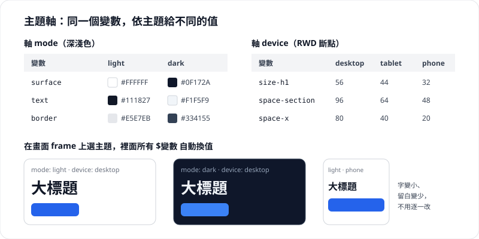

# 07. 變數與主題：深淺色與 RWD 斷點

> 把顏色、字級、間距變成「變數」，一個設定就能讓整個網站換成深色模式，或讓手機版的字級與留白自動縮小。這也是設計稿轉成 CSS 時最省力的部分。

---

## 觀念一：變數＝設計規範的「名字」



第 06 章的步驟 0 已經用過變數：屬性值寫 `$primary`，代表「使用名為 primary 的變數」。

變數有三種類型：

| 類型 | 用途 | 例子 |
| :--- | :--- | :--- |
| `color` | 顏色 | `primary`、`surface`、`text-muted` |
| `number` | 尺寸、間距、圓角、字級 | `radius-md`、`space-section`、`size-h1` |
| `string` | 字型名稱、文字 | `font-body` |

**為什麼要用變數，而不是直接寫色碼？**

- 品牌色要從藍色換成綠色：改一個變數，整個網站一起換。
- 轉成程式碼時，變數直接變成 CSS 變數（`--primary`），工程師不用一個個抄色碼。
- AI 修改設計時，會優先使用既有的變數，風格不容易跑掉。

**手動操作：**

- **綁定變數**：選取節點，在屬性面板的顏色或數值欄位旁打開變數選單，選擇要用的變數。
- **解除綁定**：在同一個地方選擇解除（detach），變回一般數值。
- **查看與編輯所有變數**：打開變數面板（找不到時，用 `Cmd/Ctrl + P` 指令面板搜尋「Variables」）。

**命名建議：用「用途」命名，不要用「長相」命名。** 例如 `text-muted`（次要文字）比 `gray-500` 好，因為深色模式下它可能根本不是灰色。

---

## 觀念二：主題軸，讓同一個變數有多個值



一個變數可以依「主題軸」設定不同的值：

- **`mode` 軸（light／dark）**：`surface` 在淺色主題是白色、在深色主題是深藍黑。
- **`device` 軸（desktop／tablet／phone）**：`size-h1` 在桌機是 56、平板 44、手機 32。

接著在最上層的**畫面 frame** 上設定主題（屬性面板的 Theme 區塊，底層屬性是 `theme: { mode: "dark", device: "phone" }`），這個畫面裡所有綁定變數的屬性就會自動換成對應的值。

**`device` 軸是 pen.dev 做 RWD 最好用的技巧。** 第 06 章做手機版時，你要逐一修改每個區塊的 padding 與字級；改用變數後，只要把手機畫面的主題設成 `device: phone`，全部自動縮小。

### 對照表：pen.dev → CSS

| pen.dev | CSS |
| :--- | :--- |
| 變數 `primary` | `:root { --primary: #2563EB; }` |
| `fill: "$primary"` | `background: var(--primary);` |
| `mode: dark` 主題 | `[data-theme="dark"] { --surface: #0F172A; }` 或 `@media (prefers-color-scheme: dark)` |
| `device: tablet` / `phone` 主題 | `@media (max-width: 1023px)` / `@media (max-width: 767px)` 裡重新設定變數 |

---

## 範例 A：LearnHub 活動頁的深色模式

延續第 06 章的 `ch06_learnhub.pen`（先另存一份 `ch07_learnhub.pen` 再練習）。

<details>
<summary>📋 Prompt</summary>

```text
請先用 GetVariables 列出這個檔案現有的變數。然後：
1. 把 surface、surface-alt、text、text-muted、border、primary-soft 改成有 mode 主題軸的變數（light 保留原本的值，dark 由你配出對比足夠的深色版本）。
2. 檢查元件區與「活動頁 - Desktop」，把所有寫死的白色、深灰色、框線色改成綁定對應的變數。
3. 複製「活動頁 - Desktop」成「活動頁 - Desktop Dark」，在這個畫面 frame 設定 theme mode: dark。
完成後截圖兩個畫面比較，並列出你換掉了哪些寫死的顏色。
```

</details>

**換你動手：**

1. 在 Dark 畫面逐一檢查：有沒有哪段文字幾乎看不見？（通常是漏綁變數，還寫死深色。）選取它，手動綁定到 `$text`。
2. 打開變數面板，把 dark 主題的 `surface` 改成你喜歡的深色，觀察整頁同步變化。
3. 找到 Footer：它本來就是深色背景，在深色模式下和頁面混在一起了嗎？自己決定 Footer 要不要也綁變數。
4. 把 Dark 畫面的主題切回 light，確認畫面和原本的 Desktop 一模一樣。

---

## 範例 B：用 device 軸做 RWD 字級與間距

<details>
<summary>📋 Prompt</summary>

```text
請在目前的 .pen 檔建立有 device 主題軸（desktop、tablet、phone）的 number 變數：
size-h1：56 / 44 / 32；size-h2：40 / 32 / 26；size-body：17 / 16 / 16；
space-section：96 / 64 / 48；space-x：80 / 40 / 20；gap-grid：24 / 20 / 16。
然後把「活動頁 - Desktop」各區塊的上下 padding 綁定 $space-section、左右 padding 綁定 $space-x，
Hero 大標綁定 $size-h1、各區塊標題綁定 $size-h2、段落綁定 $size-body、卡片列的 gap 綁定 $gap-grid。
最後在 Desktop、Tablet、Phone 三個畫面 frame 分別設定 theme device 為 desktop、tablet、phone。
```

</details>

**換你動手：**

1. 選取 Phone 畫面，把主題從 `phone` 暫時切成 `desktop`，觀察字級與留白一起放大（手機上就會擠爆），再切回來。
2. 覺得平板的大標太大？打開變數面板，把 `size-h1` 的 tablet 值改成 40，只有平板畫面會變。
3. 新增一個 `radius-card` 變數（desktop 20、phone 12），手動綁定到 CourseCard 主元件的圓角。
4. 想一想：哪些東西用 device 變數處理（數值不同），哪些要用第 04 章的方法處理（排法不同）？

---

## 範例 C：一鍵換品牌色

<details>
<summary>📋 Prompt</summary>

```text
請複製「活動頁 - Desktop」成「品牌 B 試稿」，並新增 mode 以外的主題軸 brand: [blue, green]：
primary、primary-hover、primary-soft 三個變數在 brand green 時改成綠色系（#059669、#047857、#D1FAE5）。
把「品牌 B 試稿」的 theme 設為 brand: green，截圖給我看。
```

</details>

**換你動手：**

1. 自己在變數面板加入第三個品牌（例如 orange），並把試稿切換過去。
2. 把三個品牌版本的 Hero 並排截圖，選出你覺得最適合這個課程平台的顏色，寫在便利貼上說明理由。

---

## 常見錯誤

- **切換深色模式後，有些地方沒變**：那些屬性寫死了色碼，沒有綁定變數。
- **AI 建立變數時把我原本的變數蓋掉了**：Prompt 裡要求「先 GetVariables 列出現有變數，不要覆蓋」。
- **變數名稱用 `blue-500`**：深色模式下名稱就不對了。請用用途命名（`primary`、`surface`、`text-muted`）。

## 自我檢核

- [ ] 我會在屬性面板把顏色、數值綁定到變數，也會解除綁定。
- [ ] 我能建立有 `mode` 軸的顏色變數，並在畫面 frame 上切換深淺色。
- [ ] 我能用 `device` 軸讓手機版字級與間距自動縮小。
- [ ] 我能說出 pen.dev 變數與主題對應到 CSS 的寫法。

---

[下一章：08. 填色、特效與 AI 生圖 →](../08_填色特效與AI生圖/README.md)
