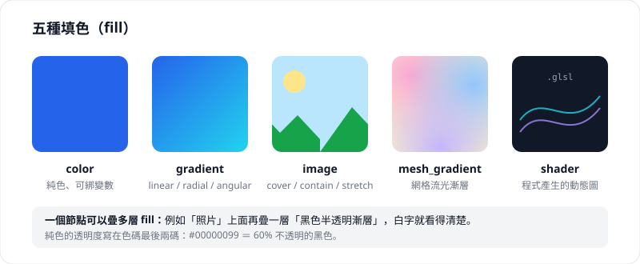
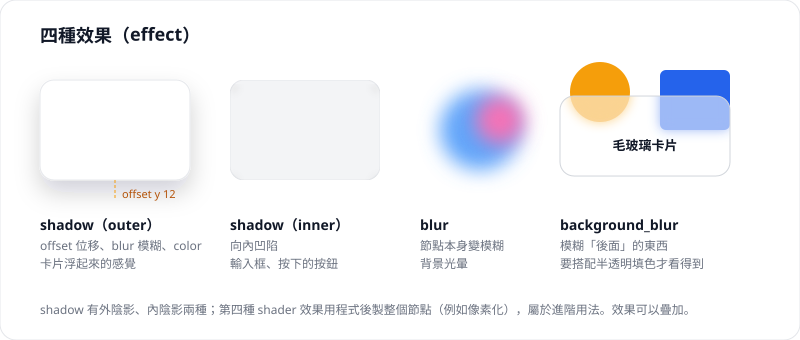
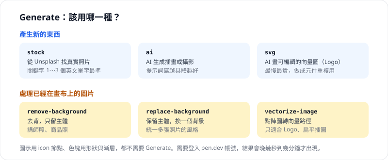

# 08. 填色、特效與 AI 生圖

> 讓網頁有質感的細節：漸層背景、照片、陰影、毛玻璃，以及用 AI 產生或處理圖片。這章也提醒你「什麼時候不要加特效」。
> ⏱ 約 70 分鐘

---

## 觀念一：五種填色，可以一層層疊



選取 `frame`、`rectangle`、`ellipse`、`polygon`、`path` 或 `text`，在屬性面板的 **Fill** 區塊可以設定：

| 類型 | 說明 | 網頁常見用途 |
| :--- | :--- | :--- |
| `color` | 純色，可綁變數。透明度寫在色碼最後兩碼（`#00000099`） | 幾乎所有背景與文字 |
| `gradient` | `linear` 線性、`radial` 放射、`angular` 角度漸層，可拖曳色標與角度 | Hero 背景、按鈕光澤 |
| `image` | 圖片填滿。`cover` 裁切填滿（預設）、`contain` 完整顯示、`stretch` 拉伸 | 照片、課程封面、頭像 |
| `mesh_gradient` | 網格狀的多色流光漸層 | 品牌形象背景 |
| `shader` | 用 WebGL 程式產生的圖案，可有動態效果 | 進階裝飾背景 |

**多層填色**：Fill 區塊可以疊加好幾層，上層會蓋在下層上面（可以拖曳調整順序）。最常見的用法是「照片＋半透明深色漸層」，讓照片上的白字清楚可讀。

> [!NOTE]
> pen.dev **沒有「圖片」節點**。圖片永遠是某個 frame 或 rectangle 的 `image` 填色。要放一張照片，先畫一個框，再把它的填色設成圖片。

**框線（Stroke）** 也在同一個面板：可以設寬度（四邊可分開設，例如只要底線）、對齊方式（`inner` 內側／`center` 置中／`outer` 外側）、虛線（`strokeDash`）、端點樣式。導覽列底部的分隔線、輸入框框線都是它。

---

## 觀念二：效果——陰影、模糊、毛玻璃



屬性面板的 **Effects** 區塊：

- **`shadow`**：`outer` 外陰影讓卡片浮起來，`inner` 內陰影讓東西凹下去。可調 `offset`（x、y 位移）、`blur`（模糊程度）、`color`（含透明度）。
- **`blur`**：整個節點變模糊，常用來做背景光暈。
- **`background_blur`**：模糊節點「後面」的東西，就是毛玻璃。**必須搭配半透明填色**（例如 `#FFFFFFB3`），否則看不出來。
- **`shader`**：用程式後製整個節點，進階用法。

另外每個節點都有 **Opacity（不透明度）**，以及填色上的 **Blend mode（混合模式）**，例如 `multiply`、`screen`、`overlay`。

> [!TIP]
> **特效要克制。** 陰影、漸層、毛玻璃一次全加，網站就會變成「AI 感」很重的模板。一個網站選一種主要特效就好，例如只用淡淡的陰影表現層次。

### 對照表：pen.dev → CSS

| pen.dev | CSS |
| :--- | :--- |
| `gradient` linear | `background: linear-gradient(…)` |
| `image` + `cover` | `background-size: cover` 或 `` |
| `shadow` outer | `box-shadow: 0 12px 24px rgba(…)` |
| `shadow` inner | `box-shadow: inset …` |
| `blur` | `filter: blur(…)` |
| `background_blur` | `backdrop-filter: blur(…)` |
| `strokeAlignment: inner` | `border`（配合 `box-sizing: border-box`） |

---

## 觀念三：Generate——讓 AI 產生或處理圖片



`Generate` 是透過 AI 呼叫的功能（在 Prompt 裡描述需求，AI 就會使用），**需要登入 pen.dev 帳號**。結果是非同步的：畫布上會先出現佔位，幾秒到幾分鐘後圖片才出現。

**先判斷要不要用：**

- 圖示 → 用 `icon` 節點（第 03 章），不要生圖。
- 色塊、裝飾背景 → 用形狀與漸層。
- 真實照片 → `stock`（最快、最自然）。
- 特定風格插畫、找不到的畫面 → `ai`。
- Logo、品牌圖形 → `svg`，最慢，做好後轉成元件重複使用。
- 已有照片要去背、換背景、轉向量 → 後三種。

產生的圖片會存成檔案放在 `.pen` 檔旁邊，轉成網頁時可以直接使用。

---

## 範例 A：Hero 背景照片＋可讀的白字

<details>
<summary>📋 Prompt</summary>

```text
請畫一個寬 1440、高 640 的「Hero - Photo」frame，vertical 排版，justifyContent end，padding 80。
1. 用 Generate stock 找一張「students laptop」的照片當 frame 的填色（cover）。
2. 在照片填色上面再疊一層 linear 漸層：從下方 #0F172ACC 到上方透明。
3. 內容放白色大標「讓 AI 成為你的設計夥伴」、白色說明文字、一顆 primary 按鈕。
完成後截圖。
```

</details>

**換你動手：**

1. 選取 Hero，在 Fill 區塊暫時關掉漸層那一層（點眼睛圖示），看白字是不是變得很難讀？再打開。
2. 拖曳漸層的方向，改成從左到右變透明，並把文字區塊改成靠左。這是另一種常見的 Hero 版型。
3. 把圖片填色的模式從 `cover` 改成 `contain`、`stretch`，觀察差異，最後改回 `cover`。
4. 把 Hero 複製成 390 寬的手機版，檢查照片的主體是否還在畫面內。如果被裁掉，調整圖片的裁切位置。

---

## 範例 B：卡片陰影與毛玻璃導覽列

<details>
<summary>📋 Prompt</summary>

```text
1. 建立三個卡片示範「陰影層級」：shadow-sm（y 2、blur 4、#0F172A14）、shadow-md（y 8、blur 16、#0F172A1F）、shadow-lg（y 20、blur 40、#0F172A29），
   卡片白底、圓角 16、寬 280、高 160，並排在淺灰背景上，每張卡片寫上它的名稱。
2. 在 Hero - Photo 的最上方，放一條寬 fill_container、高 64 的導覽列（layoutPosition absolute），
   填色 #FFFFFFB3，加上 background_blur 半徑 16，底部 1px 半透明白色框線。
```

</details>

**換你動手：**

1. 把 shadow-md 的 blur 改成 0，看陰影變成生硬的色塊；再改回 16。陰影要「大模糊、低透明」才自然。
2. 選導覽列，把 `background_blur` 半徑改成 0、再改成 40，比較差異。
3. 把導覽列的填色改成完全不透明的白色 `#FFFFFF`，毛玻璃效果是不是消失了？這就是為什麼一定要半透明。
4. 在你第 06 章的 CourseCard 主元件加上 shadow-sm，作為預設狀態；思考 hover 時要不要換成 shadow-md。

---

## 範例 C：課程封面圖、講師去背照與 Logo

<details>
<summary>📋 Prompt</summary>

```text
（開啟你的 ch06_learnhub.pen 練習檔副本）
1. 為「活動頁 - Desktop」三張 CourseCard 的 Image 區域，分別用 Generate stock 找照片：「ui design」、「web code」、「team meeting」。
2. 新增一個 240x300 的講師照片框，用 Generate stock 找「portrait woman」，等照片出現後，
   用 remove-background 去背，並把照片框的底色改成 $primary-soft。
3. 新增一個 160x160 的 frame，用 Generate svg 畫 LearnHub 的 Logo：一頂簡潔的學士帽結合鉛筆筆尖，扁平風格，只用 #2563EB 與白色。
   完成後把它設為元件，替換掉 Navbar 裡原本的圖示 Logo。
```

</details>

**換你動手：**

1. Logo 產生後，選取裡面的 path，按 `Enter` 進入編輯模式，微調一兩個錨點。這是 `svg` 模式的好處：產生的是可以編輯的向量。
2. 把 Logo 的顏色改成綁定 `$primary`，再切換第 07 章的品牌主題，Logo 顏色也會跟著換。
3. 比較三張課程照片的色調是否一致。不一致的話，請 AI 用 `replace-background` 把它們統一成相同的淺色背景，或改用同一種漸層覆蓋。

---

## 延伸：Script 與 Shader（選讀）

給對程式有興趣的同學。這兩種都是「AI 寫程式、你拉滑桿」：

- **`script` 節點**：連結一個 `.js` 檔，用程式產生圖形（例如資料圖表、幾何圖騰）。檔案開頭用 `@input` 宣告參數，屬性面板就會出現對應的滑桿、選色器、下拉選單。
- **`shader` 填色／效果**：連結一個 `.glsl` 檔（WebGL 1.0），用 `@range`、`@color`、`@label` 註解產生控制項，可以做動態極光、玻璃折射（`pencil:background`）、像素化等效果。

<details>
<summary>📋 Prompt：可調整的動態背景</summary>

```text
請在 Hero - Photo 旁邊新增一個 1440x640 的 frame「Hero - Shader」，填色使用 shader：
寫一個 aurora.glsl（WebGL 1.0），用 @time 做緩慢流動的極光效果，
提供 @label + @color 的兩個顏色參數，以及 @range 的速度（0 到 2）與強度（0 到 1）參數。
再放上白色大標文字。
```

</details>

**換你動手：** 選取 Hero - Shader，在屬性面板拖曳速度、強度滑桿，並換顏色。注意：shader 效果轉成網頁時需要額外的程式，一般網站用漸層就夠了。

---

## 常見錯誤

- **毛玻璃沒效果**：填色是完全不透明的，改成半透明（例如 `#FFFFFFB3`）。
- **AI 生圖一直沒出現**：沒有登入 pen.dev，或圖片還在產生中，稍等再看；不要重複要求生成。
- **照片上的字看不清楚**：加一層深色半透明漸層，而不是幫文字加陰影。

## 自我檢核

- [ ] 我會在 Fill 區塊疊加多層填色，並調整漸層方向。
- [ ] 我會調整陰影參數，做出自然的層次。
- [ ] 我知道毛玻璃需要半透明填色＋`background_blur`。
- [ ] 我能判斷一張圖該用 `icon`、形狀、`stock`、`ai` 還是 `svg` 來做。

---

[下一章：09. 從設計稿到 RWD 網頁程式碼 →](../09_從設計稿到RWD網頁程式碼/README.md)
