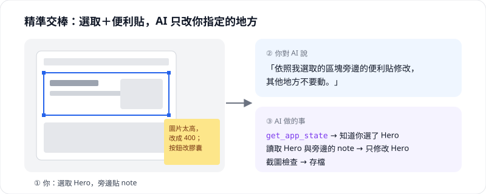
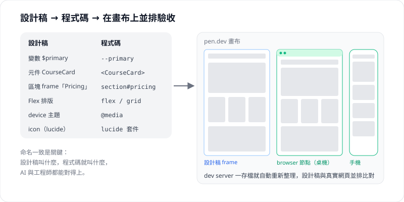

# 09. 從設計稿到 RWD 網頁程式碼

> 最後一哩路：把第 06～08 章的 LearnHub 設計稿交給 AI 精修，再轉成真正的 RWD 網頁，並在 pen.dev 畫布上把設計稿和真實網頁並排驗收。
> ⏱ 約 3 小時

---

## 觀念一：精準交棒——選取＋便利貼



用文字描述「左邊第二個區塊裡的那顆按鈕」，AI 常常改錯地方。pen.dev 的做法是：

1. **你選取**要改的節點（可以多選）。
2. 需要時在旁邊**貼 `note` 便利貼**，寫清楚要改什麼。
3. 對 AI 說「**依照我選取的部分修改**」。AI 會先呼叫 `get_app_state` 取得你目前的選取範圍，讀取那些節點與附近的便利貼，只改那一塊。

這套方法在「設計稿精修」和「網頁程式碼修改」都能用：在畫布上的 `browser` 節點裡，你也可以用元素挑選器（element picker）點選網頁上的某個元素，請 AI 找到對應的程式碼修改。

<details>
<summary>📋 Prompt：處理第 06 章留下的便利貼</summary>

```text
我在「活動頁 - Desktop」旁邊貼了幾張便利貼，寫了修改需求。
請先用 get_app_state 看我目前選取了什麼，然後逐一處理每張便利貼的需求，只修改相關的節點。
每處理完一張，就把那張便利貼的顏色改成綠色（#BBF7D0），表示已完成。最後截圖給我看。
```

</details>

**換你動手：** AI 完成後，逐一檢查綠色便利貼對應的修改是否符合你的意思。不符合的，選取那個區塊再補一張新的黃色便利貼，重複一次循環。

---

## 觀念二：設計稿怎麼對應到程式碼



AI 把設計稿轉成網頁時，會遵守這幾條對應規則。這也是為什麼前面一直要求你**好好命名**：

| 設計稿 | 程式碼 |
| :--- | :--- |
| 變數 `$primary`、`$space-section` | CSS 變數 `--primary`、`--space-section` |
| `mode` 主題 | 深淺色模式（`[data-theme="dark"]`） |
| `device` 主題 | `@media` 斷點 |
| 元件 `CourseCard`、`Button` 的變體 | 同名的程式元件（或 class），變體變成 class 或 prop |
| 區塊 frame「Pricing」 | `<section id="pricing">` |
| Flex 排版 | CSS flexbox；多欄卡片轉成 grid（網頁可以自動換行） |
| `icon`（library: lucide） | 同一套圖示套件 |
| 產生的圖片 | 匯出到專案資料夾，直接引用 |

> [!IMPORTANT]
> 畫布上的 1440／768／390 只是「示範寬度」。真正的 RWD 網頁必須在**任何寬度**都正常，所以程式碼要用 flex 與 grid，而不是照抄設計稿的固定像素。

**參考解答**：[examples/learnhub](./examples/learnhub/index.html) 是第 06、07 章設計稿轉成純 HTML／CSS 的參考版本。打開 `styles.css`，可以看到每段 CSS 都標註了它對應的元件、變體與主題軸。用瀏覽器開啟後，拖曳視窗寬度看看三種版面怎麼切換。

---

## 觀念三：在畫布上並排驗收

pen.dev 桌面版可以把**真正在跑的網頁**放進畫布，叫做 `browser` 節點。它可以捲動、點擊，也能切換成手機尺寸（`deviceId: "phone"`）。

標準的驗收配置是：**設計稿 frame｜桌機 browser 節點｜手機 browser 節點**，三個並排。開發伺服器（dev server）只要一存檔，網頁就會自動重新整理，你可以一邊看設計稿、一邊看真實網頁。

> [!NOTE]
> `browser` 節點只有桌面版有。用 VS Code／Cursor 擴充套件的同學，請改用一般瀏覽器的開發者工具切換裝置尺寸。

---

## 範例 A：轉成純 HTML／CSS（入門）

適合還沒學過前端框架的同學。

<details>
<summary>📋 Prompt</summary>

```text
請把 .pen 檔中的「活動頁 - Desktop」、「活動頁 - Tablet」、「活動頁 - Phone」轉成一個 RWD 網頁，放在 ./site 資料夾：
- 只用 HTML + CSS，不要用任何框架。
- 先用 GetVariables 讀取所有變數，轉成同名的 CSS 變數；device 主題的值放進 @media 斷點（tablet ≤1023px、phone ≤767px）。
- 每個區塊 frame 轉成 <section>，id 使用 frame 名稱的小寫（例如 #pricing）。
- 元件轉成 class（例如 .course-card、.btn--primary），變體轉成修飾 class；hover、disabled、focus 狀態都要寫。
- 卡片列使用 CSS grid，讓它在任何寬度都能正常換行。
- 圖片用 Export 匯出到 ./site/images。
- 使用語意化 HTML：標題層級正確、按鈕與連結分清楚、圖片要有 alt。
完成後，在畫布上設計稿的右邊放兩個 browser 節點（桌機 1440 寬、手機 390 寬 deviceId phone）載入這個網頁。
```

</details>

**換你動手（驗收清單）：**

1. 並排比對設計稿與桌機 browser 節點：文字、顏色、圓角、間距有沒有不一樣的地方？用便利貼標出來。
2. 在手機 browser 節點裡捲動到底，確認沒有出現左右捲軸、沒有文字被截斷。
3. 在手機 browser 節點裡點一下漢堡選單，有反應嗎？（設計稿沒畫展開後的選單，AI 可能自己決定了做法。請它說明做了什麼決定。）
4. 用一般瀏覽器打開網頁，**慢慢拖曳視窗寬度**，從 1440 一路縮到 320，記錄第一個「壞掉」的寬度。
5. 打開 `styles.css`，找到 `--primary`，改成綠色存檔，看網頁是不是全部換色了。

---

## 範例 B：轉成 Vite＋React＋Tailwind（進階）

適合要做成真實產品、或已經學過 React 的同學。AI 在空資料夾裡預設也會選這個組合。

<details>
<summary>📋 Prompt</summary>

```text
請把「活動頁」設計稿做成網站，放在 ./learnhub-web：
- 使用 Vite + React + TypeScript + Tailwind CSS v4，圖示使用 lucide-react。
- 設計稿的變數變成 Tailwind 主題 token（名稱相同），mode 主題做成深淺色切換。
- 設計稿的每個元件（Button、TextField、Tag、Navbar、CourseCard、PricingCard、FAQItem、Footer）都做成同名的 React 元件，變體軸變成 props。
- 啟動 dev server，並在畫布上設計稿右邊放桌機與手機 browser 節點。
- 逐區塊實作：每完成一個區塊，就用 browser 節點截圖和設計稿比對後再做下一個。
- 完成前確認 typecheck、lint、build 都通過。
```

</details>

**換你動手：**

1. 在 pen.dev 修改設計稿：把 Button 主元件的圓角改成 999，然後對 AI 說「設計稿的 Button 改了，請同步到程式碼」。AI 應該只修改 `Button` 元件。
2. 反過來：在聊天中要求「價格方案加一個『企業方案』」。AI 應該先改程式碼，也把設計稿同步更新。確認兩邊都有。
3. 在桌機 browser 節點用元素挑選器點選 Footer 的版權文字，請 AI 把年份改成自動顯示今年。

> [!WARNING]
> `Export` 的 `html-tailwind`／`html-css` 格式可以快速看到設計稿的 HTML 結構，但它只是設計稿的靜態轉換，尺寸照抄畫布、沒有斷點，**不是 RWD 網頁**，不要直接拿來上線。在畫布上選取節點按 `Cmd/Ctrl + Option/Alt + C` 可以複製成 HTML，適合用來參考單一元件。

---

## 範例 C：逆向參考網站，改造成自己的設計

看到喜歡的網站版型，可以把它「匯入」成可編輯的設計稿，拆解它的結構。

<details>
<summary>📋 Prompt</summary>

```text
請用 browser 工具載入 https://（換成你想參考的網站），
把它的 Hero 區塊用 import-to-canvas 匯入畫布（只匯入 Hero，不要整頁）。
接著幫我分析這個區塊的排版結構（用了哪些 frame、layout、gap、字級），寫成一張便利貼放在旁邊。
```

</details>

**換你動手：**

1. 展開匯入後的圖層，對照便利貼，看懂它的 Flex 結構。
2. 把文字和圖片換成 LearnHub 的內容，顏色改成綁定你的變數。
3. 注意：匯入的圖層不會連結到你的元件與變數，要自己替換成 Button 實例。
4. 參考網站的版型只能用來學習結構。正式作品要做出自己的設計，不要直接複製別人的品牌、圖片與文案。

---

## 範例 D：設計稿交付工程師前的檢查

如果最後是工程師負責寫程式，交付前請用這張清單把關（也可以請 AI 幫你逐項檢查）：

- [ ] 每個畫面、區塊、元件、子元素都有有意義的英文名稱。
- [ ] 顏色、字級、間距都綁定變數；`GetVariables` 列出的變數清單乾淨、沒有重複。
- [ ] 互動元件都有 hover／focus／disabled／error 等狀態變體。
- [ ] Desktop、Tablet、Phone 三個畫面內容一致，並標示斷點寬度。
- [ ] 設計稿沒有畫到的行為（手機選單展開、表單送出後、載入中）用便利貼說明。
- [ ] 圖片與 Logo 已經匯出（`Export` 支援 png／jpeg／webp／pdf／svg）。

<details>
<summary>📋 Prompt：交付前自動檢查</summary>

```text
請檢查目前 .pen 檔是否已經可以交付給工程師，逐項回報：
1. 用 Get 找出所有寫死色碼（沒有綁定變數）的節點。
2. 找出名稱是預設值（例如 Frame 12、Rectangle 3）的節點。
3. 用 ctx.problems 找出被裁切或超出父層的節點。
4. 列出所有元件與它們的變體軸，標出缺少 hover 或 disabled 狀態的互動元件。
只回報問題，不要自動修改。
```

</details>

---

## 常見錯誤

- **AI 改了我沒選的地方**：Prompt 要寫「只修改我選取的部分」，並確認 pen.dev 裡真的有選取（屬性面板有顯示內容）。
- **網頁在 1100px 左右壞掉**：設計稿只有 1440、768、390 三個寬度，中間的寬度要靠 flex／grid 撐住，請 AI 修正並且「慢慢拖曳寬度」檢查。
- **browser 節點一片空白**：dev server 沒有啟動或網址錯誤，請 AI 檢查 dev server 的輸出。

## 自我檢核

- [ ] 我會用「選取＋便利貼」讓 AI 只修改指定的區塊。
- [ ] 我能說出設計稿的變數、元件、區塊名稱分別會變成程式碼的什麼。
- [ ] 我能在畫布上用 browser 節點並排驗收桌機與手機版。
- [ ] 我的 LearnHub 活動頁在 320～1440 之間的任何寬度都不會壞掉。

---

[延伸章節：10. 設計稿轉 PyQt 桌面程式 →](../10_延伸_設計稿轉PyQt桌面程式/README.md)
