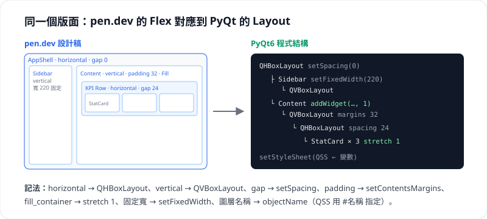

# 10.（延伸）設計稿轉 PyQt 桌面程式

> 同一套 pen.dev 設計方法，也能用在 Python 的 PyQt6 桌面程式。因為 pen.dev 的 Flex 排版和 Qt 的 Layout 觀念幾乎一樣，前面學的東西可以直接沿用。
>
> 建議先完成第 04、05、07 章。

---

## 觀念：Flex 排版 ↔ Qt Layout



pen.dev 只會匯出網頁程式碼，**PyQt 需要請 AI 依照設計稿轉換**。轉換規則很固定：

| pen.dev | PyQt6 |
| :--- | :--- |
| `layout: horizontal` / `vertical` | `QHBoxLayout` / `QVBoxLayout` |
| `gap` | `layout.setSpacing()` |
| `padding` | `layout.setContentsMargins(左, 上, 右, 下)`（注意順序和 CSS 不同） |
| `fill_container` | `addWidget(widget, 1)` 的 stretch 參數 |
| 固定寬度 | `setFixedWidth()` |
| `justifyContent: space_between` | 在中間 `addStretch()` |
| 圖層名稱 | `setObjectName()`，QSS 用 `#名稱` 選取 |
| 變數（含 `mode` 主題） | Python 字典，產生淺色／深色兩份 QSS |
| 元件 | 自訂的 `QWidget` / `QFrame` 類別 |
| `state` 變體（hover、disabled、checked） | QSS 偽狀態 `:hover`、`:disabled`、`:checked` |
| `shadow` 效果 | `QGraphicsDropShadowEffect`（QSS 不支援陰影） |
| `icon` | 匯出成 SVG 檔，用 `QIcon` 載入 |

**和網頁最大的差別**：桌面視窗通常不需要手機版。設計時只要做一個主要尺寸（例如 1100×640），並確認視窗拉大時哪些區域要 `fill_container` 跟著變大。

---

## 範例 A：登入視窗

<details>
<summary>📋 Prompt：先在 pen.dev 畫設計稿</summary>

```text
請在目前的 .pen 檔畫一個 PyQt 登入視窗設計稿「LoginWindow」：寬 400，vertical，padding 40，gap 28，白底。
- Header（vertical，gap 6）：Title「歡迎回來」22px 粗體、Subtitle「請輸入帳號與密碼」13px 灰色
- Form（vertical，gap 12）：AccountField、PasswordField（高 40，圓角 8，框線 #D1D5DB）、LoginButton（高 44，圓角 10，#2563EB）
節點名稱請使用英文（之後會變成 objectName）。
```

</details>

**換你動手：** 把 Form 的 gap 改成 16、LoginButton 圓角改成 22（膠囊形），之後轉出的程式碼應該跟著反映。

<details>
<summary>📋 Prompt：轉成 PyQt6</summary>

```text
請讀取 .pen 檔中的「LoginWindow」設計稿，轉成一個 PyQt6 程式 login_dialog.py：
- 用 QDialog，版面結構與設計稿的 Flex 排版一一對應（vertical → QVBoxLayout、gap → setSpacing、padding → setContentsMargins）。
- 每個 widget 的 objectName 使用設計稿的節點名稱，所有樣式寫在一份 QSS 字串裡，用 #objectName 選取。
- 密碼欄位要隱藏輸入；輸入框加上 :focus 樣式；按鈕加上 :hover 樣式。
- 在程式碼註解中標出每個 layout 對應的設計稿節點。
```

</details>

參考解答：[examples/login_dialog.py](./examples/login_dialog.py)。執行方式：

```bash
pip install PyQt6
python login_dialog.py
```

---

## 範例 B：後台主視窗（側邊欄＋統計卡＋深淺色）

<details>
<summary>📋 Prompt：設計稿＋轉換</summary>

```text
1. 在 .pen 檔畫「AppShell」：寬 1100、高 640，horizontal，gap 0。
   - Sidebar：寬 220 固定，vertical，padding [20, 16]，Logo、5 個 NavItem（第一個為 checked 狀態），最下方「切換深淺色」按鈕。
   - Content：fill_container，vertical，padding 32，gap 24：頁面標題「總覽」、KPI Row（horizontal，gap 24）放 3 個 StatCard 元件實例。
   - StatCard 元件：vertical，padding 20，gap 6，圓角 12，外陰影（y 8、blur 24）。
   - 所有顏色綁定有 mode 主題軸（light/dark）的變數。
2. 轉成 PyQt6 程式 app_shell.py：
   - 用 GetVariables 讀取變數，整理成 Python 字典，寫一個 build_qss(mode) 函式產生 QSS，按鈕可切換深淺色。
   - StatCard 寫成自訂 QFrame 類別；陰影用 QGraphicsDropShadowEffect。
   - NavItem 用 checkable 的 QPushButton 加 QButtonGroup，選取狀態用 QSS 的 :checked。
```

</details>

參考解答：[examples/app_shell.py](./examples/app_shell.py)。

**換你動手：**

1. 執行程式，按「切換深淺色」，確認所有顏色都有切換。
2. 把視窗拉寬，三張統計卡是否平均變寬？（`stretch 1` 就是 `fill_container`。）
3. 在 pen.dev 的變數面板把 dark 主題的 `primary` 改成紫色，然後請 AI「把變數變更同步到 app_shell.py 的 TOKENS」。
4. 試著把第 4 張統計卡加進設計稿，再請 AI 同步到程式碼。

---

## 常見錯誤

- **`setContentsMargins` 的順序**：Qt 是「左、上、右、下」，CSS 與 pen.dev 的四值 padding 是「上、右、下、左」。
- **QSS 寫了 `box-shadow` 沒效果**：Qt 不支援，請改用 `QGraphicsDropShadowEffect`。
- **元件沒有拉伸**：`addWidget` 沒有給 stretch 參數，或設了 `setFixedWidth`。

## 自我檢核

- [ ] 我能把 pen.dev 的 Flex 設定對應成 Qt 的 Layout 寫法。
- [ ] 我知道圖層名稱會變成 `objectName`，並用 QSS 的 `#名稱` 設定樣式。
- [ ] 我能用變數字典產生淺色、深色兩份 QSS。

## 延伸閱讀與影片教學

- **官方操作指南**
  - [.pen 格式與版面樹結構（The .pen Format）](https://docs.pen.dev/for-developers/the-pen-format)：了解 AI 如何讀取 `.pen` 的 Layout 與 Variables 結構，並將其映射至其他 GUI 框架。
  - [Qt 官方文件：Qt Style Sheets (QSS) 語法參考](https://doc.qt.io/qt-6/stylesheet-reference.html)：查詢 PyQt6 支援的所有 QSS 選擇器（如 `#objectName`）、偽狀態（`:hover`、`:checked`）與樣式屬性。
- **YouTube 操作影片**
  - [PyQt6 Layouts: QVBoxLayout, QHBoxLayout and QGridLayout](https://www.youtube.com/watch?v=trpI4ezSnlQ)：講解 PyQt6 的水平與垂直排版容器，可與 pen.dev 的 Flex `horizontal`／`vertical` 直接對照學習。
  - [PyQt6 CSS Stylesheets (QSS)](https://www.youtube.com/watch?v=TAL_CUH2cyI)：示範如何在 PyQt6 中使用類似 CSS 的 QSS 語法美化按鈕、輸入框與視窗介面。

---

🎉 **恭喜完成 pen.dev 全部課程！** 建議接著挑一個[產品需求實戰範例庫](../../產品需求實戰範例庫/README.md)的題目，從第 06 章的元件庫流程開始，獨立完成一個作品。
