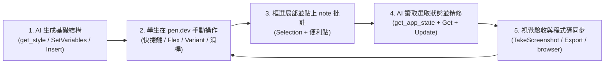

# pen.dev（Pencil）深度實戰：人機協作的 AI 向量設計畫布

> **最後更新**：2026 年 11 月  
> **核心理念**：AI 負責高速生成架構與設計系統，學生透過 `pen.dev` 介面親自操作微調，再將選取的畫面交回 AI 精修與同步程式碼。

---

## 為什麼選擇 pen.dev（Pencil）？

在傳統設計工具中，設計稿被鎖在封閉的雲端圖層裡，AI 往往只能「看截圖猜程式」；而在 **pen.dev（Pencil）** 中，整個無限畫布的底層就是一份開放且結構化的 **`.pen` JSON Schema（v2.25）**，實現真正的 **Design-in-Code（設計即程式碼）**：

1. **零付費門檻即可用 MCP**：無須 Figma 的 Full Seat 付費權限，安裝即可透過 Pencil MCP 讓 Antigravity、Claude 等 AI 代理直接讀寫畫布。
2. **完整的雙向控制（AI + 手動 UI）**：
   * **AI 控制**：透過 6 大 Pencil MCP 工具與 17 項 `execute` API，AI 可以一次建立 Light/Dark 雙主題變數、自動排列元件、用 `Generate` 生圖與轉向量、用 `browser` 逆向現成網站。
   * **學生手動控制**：AI 產出的每一個元素都是真實可編輯的向量節點！學生能隨時在畫布上按快捷鍵調整 **Flex 自動排版**、切換 **Component Variants**、修改 **SVG 錨點**，甚至直接拉動 AI 寫好的 **Script / Shader 參數滑桿**，即時看到視覺變化。
3. **無縫交棒機制（`get_app_state`）**：學生在畫布上用滑鼠框選哪個 Frame 或寫上 `note` 便利貼，AI 就能立即偵測選取狀態並接手修改，徹底告別「用文字描述半天 AI 卻改錯地方」的痛點。

---

## 人機協作三階段核心循環

在本章節的每一個練習中，我們都遵循這套「**AI 輔助 ↔ 學生手動**」的循環流程：

---

## pen.dev 全工具生態系總覽

| 功能層級 | 學生手動 UI 操作 | AI 控制介面（MCP / `execute` API） | 對應章節 |
| :--- | :--- | :--- | :--- |
| **環境與狀態** | Top Bar、Left Layers、Right Properties、AI Sidebar (`Cmd/Ctrl + K`) | `get_app_state`、`read_skill`、`get_style`（26 種內建風格）、`save` | [01](./01_介面導覽與手動工具全圖鑑.md)、[02](./02_MCP六大工具與Execute十七項API實戰.md) |
| **畫布節點類型** | `frame` (`A`/`F`)、`rectangle` (`R`)、`ellipse` (`O`)、`polygon`、`path` (`P`)、`line`、`text` (`T`)、`icon`、`note`、`group` (`Cmd+G`) | `Insert`、`Copy`、`Update`、`Replace`、`Move`、`Delete`、`FindEmptySpace` | [01](./01_介面導覽與手動工具全圖鑑.md)、[02](./02_MCP六大工具與Execute十七項API實戰.md) |
| **設計系統與元件** | Flex Auto Layout (`Shift+A`)、Create Component (`Cmd+Opt+K`)、Component Set (`Shift+Cmd+K`)、Variables 面板 | `SetVariables`、`GetVariables`、`reusable`、`variants`、`ref` + `descendants`、`slot` | [01](./01_介面導覽與手動工具全圖鑑.md)、[02](./02_MCP六大工具與Execute十七項API實戰.md) |
| **視覺填充與特效** | 純色、漸層、網格漸層、圖片裁切、Shadow、Blur、Background Blur | Fills（`color`/`gradient`/`image`/`mesh_gradient`/`shader`）與 Effects | [01](./01_介面導覽與手動工具全圖鑑.md)、[03](./03_Generate生圖轉向量與Script_Shader特效.md) |
| **AI 生圖與轉向量** | 右側面板預覽圖片填滿、手動調整生成後的 SVG `path` 錨點與填色 | `Generate` 6 大模式（`ai` / `stock` / `svg` / `remove-background` / `replace-background` / `vectorize-image`） | [03](./03_Generate生圖轉向量與Script_Shader特效.md) |
| **參數化程式藝術** | 在右側屬性面板拖曳 `@input` / `@range` 滑桿與選色器即時改圖 | `script` 節點（JS `@schema 2.11`）與 `shader`（WebGL 1.0 `.glsl` + `pencil:background` 折射） | [03](./03_Generate生圖轉向量與Script_Shader特效.md) |
| **除錯、網頁逆向與交付** | 畫布上即時互動 `browser` 節點、匯出設定面板 | `Get`（`ctx.bounds` / `ctx.problems`）、`Print`、`TakeScreenshot`、`Export`、`browser`（`import-to-canvas` 等 6 動作）、`@pen.dev/cli` | [02](./02_MCP六大工具與Execute十七項API實戰.md)、[04](./04_Browser網頁逆向與人機協作完整工作坊.md) |

---

## 本章學習路線圖（4 篇實戰指南）

### [01. 介面導覽與手動工具全圖鑑](./01_介面導覽與手動工具全圖鑑.md)
* 完整認識 Top Bar、圖層樹、屬性面板與快捷鍵，掌握所有 **13 種畫布節點**（含 Flex 排版鐵則、`ellipse` 圓環進度條、`Material Symbols` 內建圖示、`ref` & `variants` 元件、`note` 便利貼）與 5 種 Fills / 4 種 Effects。
* **動手 Lab 1**：用 Prompt 生成個人數位名片與數據小卡，再親手用快捷鍵微調 Flex 間距與圖示。

### [02. MCP 六大工具與 Execute 十七項 API 實戰](./02_MCP六大工具與Execute十七項API實戰.md)
* 徹底理解為什麼不能直接用一般讀檔工具讀 `.pen`，並實作 **6 大 Pencil MCP 工具** 與 **`execute` 內建 17 項 API**（空間搜尋、Light/Dark 雙主題變數、元件插槽替換、`ctx.problems` 排版溢出自動抓錯、`TakeScreenshot` 與 `Export`）。
* **動手 Lab 2**：建立雙主題 Design Tokens 與元件庫，並練習「學生滑鼠點選節點 → AI 透過 `get_app_state` 接手精修」。

### [03. Generate 生圖轉向量與 Script / Shader 特效](./03_Generate生圖轉向量與Script_Shader特效.md)
* 掌握 **`Generate` 6 大生圖與轉向量模式**（AI 生圖、Unsplash 圖庫、AI 生成可編輯 SVG、一鍵去背、AI 換背景、點陣圖轉向量）。
* 解鎖 `pen.dev` 最強黑科技：**`script` 參數化幾何腳本** 與 **WebGL `shader` 液態毛玻璃／即時光影**，讓 AI 寫出底層程式、學生直接在右側面板拉動滑桿調整設計！
* **動手 Lab 3**：製作電商商品去背換景卡片與互動式 Shader/Script 海報。

### [04. Browser 網頁逆向與人機協作完整工作坊](./04_Browser網頁逆向與人機協作完整工作坊.md)
* 實作 **`browser` 工具 6 大動作**（包含一鍵把任何真實網站變成可編輯向量的 `import-to-canvas`），以及在畫布旁即時並排預覽桌機（`1440px`）與手機（`390px`）`browser` 節點，並學會 `@pen.dev/cli` 終端機自動化指令。
* **終極工作坊**：從逆向參考網站、載入 `DESIGN.md` 生成全頁、學生手動微調與批註，到 `Export` 輸出程式碼的 4 階段完整專案實戰。

---

## 課前確認清單

在開始實戰前，請確認你的環境已就緒：
- [ ] 已下載並登入 **pen.dev（Pencil）** 桌面版或 IDE 外掛（VS Code / Cursor / Antigravity）。
- [ ] 已在 AI 編輯器中啟用 **Pencil MCP Server**（可參考 [課前準備](../課前準備/README.md) 與 [AI 設計畫布與 MCP 整合](../AI設計畫布與MCP整合/README.md)）。
- [ ] 在專案資料夾中準備好一份 `.pen` 練習檔案（例如 `practice.pen`）並於 pen.dev 中開啟。
