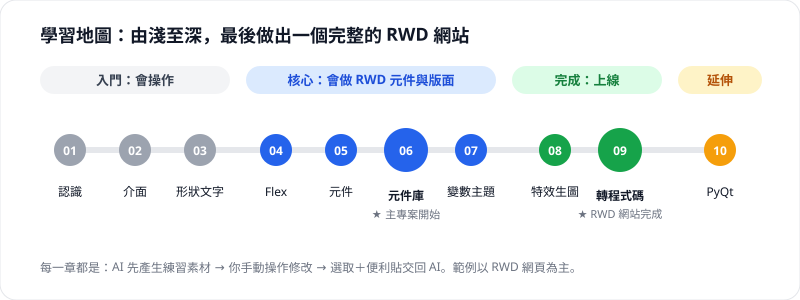

# pen.dev 實戰：AI 輔助的 RWD 網頁設計畫布

> **最後更新**：2026 年 11 月｜pen.dev 的介面與功能更新很快，若操作畫面與講義不符，請以 App 內的快捷鍵表（按 `?`）與[官方文件](https://docs.pencil.dev/)為準。

---

## pen.dev 是什麼？

**pen.dev**（MCP 工具名稱為 `pencil`）是一套無限畫布的介面設計工具，用起來和 Figma 很像：左邊是圖層、中間是畫布、右邊是屬性面板。

它最大的不同是：設計稿存成 `.pen` 檔，內容是一棵**結構清楚的節點樹**，排版規則就是 CSS 的 Flexbox。所以 AI 可以直接讀寫你的設計稿（不是看截圖猜），你手動改的東西 AI 也看得懂，而設計稿轉成 RWD 網頁時幾乎可以一對一對應。

這套教材**不要求你從空白畫布開始畫**。每一章都由 AI 先產生練習素材，再由你**親手操作每一個功能**，把它改好。學完後，你既能指揮 AI，也能在 AI 做錯時自己修好。

---

## 學完你能做到

- 用手動方式操作 pen.dev 的主要功能：圖層、形狀、文字、圖示、Flex 排版、元件與變體、變數與主題、填色與特效。
- 建立一套**網頁元件庫**（Button、TextField、Navbar、CourseCard、PricingCard、Footer…），並組成 Desktop／Tablet／Phone 三種尺寸的活動頁。
- 用「選取＋便利貼」精準地請 AI 修改指定區塊。
- 把設計稿轉成真正的 RWD 網頁，並在畫布上和設計稿並排驗收。
- （延伸）把設計稿轉成 PyQt6 桌面程式。

---

## 學習地圖

### 入門：會操作

| 章 | 你會學到 | 時間 |
| :--- | :--- | :--- |
| [01. 認識 pen.dev](./01_認識pen.dev/README.md) | pen.dev 是什麼、安裝、讓 AI 連上畫布 | 40 分 |
| [02. 介面與畫布基本操作](./02_介面與畫布基本操作/README.md) | 四大區域、選取、縮放、整理圖層、必學快捷鍵 | 50 分 |
| [03. 形狀、文字與圖示](./03_形狀文字與圖示/README.md) | 基本節點、文字換行、進度環、內建圖示庫 | 60 分 |

### 核心：會做 RWD 元件與版面

| 章 | 你會學到 | 時間 |
| :--- | :--- | :--- |
| [04. Flex 自動排版：RWD 的核心](./04_Flex自動排版_RWD的核心/README.md) | 方向、間距、對齊、Fixed／Hug／Fill，三種寬度的版面 | 90 分 |
| [05. 元件、實例與變體](./05_元件實例與變體/README.md) | 主元件、覆寫、variants、slot | 60 分 |
| [06. 網頁元件庫實戰](./06_網頁元件庫實戰/README.md) | ★ 主專案：從 Button 做到整頁 LearnHub 活動頁 | 3～4 小時 |
| [07. 變數與主題：深淺色與 RWD 斷點](./07_變數與主題_深淺色與RWD斷點/README.md) | 變數、深色模式、用 device 主題自動縮放 | 70 分 |

### 完成：上線

| 章 | 你會學到 | 時間 |
| :--- | :--- | :--- |
| [08. 填色、特效與 AI 生圖](./08_填色特效與AI生圖/README.md) | 漸層、照片、陰影、毛玻璃、Generate | 70 分 |
| [09. 從設計稿到 RWD 網頁程式碼](./09_從設計稿到RWD網頁程式碼/README.md) | ★ 選取交棒、轉成 HTML／React、browser 節點並排驗收 | 3 小時 |

### 延伸

| 章 | 你會學到 | 時間 |
| :--- | :--- | :--- |
| [10. 設計稿轉 PyQt 桌面程式](./10_延伸_設計稿轉PyQt桌面程式/README.md) | Flex ↔ Qt Layout、變數產生 QSS | 60 分 |

---

## 課前準備

- [ ] 已安裝 **pen.dev** 桌面版（建議，才有內建 AI 與 browser 節點），或 VS Code／Cursor 擴充套件。
- [ ] 已註冊並登入 pen.dev 帳號（第 08 章的 AI 生圖需要登入）。
- [ ] 準備一個 AI 工具：pen.dev 內建 AI，或 Claude Code、Codex、Gemini CLI、Antigravity 等（設定方式見第 01 章）。
- [ ] 建立一個課程資料夾，每章一個 `.pen` 檔（例如 `ch03.pen`）。
- [ ] 帳號與軟體的整體準備，請參考課程的[課前準備](../課前準備/README.md)。

---

## 附錄：手動操作 ↔ AI 指令對照

學會手動操作後，你會發現 AI 做的事和你做的是同一件事。下表可以幫你看懂 AI 回報的內容：

| 你手動做的事 | AI 使用的工具／函式 | 章節 |
| :--- | :--- | :--- |
| 看自己選了什麼、開了哪個檔 | `get_app_state` | 09 |
| 畫新元素、加子元素 | `execute` → `Insert` | 03 |
| 在屬性面板改數值 | `execute` → `Update` | 03、04 |
| `Cmd/Ctrl + D` 複製、拖出實例 | `execute` → `Copy`（元件會變成 `ref` 實例） | 05 |
| 拖曳圖層換順序 | `execute` → `Move` | 02 |
| 刪除 | `execute` → `Delete` | 02 |
| 在實例裡換掉一個子元素 | `execute` → `Replace` | 05 |
| 在變數面板建立／修改變數 | `execute` → `SetVariables` / `GetVariables` | 07 |
| 放大檢查有沒有跑版 | `execute` → `Get`（`ctx.problems`）、`TakeScreenshot` | 09 |
| 匯出圖片或 HTML | `execute` → `Export` | 08、09 |
| 生圖、去背、轉向量 | `execute` → `Generate` | 08 |
| 套用現成的視覺風格 | `get_style`（內建多種風格原型，例如 Soft Bento、Editorial Landscape Stack） | 06 |
| 匯入真實網站、操作 browser 節點 | `browser`（`load-page`、`import-to-canvas`、`return-screenshot`…） | 09 |
| `Cmd/Ctrl + S` 存檔 | `save` | 01 |

> 小技巧：沒有指定品牌風格時，可以在 Prompt 裡加一句「先用 `get_style` 列出可用風格，推薦三種給我選」，讓 AI 先提案再動工。
