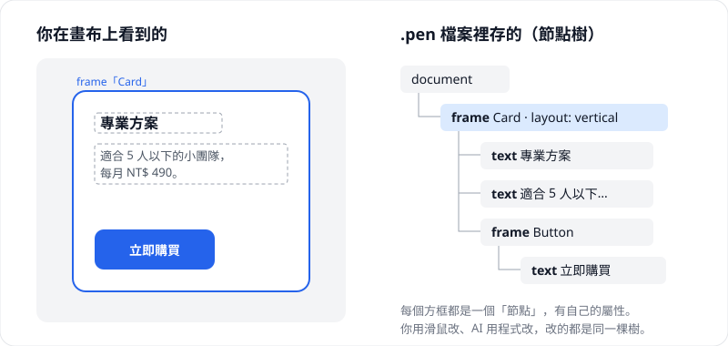

# pen.dev 實戰：AI 輔助的 RWD 網頁設計畫布

## pen.dev 是什麼？

**pen.dev** 是一套介面設計工具，用起來和 Figma 很像：左邊是圖層，中間是畫布，右邊是屬性面板。

它和其他工具最大的不同，是設計稿裡的每個東西都是清楚的「節點」，排版規則就是網頁的 Flexbox。所以：

- **AI 可以直接修改你的設計稿**，不是看截圖猜。
- **你手動改的地方，AI 也看得懂。**
- **設計稿轉成 RWD 網頁時，幾乎可以一對一對應。**

---

## 這套教材怎麼學？

不需要從空白畫布一筆一筆畫。每一章都是三個步驟：

1. **AI 先做**：貼上 Prompt，AI 在畫布上產生練習用的設計。
2. **你動手改**：用面板、快捷鍵、拖曳，親手操作每一個功能。
3. **交回 AI**：選取要改的地方、貼上便利貼，讓 AI 精修或轉成程式碼。

學完後，你既能指揮 AI，也能在 AI 做錯時自己修好。

---

## 學習地圖

### 入門：學會操作

- [01. 認識 pen.dev](./01_認識pen.dev/README.md)：pen.dev 是什麼、安裝、讓 AI 連上畫布。
- [02. 介面與畫布基本操作](./02_介面與畫布基本操作/README.md)：選取、縮放、整理圖層與必學快捷鍵。
- [03. 形狀、文字與圖示](./03_形狀文字與圖示/README.md)：基本節點、文字換行、進度環、內建圖示。

### 核心：做出 RWD 元件與版面

- [04. Flex 自動排版：RWD 的核心](./04_Flex自動排版_RWD的核心/README.md)：方向、間距、對齊，以及桌機、平板、手機三種版面。
- [05. 元件、實例與變體](./05_元件實例與變體/README.md)：改一個地方，整個網站一起更新。
- [06. 網頁元件庫實戰](./06_網頁元件庫實戰/README.md)：★ 主專案，從按鈕做到整頁 LearnHub 活動頁。
- [07. 變數與主題：深淺色與 RWD 斷點](./07_變數與主題_深淺色與RWD斷點/README.md)：一鍵切換深色模式，手機版字級與留白自動縮小。

### 完成：變成真正的網頁

- [08. 填色、特效與 AI 生圖](./08_填色特效與AI生圖/README.md)：漸層、照片、陰影、毛玻璃，以及用 AI 產生圖片。
- [09. 從設計稿到 RWD 網頁程式碼](./09_從設計稿到RWD網頁程式碼/README.md)：★ 完成作品，把設計稿轉成網頁，並在畫布上和設計稿並排檢查。

### 延伸

- [10. 設計稿轉 PyQt 桌面程式](./10_延伸_設計稿轉PyQt桌面程式/README.md)：同樣的設計方法，用在 Python 桌面程式。

---

## 開始前的準備

- [ ] 安裝 **pen.dev** 桌面版（建議），或 VS Code／Cursor 擴充套件。
- [ ] 註冊並登入 pen.dev 帳號。
- [ ] 準備一個 AI 工具：pen.dev 內建 AI，或 Claude Code、Codex、Gemini CLI 等（第 01 章會教你設定）。
- [ ] 建立一個課程資料夾，每章存一個 `.pen` 檔，例如 `ch03.pen`。

帳號與軟體的整體準備，請看[課前準備](../課前準備/README.md)。

> [!TIP]
> pen.dev 更新很快。畫面和講義不一樣時，在畫布上按 `?` 可以看到最新的快捷鍵，也可以隨時查閱 [pen.dev 官方網站](https://www.pen.dev/)、[官方操作文件](https://docs.pen.dev/)，或先看 [YouTube：Pencil 01 Vibe Design 入門實戰影片](https://www.youtube.com/watch?v=DSow83bnO4g) 快速建立整體概念。
