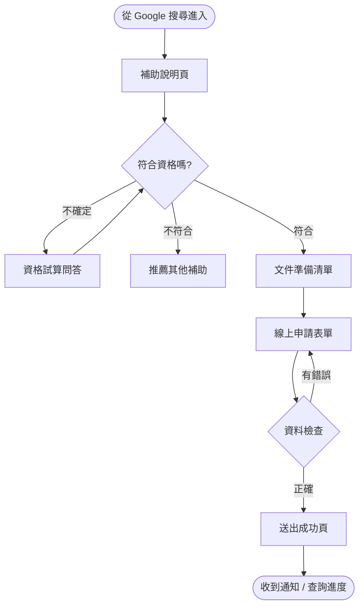

# 定義使用者與需求：先想清楚「為誰做、做什麼」 👥

在 [如何評估現有的網站](../如何評估現有的網站/README.md) 中，我們找出了舊網站的問題；在 [網站架構觀念](../網站架構觀念/README.md) 中，我們學會了版型與導覽的原則。但在動手做原型之前，還有一個最容易被跳過、卻最關鍵的步驟：**這個網站到底是為誰做的？他們來網站想完成什麼事？**

AI 可以在幾秒內生成十個漂亮的首頁，但如果沒有先定義使用者與需求，你只會得到十個「漂亮但不知道對不對」的首頁。

> [!IMPORTANT]
> **UI 回答「長什麼樣子」，UX 回答「為什麼這樣做」。**
> 本單元的產出（Persona、使用者旅程、任務流程、線框圖）是後面所有單元的依據：原型要服務哪個 Persona、`DESIGN.md` 要營造什麼感覺、易用性測試要測哪些任務，全部從這裡來。

---

## 📖 本單元學習目錄

1. [Persona（人物誌）：把「使用者」變成一個具體的人](#1-persona人物誌把使用者變成一個具體的人)
2. [使用者旅程地圖：看見使用者在每個階段的感受](#2-使用者旅程地圖看見使用者在每個階段的感受)
3. [任務流程（User Flow）：使用者怎麼一步步完成任務](#3-任務流程user-flow使用者怎麼一步步完成任務)
4. [線框圖（Wireframe）：先決定「放什麼、放哪裡」](#4-線框圖wireframe先決定放什麼放哪裡)
5. [需求優先順序：不是每個需求都要做](#5-需求優先順序不是每個需求都要做)

---

## 🛠️ 本單元實作一覽

| 編號 | 實作內容 | 產出 |
| :--- | :--- | :--- |
| 3-1 | 收集使用者資料，請 AI 整理成 Persona | `persona.md` |
| 3-2 | 為主要 Persona 畫出使用者旅程地圖 | `journey.md` |
| 3-3 | 挑一個核心任務，畫出任務流程圖 | `user-flow.md`（Mermaid 流程圖） |
| 3-4 | 生成低保真線框圖並調整 | `wireframe.html` |
| 3-5 | 用 MoSCoW 排出需求優先順序 | `requirements.md` |

> [!TIP]
> 請沿用 [課前準備](../課前準備/README.md) 建議的 `my-design-lab/03-requirements/` 資料夾存放本單元產出，後面的單元會一直用到。

---

## 1. Persona（人物誌）：把「使用者」變成一個具體的人

### 為什麼需要 Persona？

「我們的使用者是一般民眾」——這句話對設計毫無幫助。一般民眾包括 20 歲的大學生、45 歲的上班族、75 歲的長輩，他們的需求完全不同。

**Persona** 是根據真實使用者資料歸納出的「代表人物」，有名字、年齡、目標、痛點與使用情境。團隊討論時不再說「使用者會不會喜歡」，而是說「**王小姐會不會在午休 10 分鐘內完成申請**」。

### 一份 Persona 包含什麼？

| 欄位 | 說明 | 範例 |
| :--- | :--- | :--- |
| **基本資料** | 名字、年齡、職業、使用裝置 | 王怡君，38 歲，會計，主要用手機 |
| **目標** | 來網站想完成什麼 | 幫小孩申請托育補助 |
| **痛點** | 目前遇到什麼困難 | 不知道自己符不符合資格、要準備哪些文件 |
| **使用情境** | 在什麼時間、地點、心情下使用 | 午休時間、在辦公室用手機、只有 10 分鐘 |
| **數位能力** | 對網路操作的熟悉程度 | 會網購，但不熟悉政府網站的用語 |
| **一句話** | 代表這個人的心聲 | 「我只想知道我能不能申請，不要叫我看法規。」 |

### Persona 的資料從哪裡來？

> [!WARNING]
> **AI 生成的 Persona 只是「假設」，不是「事實」。**
> 如果完全憑空請 AI 生成 Persona，得到的只是刻板印象。請盡量提供真實資料給 AI 整理，並在文件上標註哪些是已驗證、哪些是推測。

| 資料來源 | 取得方式 |
| :--- | :--- |
| 網站流量分析 | Google Analytics 的年齡、裝置、熱門頁面、跳出率 |
| 客服紀錄 | 最常被問的問題、最常被抱怨的地方 |
| 使用者訪談 | 找 3～5 位真實使用者聊 20 分鐘 |
| 單元 1 的評估報告 | AI 找出的痛點，可以推測受影響的使用者 |
| 問卷 | 用 Google 表單收集使用目的與滿意度 |

### 實作 3-1：請 AI 整理 Persona

```text
我正在改版 [網站名稱]（[網址]）。以下是我收集到的使用者資料：

[貼上：流量數據摘要、客服常見問題、訪談筆記、單元 1 評估報告重點……]

請根據這些資料：
1. 歸納出 2～3 個主要使用者類型，各寫成一份 Persona
   （欄位：名字、年齡、職業、裝置、目標、痛點、使用情境、數位能力、一句話）。
2. 每個欄位標註【資料支持】或【推測】，推測的部分請說明需要什麼資料來驗證。
3. 指出哪一個 Persona 應該是這次改版的「主要 Persona」，並說明理由。
請用 Markdown 輸出，我要存成 persona.md。
```

---

## 2. 使用者旅程地圖：看見使用者在每個階段的感受

### 什麼是使用者旅程地圖？

**使用者旅程地圖（User Journey Map）** 把使用者從「產生需求」到「完成任務」的完整過程攤開來，記錄每個階段的 **行為、想法、情緒與痛點**。它讓團隊看見：問題不只發生在網站上，也可能發生在網站之前或之後。

### 旅程地圖的結構

| 階段 | 察覺需求 | 尋找資訊 | 確認資格 | 線上申請 | 等待結果 |
| :--- | :--- | :--- | :--- | :--- | :--- |
| **行為** | 聽同事說有補助 | Google 搜尋「托育補助」 | 閱讀申請資格頁面 | 填寫線上表單、上傳文件 | 等待通知 |
| **想法** | 「我也可以申請嗎？」 | 「哪一個才是官方網站？」 | 「這些條文到底在說什麼？」 | 「戶籍謄本要去哪裡拿？」 | 「到底審核到哪裡了？」 |
| **情緒** | 😊 期待 | 😐 困惑 | 😟 挫折 | 😫 焦慮 | 😐 不安 |
| **痛點** | — | 搜尋結果太多 | 資格說明全是法規文字 | 不知道要準備什麼文件 | 沒有進度查詢 |
| **機會** | — | 改善 SEO 標題 | 做「資格試算」互動問答 | 申請前先列出文件清單 | 提供進度查詢頁面 |

> [!TIP]
> **情緒最低點就是改版最優先的地方。** 上表中「確認資格」與「線上申請」是情緒谷底，改版資源應該優先投入這兩個階段。

### 實作 3-2：請 AI 畫出使用者旅程地圖

```text
請根據附件的 persona.md 中的「主要 Persona」，
針對「[核心任務，例如：申請托育補助]」這個任務，畫出使用者旅程地圖。

1. 分成 4～6 個階段，從「產生需求」到「完成任務之後」。
2. 每個階段列出：行為、想法（用 Persona 的口吻）、情緒（用表情符號＋文字）、痛點、改善機會。
3. 用 Markdown 表格輸出。
4. 最後標出情緒最低的兩個階段，說明為什麼應該優先改善。
```

---

## 3. 任務流程（User Flow）：使用者怎麼一步步完成任務

### 從「旅程」聚焦到「網站上的操作」

旅程地圖看的是全貌，**任務流程** 則聚焦在網站上：使用者從哪個頁面進來、點了什麼、遇到什麼判斷、最後到達哪裡。畫出流程，就能發現多餘的步驟、斷掉的路徑與缺少的頁面。

### 流程圖的基本符號

| 形狀 | 意義 |
| :--- | :--- |
| 圓角矩形 | 開始／結束 |
| 矩形 | 頁面或畫面 |
| 菱形 | 使用者的判斷或系統的檢查 |
| 箭頭 | 流向 |

### 用 Mermaid 讓 AI 直接畫流程圖

**Mermaid** 是一種用文字描述流程圖的語法，GitHub、Notion 與許多 Markdown 編輯器都能直接顯示成圖。AI 非常擅長寫 Mermaid，你只要描述流程即可。



> [!NOTE]
> 畫流程時請回頭對照 [垂直、水平、前後的立體構造](../網站架構觀念/垂直_水平_前後的立體構造/README.md)：每一步是換頁（垂直／水平移動）還是在原頁面彈出（前後關係）？能不能用 [無縫式介面](../網站架構觀念/無縫式介面/README.md) 減少換頁？

### 實作 3-3：請 AI 畫出任務流程

```text
請根據 persona.md 與 journey.md，
為「[核心任務]」設計改版後的網站任務流程：

1. 用 Mermaid flowchart TD 語法輸出流程圖。
2. 標出使用者需要做判斷的地方（菱形），並設計「答案是否定」時的路徑，不能有死路。
3. 標註哪些步驟可以用無縫式介面（覆蓋式、嵌入式、無縫式步驟）完成、不需要換頁。
4. 和舊網站相比，列出減少了哪些步驟。
```

---

## 4. 線框圖（Wireframe）：先決定「放什麼、放哪裡」

### 為什麼先畫線框圖，不直接做漂亮的原型？

**線框圖** 是只有灰階方塊、文字標示與基本版型的低保真草圖。它刻意不處理顏色、字體與圖片，讓大家 **只討論內容與排列**。

| | 線框圖（低保真） | 原型（高保真） |
| :--- | :--- | :--- |
| 討論焦點 | 放什麼內容、優先順序、版型 | 色彩、字體、視覺風格、互動 |
| 修改成本 | 極低，幾分鐘就能重來 | 較高 |
| 常見回饋 | 「申請按鈕應該放在更上面」 | 「藍色太深了」 |
| 適合時機 | 需求還在討論 | 結構已經確定 |

> [!TIP]
> 給主管或客戶看高保真原型時，討論常常會被顏色和圖片帶走。**先用線框圖確認結構，再進入原型**，可以省下大量來回修改的時間。

### 實作 3-4：用 AI 生成可點擊的線框圖

```text
請根據 user-flow.md 中的流程，製作一個低保真線框圖 wireframe.html：

1. 只用灰階（白、淺灰、深灰、黑），不要任何品牌色與真實圖片，圖片用帶 X 的灰色方塊表示。
2. 每個區塊用文字標示用途，例如「[主要行動按鈕：立即申請]」。
3. 包含流程中的每一個頁面，頁面之間的按鈕可以點擊切換。
4. 版型參考網站架構觀念：手機版單欄、電腦版雙欄。
5. 使用單一 HTML 檔，不需要外部函式庫。
```

產出後請自己檢查：

- [ ] 主要 Persona 的核心任務，是否能在首屏看到入口？
- [ ] 每個頁面都能回答「我在哪裡、我能去哪裡」嗎？（[掌握身在何處的四個元素](../網站架構觀念/垂直_水平_前後的立體構造/README.md)）
- [ ] 流程中有沒有死路？
- [ ] 有沒有可以刪掉的區塊？（[讓介面變得極簡](../網站架構觀念/設計的講究之處/README.md)）

---

## 5. 需求優先順序：不是每個需求都要做

### MoSCoW 法

改版時，各單位都會提出需求，但資源有限。**MoSCoW** 是一個簡單的分類法：

| 分類 | 意義 | 判斷標準 |
| :--- | :--- | :--- |
| **M**ust have | 一定要有 | 沒有它，主要 Persona 就無法完成核心任務 |
| **S**hould have | 應該要有 | 很重要，但暫時有替代方案 |
| **C**ould have | 有的話更好 | 加分項目，有餘力再做 |
| **W**on't have (this time) | 這次不做 | 明確寫下來，避免日後爭論 |

### 實作 3-5：請 AI 協助排優先順序

```text
以下是這次改版收集到的需求清單：
[貼上需求清單，例如：資格試算、文件清單、進度查詢、首頁大輪播、多國語言、聊天機器人……]

請根據 persona.md 的主要 Persona 與 journey.md 的痛點，
用 MoSCoW 法分類這些需求，每一項說明理由（對應到哪個痛點或哪個 Persona）。
最後請把 Must have 的項目整理成一段「本次改版目標」，我要放進 requirements.md 的開頭。
```

---

## 🔄 與本課程其他單元的連動關係

```text
[1. 網站評估] 找出舊網站的問題
       ↓
[2. 網站架構觀念] 版型、導覽、一致性原則
       ↓
[3. 定義使用者與需求] Persona、旅程、任務流程、線框圖  ◀── 本單元
       ↓
[4. 建立提案用的原型網頁] 依線框圖探索視覺氛圍，做出高保真原型
       ↓
[8. 易用性測試] 用本單元定義的「核心任務」測試原型
```

---

[⬅️ 返回主目錄](../README.md)
