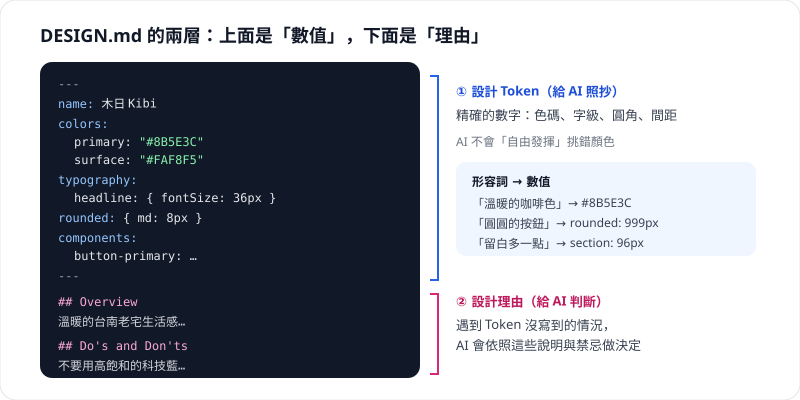

# 01. 認識 DESIGN.md：把「設計感」寫成 AI 看得懂的規範

> 這一章你會知道 DESIGN.md 是什麼、長什麼樣子，並親手做一次「有規範 vs. 沒規範」的對照實驗。

---

## DESIGN.md 是什麼？

AI 做出來的網頁常常「每一頁長得不一樣」，或是千篇一律的公版風格。原因很簡單：**你沒告訴它你的設計規則。**

**DESIGN.md** 就是一份寫給 AI 看的「設計規範書」。它是一個普通的文字檔，放在專案資料夾裡，寫清楚網站的顏色、字型、圓角、間距、按鈕長怎樣、什麼事不能做。AI 讀了它，每一頁都會遵守同一套規則。

這個格式由 Google 在 Stitch 中推出，並在 2026 年 4 月公開成開放規格，現在 Claude、Stitch、pen.dev 等工具都能讀。

| 檔案 | 寫給誰看 | 回答什麼問題 |
| :--- | :--- | :--- |
| `README.md` | 人 | 這個專案是什麼？ |
| `AGENTS.md` | 寫程式的 AI | 這個專案怎麼寫程式、怎麼測試？ |
| `DESIGN.md` | 做設計的 AI | **這個網站應該長什麼樣子？** |

---

## 觀念：DESIGN.md 有兩層



**上層：設計 Token（夾在兩行 `---` 之間）**

用精確的數值定義規則，AI 會直接照抄，不會自由發揮：

```yaml
---
name: 木日 Kibi                    # 設計系統／品牌名稱
colors:                            # 色彩設定
  primary: "#8B5E3C"               # 品牌主色：主要按鈕、連結
  surface: "#FAF8F5"               # 頁面底色
  text: "#1E1B18"                  # 主要文字（不用純黑）
typography:                        # 字體與排版設定
  headline:                        # 標題文字樣式
    fontFamily: Noto Serif TC      # 標題字型（思源宋體／襯線字）
    fontSize: 36px                 # 標題字級大小
    fontWeight: 700                # 標題字重（粗體）
  body:                            # 內文文字樣式
    fontFamily: Noto Sans TC       # 內文字型（思源黑體／無襯線字）
    fontSize: 17px                 # 內文字級大小
    lineHeight: 1.7                # 內文行高（1.7 倍）
rounded:                           # 圓角設定
  md: 8px                          # 中等圓角尺寸
spacing:                           # 間距設定
  section: 96px                    # 大區塊之間的上下間距
components:                        # 元件樣式設定
  button-primary:                  # 主要按鈕元件
    backgroundColor: "{colors.primary}" # 按鈕底色（引用品牌主色）
    textColor: "#FFFFFF"           # 按鈕文字顏色（純白）
    rounded: "{rounded.md}"        # 按鈕圓角（引用中等圓角）
---
```

`"{colors.primary}"` 叫做**引用**：按鈕不寫死色碼，而是「使用 primary 這個顏色」。之後品牌色要改，只改一個地方。

**下層：設計理由（Markdown 章節）**

用文字說明「為什麼」與「不能做什麼」。Token 沒寫到的情況，AI 會依照這些說明判斷。官方規格的章節順序是：

| 順序 | 章節 | 寫什麼 |
| :--- | :--- | :--- |
| 1 | Overview | 品牌個性、目標對象、整體感覺 |
| 2 | Colors | 每個顏色的用途 |
| 3 | Typography | 字型怎麼搭配、各級標題怎麼用 |
| 4 | Layout | 版面寬度、間距、欄數、手機版怎麼排 |
| 5 | Elevation & Depth | 陰影與層次 |
| 6 | Shapes | 圓角、形狀 |
| 7 | Motion & Micro-interaction | 動畫與互動回饋 |
| 8 | Voice & Content Strategy | 文案語氣 |
| 9 | Components | 按鈕、卡片、表單等元件 |
| 10 | Do's and Don'ts | 該做與不能做的事 |

不需要每一章都寫，但寫了就要照這個順序。

> [!NOTE]
> 網路上有些 DESIGN.md 範例（例如社群整理的 awesome-design-md）用的是另一種章節名稱，例如「Visual Theme & Atmosphere」、「Agent Prompt Guide」。AI 一樣看得懂，但本課程統一使用 Google 官方規格，在各種工具之間比較不會出問題。

---

## 實作：有規範 vs. 沒規範

1. 開一個練習資料夾，用你的 AI 工具（Claude、Claude Code、Cursor 等）打開。
2. **第一次（沒有規範）**：

<details>
<summary>📋 Prompt</summary>

```text
幫我做一個咖啡店首頁：包含導覽列、主視覺、三款招牌咖啡卡片、營業資訊、頁尾。
```

</details>

3. **第二次（有規範）**：在資料夾新增 `DESIGN.md`，貼上上面那段 YAML，然後說：

<details>
<summary>📋 Prompt</summary>

```text
請讀取 DESIGN.md，嚴格依照裡面的顏色、字型、圓角、間距與按鈕設定，
做一個內容相同的咖啡店首頁。
```

</details>

4. 並排比較兩次做出來的畫面：
   - 顏色是不是從「AI 隨便挑」變成「你指定的咖啡色」？
   - 標題字型有沒有變成襯線字？
   - 按鈕圓角是不是一致？

---

## 練習：把形容詞翻譯成規則

AI 聽不懂形容詞，聽得懂具體的規則。試著把左邊翻譯成右邊：

| ❌ 形容詞 | ✅ AI 能執行的規則 |
| :--- | :--- |
| 溫暖一點 | 背景用米白 `#FAF8F5`，不用純白；主色用暖棕 `#8B5E3C` |
| 高級感 | 區塊上下間距 96px；標題用襯線字；不用陰影，用 1px 細線 |
| 好讀 | 內文 17px、行高 1.7、每行不超過 40 個中文字 |
| 不要太花 | 一個畫面最多一個主要按鈕；除了主色不再新增其他鮮豔顏色 |

**換你試試：** 把「年輕有活力」和「專業可信賴」各翻譯成三條規則。

想不出來的話，下一章的風格圖鑑會給你很多現成的關鍵字。

---

## 常見錯誤

- **只寫顏色**：至少要有顏色、字型、圓角與主要按鈕的設定。
- **寫形容詞不寫數值**：「圓一點」不如「`rounded.md: 12px`」。
- **用純黑 `#000000` 當文字色**：在螢幕上太刺眼，通常用很深的灰或咖啡色。

## 自我檢核

- [ ] 我能說出 DESIGN.md 的上下兩層各寫什麼。
- [ ] 我看得懂 `"{colors.primary}"` 這種引用寫法。
- [ ] 我做過有規範與沒規範的對照實驗，看得出差別。

---

[下一章：02. 常用設計風格圖鑑 →](./02_常用設計風格圖鑑.md)
