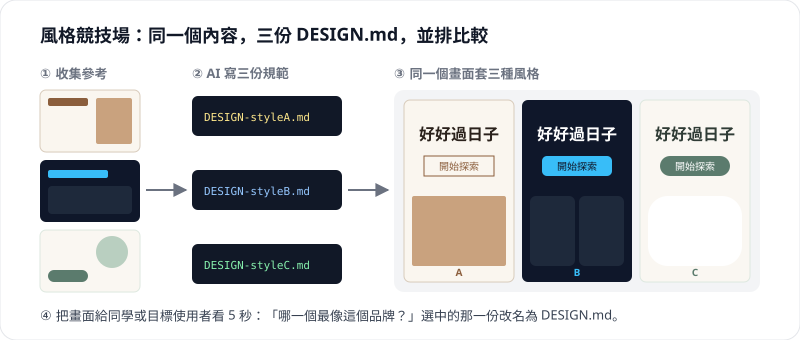

# 02. 參考靈感網站與風格比稿

> 腦袋裡沒有畫面時，就去看別人怎麼做。這一章介紹最常用的靈感網站，教你看出一個網站屬於哪種風格，再請 AI 一次做三種風格比稿，選出最適合的方向。

---

## 去哪裡找靈感？

| 網站 | 看什麼 | 適合找 |
| :--- | :--- | :--- |
| [Land-book](https://land-book.com/)、[Lapa Ninja](https://www.lapa.ninja/) | 依產業分類的優秀網頁 | 整頁版型、區塊順序（**新手最推薦**） |
| [Mobbin](https://mobbin.com/) | 真實上線產品的畫面與流程 | 註冊、結帳、篩選等功能怎麼設計 |
| [Dribbble](https://dribbble.com/)、[Behance](https://www.behance.net/) | 設計師的概念作品 | 配色、字型搭配、氛圍（但不一定做得出來） |
| [Awwwards](https://www.awwwards.com/) | 得獎網站 | 動畫、互動、大膽的版面 |
| [Figma Community](https://www.figma.com/community) | 開放下載的設計檔與 UI Kit | 拆解別人的元件與設計系統 |
| [awesome-design-md](https://github.com/VoltAgent/awesome-design-md) | 社群整理的各品牌 DESIGN.md | 直接參考寫好的規範（第 04 章路線 B） |

**找靈感的小技巧：** 不要只找同產業的網站。咖啡館網站可以參考雜誌、選品店、旅館的設計，常常會有更新鮮的想法。

---

## 怎麼看出一個網站是什麼風格？

看到喜歡的網站，用這張表檢查，再對照第 03 章的風格圖鑑：

| 看這裡 | 問自己 | 提示 |
| :--- | :--- | :--- |
| 背景色 | 白、米白、深色，還是彩色？ | 深色＋金色 → 暗黑奢華；亮黃＋黑框 → 新粗野主義 |
| 標題字型 | 襯線（有腳）還是無襯線？ | 襯線 → 編輯雜誌風或暗黑奢華 |
| 圓角 | 直角、小圓角，還是很圓？ | 很圓 → 柔和療癒或便當盒；直角 → 瑞士風或新粗野 |
| 陰影 | 沒有、很淡、還是很硬？ | 黑色硬陰影 → 新粗野主義 |
| 留白 | 很多還是很擠？ | 很多 → 極簡、雜誌、奢華 |
| 圖片比重 | 照片是主角嗎？ | 大張照片 → 編輯雜誌風 |
| 版面 | 置中、靠左、格子？ | 格子 → 便當盒；超大字靠左 → 瑞士風 |

**換你練習：** 在 Land-book 找 3 個你喜歡的網站，截圖存下來，用上表判斷各是什麼風格，寫在截圖旁邊。

也可以請 AI 幫你判斷：

<details>
<summary>📋 Prompt：請 AI 分析截圖的風格</summary>

```text
附件是一個網站的截圖。請告訴我：
1. 它最接近哪一種設計風格（例如極簡、編輯雜誌、現代 SaaS、便當盒格狀、新粗野主義、瑞士格線、玻璃擬態、柔和療癒、暗黑奢華、公共服務）
2. 判斷的理由（背景、字型、圓角、陰影、留白、版面）
3. 它的主色、輔色、背景色大約是什麼色碼
4. 如果我要做類似的感覺，可以給 AI 哪些關鍵字
```

</details>

---

## 實作：風格競技場



真正的設計師不會只做一個版本就定案。做法是：**同一個內容，做三種風格，並排比較，再挑一個。**

### 步驟 1：準備

1. 從〈[產品需求實戰範例庫](../產品需求實戰範例庫/README.md)〉挑一個題目（以下用木日 Kibi 咖啡館示範）。
2. 從第 03 章挑三種**差異明顯**的風格，例如：編輯雜誌風、暗黑奢華、柔和療癒。
3. 如果有參考截圖，放進專案的 `refs/` 資料夾。

### 步驟 2：請 AI 做三份規範與比較頁

<details>
<summary>📋 Prompt</summary>

```text
請為【木日 Kibi 台南老宅咖啡館一週年活動】做三種不同風格的設計提案：
- 風格 A：【編輯雜誌風】關鍵字【襯線標題、大張照片、細線分隔、暖色紙張底、留白多】
- 風格 B：【暗黑奢華】關鍵字【近黑背景、金色細線、襯線字置中、字距拉寬】
- 風格 C：【柔和療癒】關鍵字【低飽和自然色、大圓角、膠囊按鈕、淡淡的陰影】
（如果我有附上參考截圖，請一併參考。）

請完成：
1. 三份完整的 DESIGN.md，分別存成 DESIGN-styleA.md、DESIGN-styleB.md、DESIGN-styleC.md，
   依照官方格式（YAML Token＋Overview、Colors、Typography、Layout、Components、Do's and Don'ts），字型要包含繁體中文。
2. 一個比較頁 style-arena.html：上方有「A／B／C」切換按鈕（或三欄並排），
   用同樣的內容（主標語、副標語、立即訂位按鈕、兩張咖啡豆卡片）分別套用三種風格。
```

</details>

### 步驟 3：比稿與選擇

1. 用瀏覽器打開 `style-arena.html`。
2. 把畫面給一位同學（或符合目標對象的人）看 **5 秒**，問他：「哪一個最像一間台南老宅咖啡館？」
3. 再問自己三個問題：
   - 哪一個最符合目標對象的喜好？
   - 哪一個讓「立即訂位」最明顯？
   - 哪一個做成手機版還會好看？
4. 選定後，把那一份（例如 `DESIGN-styleA.md`）**複製並改名為 `DESIGN.md`**。另外兩版有喜歡的小地方，可以請 AI 融合進來，但不要全部混在一起。

---

## 常見錯誤

- **三種風格太接近**：例如極簡和現代 SaaS 放在一起比，差異太小。選地圖上距離遠的風格。
- **只問自己喜不喜歡**：要問目標對象。你喜歡的不一定是使用者需要的。
- **直接照抄參考網站**：參考是學它的配色比例與版面節奏，顏色、Logo、文字都要換成自己的。

## 自我檢核

- [ ] 我知道去哪個網站找哪一種靈感。
- [ ] 我能看著一個網站，說出它屬於哪種風格與判斷理由。
- [ ] 我完成了風格競技場，並選出一份 DESIGN.md。

---

[下一章：03. 常用設計風格圖鑑 →](./03_常用設計風格圖鑑.md)
