# 02. 常用設計風格圖鑑

> 「我想要有質感一點」，AI 聽不懂；「我想要編輯雜誌風」，AI 就知道怎麼做。這一章用同一個示範網頁，畫出 10 種最常用的設計風格，讓你一眼看懂差別，並知道怎麼跟 AI 說。

---

## 先看地圖：你的網站要理性還是感性？

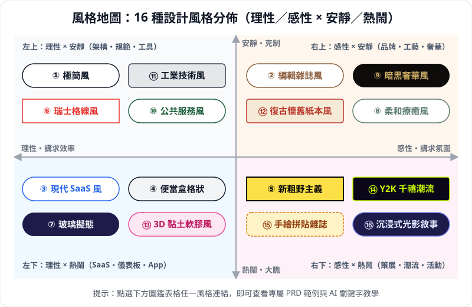

選風格之前，先回答兩個問題：

1. **理性還是感性？** 使用者是來「完成事情」（申請、購買、查資料），還是來「感受氛圍」（逛品牌、看作品）？
2. **安靜還是熱鬧？** 品牌個性是沉穩克制，還是大膽好玩？

答案落在哪個象限，就從那一區的風格開始挑。下面每一種風格，都用同一個示範網頁「Lumen」來畫，內容完全相同，只有風格不同，方便你比較。

> [!TIP]
> 每種風格都附有「**給 AI 的關鍵字**」。把這一行貼進 Prompt，就能讓 AI 朝這個方向設計。

---

## ① 極簡風（Minimalism）

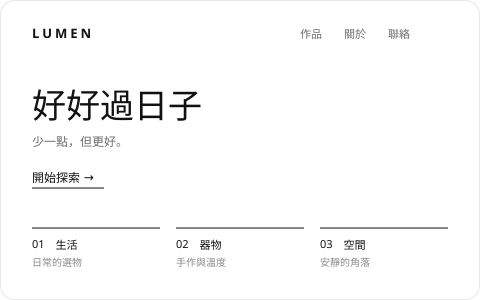

**一句話：少即是多，只留下必要的東西。**

| | |
| :--- | :--- |
| 適合 | 作品集、設計工作室、建築師、高價單品 |
| 不適合 | 資訊很多的頁面（電商列表、新聞），會顯得空洞難找 |
| 顏色 | 白 `#FFFFFF`＋黑 `#111111`＋灰 `#6B6B6B`，最多一個重點色 |
| 字型 | 細的無襯線字（Noto Sans TC 300、Inter） |
| 形狀 | 幾乎不用圓角與陰影，用細線分隔 |
| 給 AI 的關鍵字 | `極簡、大量留白、黑白灰、細線條、無陰影、只保留必要元素` |

---

## ② 編輯雜誌風（Editorial）

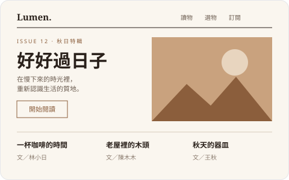

**一句話：像翻開一本生活雜誌，文字和照片都很講究。**

| | |
| :--- | :--- |
| 適合 | 咖啡館、選品店、文創品牌、深度旅遊、部落格 |
| 不適合 | 需要快速操作的工具或後台 |
| 顏色 | 紙張米白 `#FAF6EF`＋深咖啡字 `#2A211B`＋暖棕重點色 `#8B5E3C` |
| 字型 | 標題用襯線字（Noto Serif TC），內文用無襯線字 |
| 形狀 | 小圓角或直角；用 1px 細線代替陰影 |
| 給 AI 的關鍵字 | `編輯雜誌風、襯線標題、大張照片、細線分隔、暖色紙張底、留白多、像生活雜誌` |

---

## ③ 現代 SaaS 風（Modern SaaS）

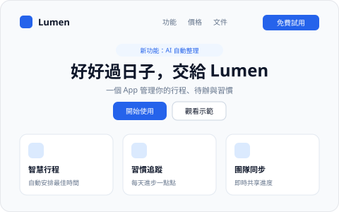

**一句話：乾淨、專業、一看就知道產品能做什麼。**

| | |
| :--- | :--- |
| 適合 | 軟體、App、AI 工具、新創公司官網 |
| 不適合 | 需要溫度與故事感的品牌（會顯得冷） |
| 顏色 | 淺灰白 `#F8FAFC`＋深藍黑字 `#0F172A`＋品牌藍 `#2563EB` |
| 字型 | Inter＋Noto Sans TC，標題粗 |
| 形狀 | 中等圓角 8–12px；細邊框＋很淡的陰影 |
| 給 AI 的關鍵字 | `現代 SaaS、乾淨專業、置中大標、功能卡片附圖示、清楚的主要按鈕、淡淡的陰影` |

> [!WARNING]
> AI 最愛的「紫藍漸層＋發光效果」就是 SaaS 風的公版味。記得加上「**不要紫色漸層、不要發光效果**」。

---

## ④ 便當盒格狀（Bento Grid）

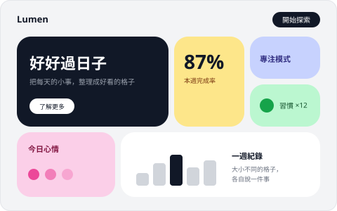

**一句話：像便當盒一樣，大小不同的格子各裝一件事。**

| | |
| :--- | :--- |
| 適合 | 產品功能總覽、個人主頁、數據儀表板 |
| 不適合 | 需要依序閱讀的長文章 |
| 顏色 | 淺灰底 `#F3F4F6`＋一個深色主格＋幾個柔和色塊 |
| 字型 | 無襯線粗體，數字放大 |
| 形狀 | 大圓角 16–24px；格子之間間距一致 |
| 給 AI 的關鍵字 | `便當盒格狀版面、大小不同的圓角方塊、每格一個重點、格距一致、手機版改成單欄` |

---

## ⑤ 新粗野主義（Neo-Brutalism）

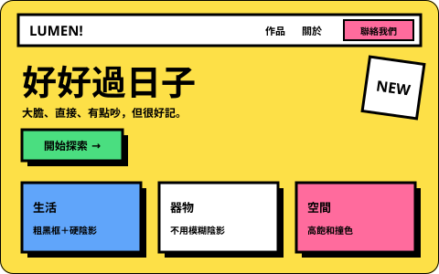

**一句話：粗黑框、硬陰影、撞色，大膽又好記。**

| | |
| :--- | :--- |
| 適合 | 年輕品牌、活動頁、創意工作坊、潮流商品 |
| 不適合 | 醫療、金融、政府等需要信任感的網站 |
| 顏色 | 高飽和撞色：黃 `#FDE047`、粉 `#FF6B9D`、藍 `#60A5FA`＋純黑框 |
| 字型 | 非常粗的無襯線字（Noto Sans TC 900） |
| 形狀 | 直角；3px 黑框；黑色硬陰影（向右下偏移、不模糊） |
| 給 AI 的關鍵字 | `新粗野主義、粗黑框、無模糊的硬陰影、高飽和撞色、粗體大字、直角` |

---

## ⑥ 瑞士格線風（Swiss Style）

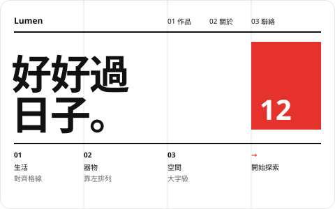

**一句話：嚴謹的網格、超大的字，用排版本身當作設計。**

| | |
| :--- | :--- |
| 適合 | 設計展、建築事務所、藝術機構、出版品 |
| 不適合 | 需要親切、溫暖感覺的品牌 |
| 顏色 | 白＋黑＋一個強烈的紅 `#E5322D` |
| 字型 | 粗黑無襯線字，標題超大、靠左對齊；搭配數字編號 |
| 形狀 | 完全直角；用粗線與網格分區 |
| 給 AI 的關鍵字 | `瑞士國際主義風格、嚴謹網格、超大粗體標題、靠左對齊、紅黑白、數字編號、直角` |

---

## ⑦ 玻璃擬態（Glassmorphism）

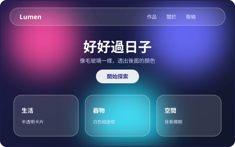

**一句話：像毛玻璃一樣，半透明的卡片透出後面的顏色。**

| | |
| :--- | :--- |
| 適合 | 科技產品、音樂、App 的局部介面（例如浮動面板） |
| 不適合 | 整個網站都用；文字多的頁面（不好讀） |
| 顏色 | 深色底＋彩色光暈；卡片是半透明白 |
| 字型 | 無襯線字，白色 |
| 形狀 | 中大圓角；1px 半透明白框；背景模糊（backdrop blur） |
| 給 AI 的關鍵字 | `玻璃擬態、半透明卡片、背景模糊、彩色光暈背景、白色細邊框、注意文字對比` |

> [!WARNING]
> 玻璃擬態是 AI 最容易濫用的效果之一。建議**只用在一兩個地方**當重點，不要整站都是玻璃。

---

## ⑧ 柔和療癒風（Soft & Organic）

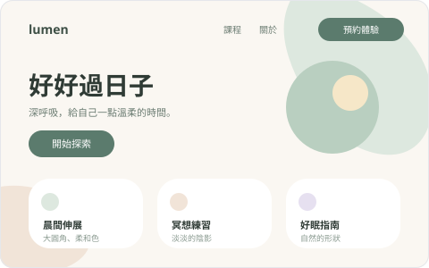

**一句話：柔和的顏色、圓圓的形狀，讓人放鬆。**

| | |
| :--- | :--- |
| 適合 | 診所、瑜伽、香氛、心理諮商、習慣養成 App |
| 不適合 | 需要強烈行動、限時搶購的頁面 |
| 顏色 | 低飽和自然色：米白 `#FAF7F2`、鼠尾草綠 `#5B7B6D`、淡粉、淡紫 |
| 字型 | 圓潤的無襯線字 |
| 形狀 | 大圓角 20–24px、膠囊按鈕、有機形狀；很淡的陰影 |
| 給 AI 的關鍵字 | `柔和療癒、低飽和自然色、大圓角、有機形狀、膠囊按鈕、淡淡的陰影、讓人放鬆` |

---

## ⑨ 暗黑奢華風（Dark Luxury）

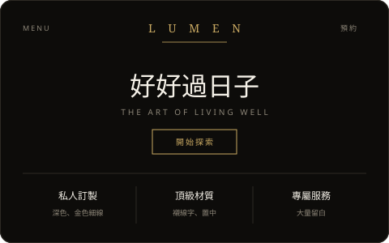

**一句話：深色、金色、留白，安靜地表現高級感。**

| | |
| :--- | :--- |
| 適合 | 精品、珠寶、酒類、高級餐廳、會員制服務 |
| 不適合 | 平價、親子、需要大量資訊的網站 |
| 顏色 | 近黑 `#0D0C0A`＋米白字 `#F5F1E8`＋金色 `#C9A962` |
| 字型 | 襯線字、置中、字距拉寬；英文小字大寫 |
| 形狀 | 直角；金色細線框按鈕；大量留白 |
| 給 AI 的關鍵字 | `暗黑奢華、近黑背景、金色細線、襯線字置中、字距拉寬、大量留白、低調高級` |

---

## ⑩ 公共服務風（Accessible / Civic）

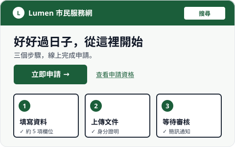

**一句話：所有人都看得清楚、用得懂，包括長輩。**

| | |
| :--- | :--- |
| 適合 | 政府、醫療、教育、銀行、任何需要「每個人都能用」的服務 |
| 不適合 | 以氛圍為主的品牌形象網站 |
| 顏色 | 高對比：深綠 `#1B5E3A`、深灰字 `#1F2937`，符合 WCAG AA |
| 字型 | 內文至少 16px、行高寬鬆 |
| 形狀 | 清楚的邊框、有編號的步驟卡片、大按鈕；連結加底線 |
| 給 AI 的關鍵字 | `公共服務風、高對比、內文至少 16px、步驟卡片加編號、狀態用圖示加文字、連結有底線、符合 WCAG AA` |

---

## 怎麼把風格變成 DESIGN.md？

選好風格後，把「給 AI 的關鍵字」交給 AI，請它寫成 DESIGN.md：

<details>
<summary>📋 Prompt：把風格變成 DESIGN.md</summary>

```text
我的專案是【木日 Kibi 台南老宅咖啡館的一週年活動頁】，目標對象是【22–40 歲喜歡老宅與手沖咖啡的人】。
我選擇的風格是【編輯雜誌風】，關鍵字：【編輯雜誌風、襯線標題、大張照片、細線分隔、暖色紙張底、留白多】。

請依照 DESIGN.md 官方格式寫一份 DESIGN.md：
1. 上方 YAML：name、colors、typography、rounded、spacing、components（至少主要按鈕、次要按鈕、卡片）。
2. 下方章節：Overview、Colors、Typography、Layout、Shapes、Components、Do's and Don'ts。
3. 字型要包含繁體中文字型（Noto Serif TC／Noto Sans TC）。
4. Do's and Don'ts 至少寫 3 條「這個風格不能做的事」。
```

</details>

**也可以混搭**：以一種風格為主，再借另一種的一個特色。例如「編輯雜誌風為主，商品區用便當盒格狀排列」。但**最多混兩種**，混太多就沒有風格了。

---

## 常見錯誤

- **只說「有質感」、「高級一點」**：AI 只能猜。改用風格名稱＋關鍵字。
- **選了跟用途衝突的風格**：例如醫療網站用新粗野主義，使用者會不信任。回去看風格地圖。
- **把 AI 公版當成風格**：紫藍漸層、到處發光、每個東西都包成卡片，不是任何一種風格，只是 AI 的習慣。

## 自我檢核

- [ ] 我能看圖說出至少 6 種風格的名稱與特徵。
- [ ] 我能依照網站的用途，在風格地圖上找到適合的方向。
- [ ] 我會用「給 AI 的關鍵字」，請 AI 把風格寫成 DESIGN.md。

---

[下一章：03. 參考靈感網站與風格比稿 →](./03_參考靈感網站與風格比稿.md)
