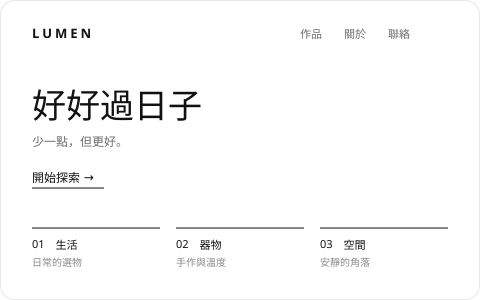
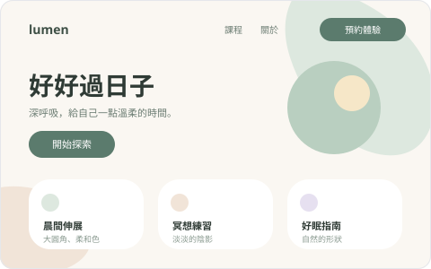
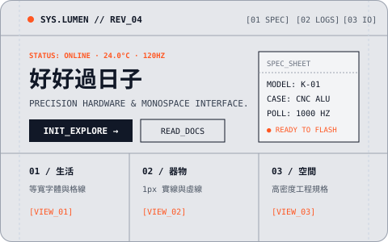
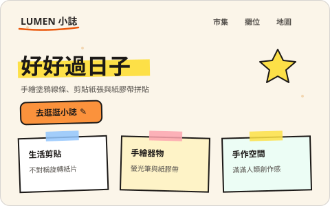

# 03. 常用設計風格圖鑑

> 「我想要有質感一點」，AI 聽不懂；「我想要編輯雜誌風」，AI 就知道怎麼做。這一章在「理性／感性 × 安靜／熱鬧」四個象限裡，整理出 **16 種最實用的網頁設計風格**（每象限 4 種），用同一個示範畫面對照差異，並為每種風格準備了專屬的 `PRD.md` 與關鍵字教學指南。

---

## 先看地圖：你的網站要理性還是感性？


選風格之前，先回答兩個問題：

1. **理性還是感性？** 使用者是來「完成事情」（申請、購買、查資料），還是來「感受氛圍」（逛品牌、看作品）？
2. **安靜還是熱鬧？** 品牌個性是沉穩克制，還是大膽好玩？

答案落在哪個象限，就從那一區的風格開始挑。下面每一種風格，都用同一個示範網頁「Lumen / 好好過日子」來畫，方便你直接比較差異。

### 先看一眼：16 種常用設計風格（四象限各 4 種）

| | | | |
| :---: | :---: | :---: | :---: |
| <br>① 極簡風 | <br>② 編輯雜誌風 | <br>③ 現代 SaaS 風 | <br>④ 便當盒格狀 |
| <br>⑤ 新粗野主義 | <br>⑥ 瑞士格線風 | <br>⑦ 玻璃擬態 | <br>⑧ 柔和療癒風 |
| <br>⑨ 暗黑奢華風 | <br>⑩ 公共服務風 | <br>⑪ 工業技術風 | <br>⑫ 復古懷舊紙本風 |
| <br>⑬ 3D 黏土軟膠風 | <br>⑭ Y2K 千禧潮流風 | <br>⑮ 手繪拼貼雜誌風 | <br>⑯ 沉浸式光影敘事風 |

> [!TIP]
> 每種風格都附有「**給 AI 的關鍵字**」以及獨立的實戰指南頁（含專屬 `PRD.md`、產生 `DESIGN.md` 的 Prompt 與關鍵字拆解教學）。

---

## ① 極簡風（Minimalism）`理性 × 安靜`


**一句話：少即是多，只留下必要的東西。**

| | |
| :--- | :--- |
| 適合 | 作品集、設計工作室、建築師、高價單品 |
| 不適合 | 資訊很多的頁面（電商列表、新聞），會顯得空洞難找 |
| 顏色 | 白 `#FFFFFF`＋黑 `#111111`＋灰 `#6B6B6B`，最多一個重點色 |
| 字型 | 細的無襯線字（Noto Sans TC 300、Inter） |
| 形狀 | 幾乎不用圓角與陰影，用細線分隔 |
| 給 AI 的關鍵字 | `極簡、大量留白、黑白灰、細線條、無陰影、只保留必要元素` |

👉 進入實戰頁（含專屬 PRD 與關鍵字教學）：[01. 極簡風實戰指南（白隅空間）](./風格圖鑑/01_極簡風_Minimalism.md)

---

## ② 編輯雜誌風（Editorial）`感性 × 安靜`


**一句話：像翻開一本生活雜誌，文字和照片都很講究。**

| | |
| :--- | :--- |
| 適合 | 咖啡館、選品店、文創品牌、深度旅遊、部落格 |
| 不適合 | 需要快速操作的工具或後台 |
| 顏色 | 紙張米白 `#FAF6EF`＋深咖啡字 `#2A211B`＋暖棕重點色 `#8B5E3C` |
| 字型 | 標題用襯線字（Noto Serif TC），內文用無襯線字 |
| 形狀 | 小圓角或直角；用 1px 細線代替陰影 |
| 給 AI 的關鍵字 | `編輯雜誌風、襯線標題、大張照片、細線分隔、暖色紙張底、留白多、像生活雜誌` |

👉 進入實戰頁（含專屬 PRD 與關鍵字教學）：[02. 編輯雜誌風實戰指南（島嶼陶器）](./風格圖鑑/02_編輯雜誌風_Editorial.md)

---

## ③ 現代 SaaS 風（Modern SaaS）`理性 × 熱鬧`


**一句話：乾淨、專業、一看就知道產品能做什麼。**

| | |
| :--- | :--- |
| 適合 | 軟體、App、AI 工具、新創公司官網 |
| 不適合 | 需要溫度與故事感的品牌（會顯得冷） |
| 顏色 | 淺灰白 `#F8FAFC`＋深藍黑字 `#0F172A`＋品牌藍 `#2563EB` |
| 字型 | Inter＋Noto Sans TC，標題粗 |
| 形狀 | 中等圓角 8–12px；細邊框＋很淡的陰影 |
| 給 AI 的關鍵字 | `現代 SaaS、乾淨專業、置中大標、功能卡片附圖示、清楚的主要按鈕、淡淡的陰影` |

> [!WARNING]
> AI 最愛的「紫藍漸層＋發光效果」就是 SaaS 風的公版味。記得加上「**不要紫色漸層、不要發光效果**」。

👉 進入實戰頁（含專屬 PRD 與關鍵字教學）：[03. 現代 SaaS 風實戰指南（秒讀 ReadSnap）](./風格圖鑑/03_現代SaaS風_Modern_SaaS.md)

---

## ④ 便當盒格狀（Bento Grid）`理性 × 熱鬧`


**一句話：像便當盒一樣，大小不同的格子各裝一件事。**

| | |
| :--- | :--- |
| 適合 | 產品功能總覽、個人主頁、數據儀表板 |
| 不適合 | 需要依序閱讀的長文章 |
| 顏色 | 淺灰底 `#F3F4F6`＋一個深色主格＋幾個柔和色塊 |
| 字型 | 無襯線粗體，數字放大 |
| 形狀 | 大圓角 16–24px；格子之間間距一致 |
| 給 AI 的關鍵字 | `便當盒格狀版面、大小不同的圓角方塊、每格一個重點、格距一致、手機版改成單欄` |

👉 進入實戰頁（含專屬 PRD 與關鍵字教學）：[04. 便當盒格狀實戰指南（PocketFin 口袋帳房）](./風格圖鑑/04_便當盒格狀_Bento_Grid.md)

---

## ⑤ 新粗野主義（Neo-Brutalism）`感性 × 熱鬧`


**一句話：粗黑框、硬陰影、撞色，大膽又好記。**

| | |
| :--- | :--- |
| 適合 | 年輕品牌、活動頁、創意工作坊、潮流商品 |
| 不適合 | 醫療、金融、政府等需要信任感的網站 |
| 顏色 | 高飽和撞色：黃 `#FDE047`、粉 `#FF6B9D`、藍 `#60A5FA`＋純黑框 |
| 字型 | 非常粗的無襯線字（Noto Sans TC 900） |
| 形狀 | 直角；3px 黑框；黑色硬陰影（向右下偏移、不模糊） |
| 給 AI 的關鍵字 | `新粗野主義、粗黑框、無模糊的硬陰影、高飽和撞色、粗體大字、直角` |

👉 進入實戰頁（含專屬 PRD 與關鍵字教學）：[05. 新粗野主義實戰指南（夜浪聲景 NightWave）](./風格圖鑑/05_新粗野主義_Neo_Brutalism.md)

---

## ⑥ 瑞士格線風（Swiss Style）`理性 × 安靜`


**一句話：嚴謹的網格、超大的字，用排版本身當作設計。**

| | |
| :--- | :--- |
| 適合 | 設計展、建築事務所、藝術機構、出版品 |
| 不適合 | 需要親切、溫暖感覺的品牌 |
| 顏色 | 白＋黑＋一個強烈的紅 `#E5322D` |
| 字型 | 粗黑無襯線字，標題超大、靠左對齊；搭配數字編號 |
| 形狀 | 完全直角；用粗線與網格分區 |
| 給 AI 的關鍵字 | `瑞士國際主義風格、嚴謹網格、超大粗體標題、靠左對齊、紅黑白、數字編號、直角` |

👉 進入實戰頁（含專屬 PRD 與關鍵字教學）：[06. 瑞士格線風實戰指南（漢字秩序 TypeGrid）](./風格圖鑑/06_瑞士格線風_Swiss_Style.md)

---

## ⑦ 玻璃擬態（Glassmorphism）`理性 × 熱鬧`


**一句話：像毛玻璃一樣，半透明的卡片透出後面的顏色。**

| | |
| :--- | :--- |
| 適合 | 科技產品、音樂、App 的局部介面（例如浮動面板） |
| 不適合 | 整個網站都用；文字多的頁面（不好讀） |
| 顏色 | 深色底＋彩色光暈；卡片是半透明白 |
| 字型 | 無襯線字，白色 |
| 形狀 | 中大圓角；1px 半透明白框；背景模糊（backdrop blur） |
| 給 AI 的關鍵字 | `玻璃擬態、半透明卡片、背景模糊、彩色光暈背景、白色細邊框、注意文字對比` |

> [!WARNING]
> 玻璃擬態是 AI 最容易濫用的效果之一。建議**只用在一兩個地方**當重點，不要整站都是玻璃。

👉 進入實戰頁（含專屬 PRD 與關鍵字教學）：[07. 玻璃擬態實戰指南（Aether 聲境）](./風格圖鑑/07_玻璃擬態_Glassmorphism.md)

---

## ⑧ 柔和療癒風（Soft & Organic）`感性 × 安靜`


**一句話：柔和的顏色、圓圓的形狀，讓人放鬆。**

| | |
| :--- | :--- |
| 適合 | 診所、瑜伽、香氛、心理諮商、習慣養成 App |
| 不適合 | 需要強烈行動、限時搶購的頁面 |
| 顏色 | 低飽和自然色：米白 `#FAF7F2`、鼠尾草綠 `#5B7B6D`、淡粉、淡紫 |
| 字型 | 圓潤的無襯線字 |
| 形狀 | 大圓角 20–24px、膠囊按鈕、有機形狀；很淡的陰影 |
| 給 AI 的關鍵字 | `柔和療癒、低飽和自然色、大圓角、有機形狀、膠囊按鈕、淡淡的陰影、讓人放鬆` |

👉 進入實戰頁（含專屬 PRD 與關鍵字教學）：[08. 柔和療癒風實戰指南（森息呼吸 Mori Breath）](./風格圖鑑/08_柔和療癒風_Soft_Organic.md)

---

## ⑨ 暗黑奢華風（Dark Luxury）`感性 × 安靜`


**一句話：深色、金色、留白，安靜地表現高級感。**

| | |
| :--- | :--- |
| 適合 | 精品、珠寶、酒類、高級餐廳、會員制服務 |
| 不適合 | 平價、親子、需要大量資訊的網站 |
| 顏色 | 近黑 `#0D0C0A`＋米白字 `#F5F1E8`＋金色 `#C9A962` |
| 字型 | 襯線字、置中、字距拉寬；英文小字大寫 |
| 形狀 | 直角；金色細線框按鈕；大量留白 |
| 給 AI 的關鍵字 | `暗黑奢華、近黑背景、金色細線、襯線字置中、字距拉寬、大量留白、低調高級` |

👉 進入實戰頁（含專屬 PRD 與關鍵字教學）：[09. 暗黑奢華風實戰指南（琥珀時光 Amber & Cask）](./風格圖鑑/09_暗黑奢華風_Dark_Luxury.md)

---

## ⑩ 公共服務風（Accessible / Civic）`理性 × 安靜`


**一句話：所有人都看得清楚、用得懂，包括長輩。**

| | |
| :--- | :--- |
| 適合 | 政府、醫療、教育、銀行、任何需要「每個人都能用」的服務 |
| 不適合 | 以氛圍為主的品牌形象網站 |
| 顏色 | 高對比：深綠 `#1B5E3A`、深灰字 `#1F2937`，符合 WCAG AA |
| 字型 | 內文至少 16px、行高寬鬆 |
| 形狀 | 清楚的邊框、有編號的步驟卡片、大按鈕；連結加底線 |
| 給 AI 的關鍵字 | `公共服務風、高對比、內文至少 16px、步驟卡片加編號、狀態用圖示加文字、連結有底線、符合 WCAG AA` |

👉 進入實戰頁（含專屬 PRD 與關鍵字教學）：[10. 公共服務風實戰指南（台南市民綠生活補助）](./風格圖鑑/10_公共服務風_Accessible_Civic.md)

---

## ⑪ 工業技術風（Technical / Monospace）`理性 × 安靜`


**一句話：等寬字體、虛線表格與狀態燈號，像打開精密儀器的工程規格書。**

| | |
| :--- | :--- |
| 適合 | 開發者工具、AI 模型發布頁、機械鍵盤或合成器等硬體產品 |
| 不適合 | 溫馨生活雜貨、親子教育、浪漫氛圍品牌 |
| 顏色 | 冷灰金屬 `#E5E7EB`＋碳黑 `#111827`＋工業橘 `#FF5722` |
| 字型 | 大量使用等寬字體（JetBrains Mono）＋ Noto Sans TC |
| 形狀 | 零圓角；1px 實線與虛線框線；工程編號 `[01]` 與燈號標記 |
| 給 AI 的關鍵字 | `工業技術風、Teenage Engineering 質感、冷灰底、1px 實線與虛線表格、等寬字體、工業橘狀態燈號、零圓角` |

👉 進入實戰頁（含專屬 PRD 與關鍵字教學）：[11. 工業技術風實戰指南（Krono-01 機械鍵盤）](./風格圖鑑/11_工業技術風_Technical_Mono.md)

---

## ⑫ 復古懷舊紙本風（Retro / Vintage Print）`感性 × 安靜`


**一句話：泛黃紙張、印章紅與雙層印刷框線，充滿台灣老舖與昭和時光的溫度。**

| | |
| :--- | :--- |
| 適合 | 百年老店改版、活版印刷／獨立書店、喫茶店、精釀與傳統糕餅品牌 |
| 不適合 | AI 科技產品、雲端 SaaS、數位金融網站 |
| 顏色 | 泛黃紙張 `#F4EAD5`＋濃墨深褐 `#2A1B15`＋硃砂印章紅 `#B8332A` |
| 字型 | 濃郁襯線字（Noto Serif TC 700）＋ 傳統大寫編號（壹、貳、參） |
| 形狀 | 雙層復古印刷線框（外粗內細）；票根虛線邊框；方形紅印章 |
| 給 AI 的關鍵字 | `復古懷舊紙本風、泛黃古董紙底、雙層印刷邊框、印章紅點綴、票根虛線卡片、全站襯線體` |

👉 進入實戰頁（含專屬 PRD 與關鍵字教學）：[12. 復古懷舊紙本風實戰指南（日新印刷所）](./風格圖鑑/12_復古懷舊紙本風_Retro_Print.md)

---

## ⑬ 3D 黏土軟膠風（Claymorphism）`理性 × 熱鬧`


**一句話：像軟糖和黏土一樣蓬鬆立體的圓潤卡片，親切、好玩、想戳一下。**

| | |
| :--- | :--- |
| 適合 | 青少年／兒童教育 App、遊戲化記帳、新手友善學習網站 |
| 不適合 | 嚴肅新聞媒體、醫療報告、B2B 採購後台 |
| 顏色 | 粉彩淺紫底 `#EEF2FF`＋潔白卡片＋珊瑚粉 `#F472B6`、薄荷綠 `#34D399` |
| 字型 | 飽滿粗圓體（Fredoka ＋ Noto Sans TC 800） |
| 形狀 | 超大圓角 24–30px；內外雙層柔和陰影＋白色高光邊緣，製造 3D 鼓起質感 |
| 給 AI 的關鍵字 | `3D 黏土軟膠風、馬卡龍粉彩色、超大圓角、outer 與 inner highlight 雙層陰影、白色高光邊框、不要黑框` |

👉 進入實戰頁（含專屬 PRD 與關鍵字教學）：[13. 3D 黏土軟膠風實戰指南（怪獸存錢筒 MonSave）](./風格圖鑑/13_3D黏土軟膠風_Claymorphism.md)

---

## ⑭ Y2K 千禧潮流風（Y2K / Acid Cyber）`感性 × 熱鬧`


**一句話：鉻銀金屬光澤、螢光酸綠撞電光粉與千禧視窗，致敬 2000 年代街頭數位美學。**

| | |
| :--- | :--- |
| 適合 | 街頭潮牌、電競賽事、地下電音派對、Z 世代快閃企劃 |
| 不適合 | 長輩服務、醫療院所、保守型企業 B2B 官網 |
| 顏色 | 深紫黑 `#0B0719`＋螢光酸綠 `#CCFF00`＋電光粉 `#FF00AA`＋鉻銀漸層 |
| 字型 | 寬體英文（Syne）＋ 極粗黑中文（Noto Sans TC 900）＋ Space Mono |
| 形狀 | 銳利直角；千禧復古視窗標題列；透視雷射網格、斜角貼紙與跑馬燈 |
| 給 AI 的關鍵字 | `Y2K 千禧未來風、酸性設計、深紫黑透視網格、螢光酸綠撞電光粉、鉻銀復古視窗列、斜角貼紙、跑馬燈` |

👉 進入實戰頁（含專屬 PRD 與關鍵字教學）：[14. Y2K 千禧潮流風實戰指南（CYBER-TPE 2000）](./風格圖鑑/14_Y2K千禧潮流風_Y2K_Cyber.md)

---

## ⑮ 手繪拼貼雜誌風（Hand-drawn / Zine Collage）`感性 × 熱鬧`


**一句話：紙膠帶、螢光筆劃重點與微傾斜剪貼紙片，最有「人類手作感」的溫度。**

| | |
| :--- | :--- |
| 適合 | 插畫家／創作者作品集、週末文創市集、獨立出版 Zine 展、親子繪本活動 |
| 不適合 | 企業軟體後台、金融數據報表、法律或醫療正式網站 |
| 顏色 | 暖米牛皮紙 `#FBF5E9`＋炭黑墨線 `#1C1917`＋螢光筆黃 `#FDE047`＋暖橘 `#FB923C` |
| 字型 | 手寫感字型（Klee One / Zen Maru Gothic）＋ Noto Sans TC |
| 形狀 | 卡片頂端貼半透明紙膠帶；微幅不對稱旋轉（±2°）；標題螢光筆色塊與塗鴉線條 |
| 給 AI 的關鍵字 | `手繪拼貼小誌風、牛皮紙暖底、卡片上方貼紙膠帶、標題加螢光筆底塊、微幅左右旋轉、手寫感字型` |

👉 進入實戰頁（含專屬 PRD 與關鍵字教學）：[15. 手繪拼貼雜誌風實戰指南（草地小誌祭）](./風格圖鑑/15_手繪拼貼雜誌風_Zine_Collage.md)

---

## ⑯ 沉浸式光影敘事風（Immersive / Scrollytelling）`感性 × 熱鬧`


**一句話：全螢幕深邃夜色搭配極光流體光暈與電影級巨型宣言，像一場線上數位展覽。**

| | |
| :--- | :--- |
| 適合 | 旗艦級新產品發表、沉浸式數位光影展、影展或紀錄片官網 |
| 不適合 | 強調快速查表與多欄位搜尋的資訊入口網 |
| 顏色 | 宇宙深黑 `#05050A`＋純白高光字 `#FFFFFF`＋極光藍紫流體光暈 `#38BDF8` / `#6366F1` |
| 字型 | 有份量的無襯線標題（Outfit ＋ Noto Sans TC 700–800），可配文字微漸層 |
| 形狀 | 全螢幕滿版章節、懸浮膠囊導覽列、隨捲動淡入（Scroll fade-in）與進度條 |
| 給 AI 的關鍵字 | `沉浸式光影敘事風、全螢幕深黑背景、極光流體光暈、置中電影級大標、捲動漸進浮現、懸浮膠囊導覽列` |

👉 進入實戰頁（含專屬 PRD 與關鍵字教學）：[16. 沉浸式光影敘事風實戰指南（深海微光）](./風格圖鑑/16_沉浸式光影敘事風_Immersive_Scrolly.md)

---

## 怎麼把風格變成 DESIGN.md（搭配 PRD.md）？

選好風格後，除了直接點進上面任一個風格實戰頁複製專屬 `PRD.md` 與 Prompt，也可以依照這個通用公式，把「給 AI 的關鍵字」交給 AI 一併產出 `DESIGN.md` 與 `PRD.md`：

<details>
<summary>📋 通用 Prompt：把任一種風格變成 DESIGN.md ＋ PRD.md</summary>

```text
我的專案是【你的專案主題】，目標對象是【你的目標客群】。
我選擇的風格是【風格名稱】，關鍵字：【貼上該風格給 AI 的關鍵字】。

請幫我產出兩份檔案（直接給出完整內容，不要反問我問題）：

第一份：DESIGN.md（設計規範，管網站長什麼樣子）
1. 上方 YAML：name、colors、typography、rounded、spacing、components（至少主要按鈕、次要按鈕、卡片）。
2. 下方章節：Overview、Colors、Typography、Layout、Shapes、Voice & Content Strategy、Components、Do's and Don'ts。
3. 字型請依這個風格挑選最適合的「英文字型＋繁體中文字型」組合（並在 Typography 寫明 Google Fonts CDN 載入方式）。
4. Do's and Don'ts 至少寫 3 條「這個風格不能做的事」。

第二份：PRD.md（需求與文案素材，管網站有哪些區塊與文字）
1. 頁面區塊架構（導覽列、主視覺、核心內容三張卡片、聯絡資訊與頁尾）。
2. 符合上述風格語氣的真實感繁體中文文案素材。
```

</details>

（不知道有哪些中英文字型可選，可先看〈[05. 網頁中英文字型與圖示指南](./05_網頁中英文字型與圖示指南.md)〉。）

> [!TIP]
> **分工口訣**：`DESIGN.md` 管**視覺風格**（皮），`PRD.md` 管**區塊與文案素材**（骨肉）。兩份都準備好，AI 做網頁時就不會因為缺少內容而反問你，也不會自己亂編不合風格的文字。

**也可以混搭**：以一種風格為主，再借另一種的一個特色。例如「編輯雜誌風為主，商品區用便當盒格狀排列」。但**最多混兩種**，混太多就沒有風格了。

---

## 常見錯誤

- **只說「有質感」、「高級一點」**：AI 只能猜。改用風格名稱＋關鍵字。
- **選了跟用途衝突的風格**：例如醫療網站用新粗野主義，使用者會不信任。回去看風格地圖。
- **把 AI 公版當成風格**：紫藍漸層、到處發光、每個東西都包成卡片，不是任何一種風格，只是 AI 的習慣。

## 自我檢核

- [ ] 我能看圖說出至少 8 種風格的名稱與特徵。
- [ ] 我能依照網站的用途，在四象限風格地圖上找到適合的方向。
- [ ] 我已經從 16 個風格實戰頁中挑出一個，複製它的 `PRD.md` 並用關鍵字產出了 `DESIGN.md`。

---

[下一章：04. 建立與驗證自己的 DESIGN.md →](./04_建立與驗證自己的DESIGN_md.md)
