# 03. 常用設計風格圖鑑

> 「我想要有質感一點」，AI 聽不懂；「我想要編輯雜誌風」，AI 就知道怎麼做。這一章在「理性／感性 × 安靜／熱鬧」四個象限裡，整理出 **16 種最實用的網頁設計風格**（每象限 4 種），用同一個示範畫面對照差異，並為每種風格準備了專屬的 `PRD.md` 與關鍵字教學指南。

---

## 先看地圖：你的網站要理性還是感性？

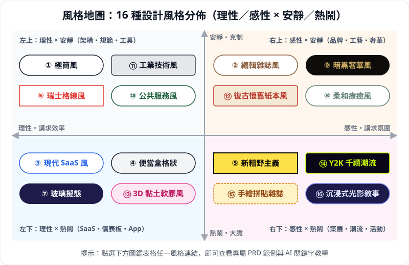

選風格之前，先回答兩個問題：

1. **理性還是感性？** 使用者是來「完成事情」（申請、購買、查資料），還是來「感受氛圍」（逛品牌、看作品）？
2. **安靜還是熱鬧？** 品牌個性是沉穩克制，還是大膽好玩？

答案落在哪個象限，就從那一區的風格開始挑。下面每一種風格，都用同一個示範網頁「Lumen / 好好過日子」來畫，方便你直接比較差異。

### 先看一眼：16 種常用設計風格（點進去看專屬 PRD 與關鍵字教學）

| | | | |
| :---: | :---: | :---: | :---: |
| <br>[① 極簡風](./風格圖鑑/01_極簡風_Minimalism.md) | 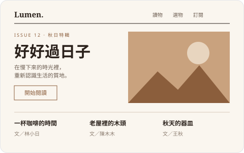<br>[② 編輯雜誌風](./風格圖鑑/02_編輯雜誌風_Editorial.md) | <br>[③ 現代 SaaS 風](./風格圖鑑/03_現代SaaS風_Modern_SaaS.md) | 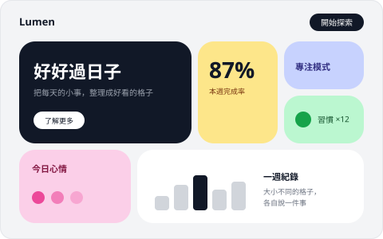<br>[④ 便當盒格狀](./風格圖鑑/04_便當盒格狀_Bento_Grid.md) |
| 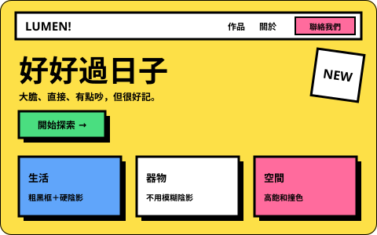<br>[⑤ 新粗野主義](./風格圖鑑/05_新粗野主義_Neo_Brutalism.md) | 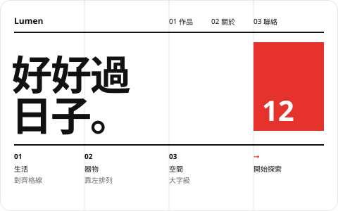<br>[⑥ 瑞士格線風](./風格圖鑑/06_瑞士格線風_Swiss_Style.md) | <br>[⑦ 玻璃擬態](./風格圖鑑/07_玻璃擬態_Glassmorphism.md) | <br>[⑧ 柔和療癒風](./風格圖鑑/08_柔和療癒風_Soft_Organic.md) |
| 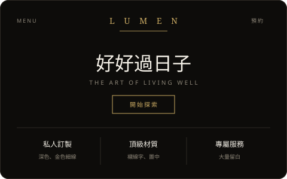<br>[⑨ 暗黑奢華風](./風格圖鑑/09_暗黑奢華風_Dark_Luxury.md) | 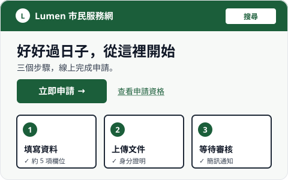<br>[⑩ 公共服務風](./風格圖鑑/10_公共服務風_Accessible_Civic.md) | <br>[⑪ 工業技術風](./風格圖鑑/11_工業技術風_Technical_Mono.md) | 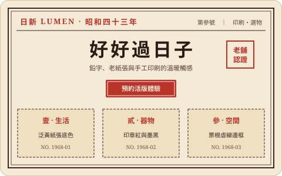<br>[⑫ 復古懷舊紙本風](./風格圖鑑/12_復古懷舊紙本風_Retro_Print.md) |
| 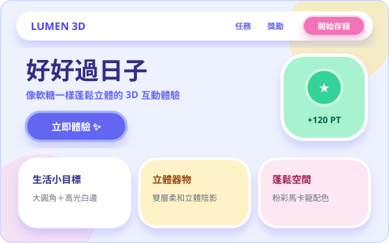<br>[⑬ 3D 黏土軟膠風](./風格圖鑑/13_3D黏土軟膠風_Claymorphism.md) | 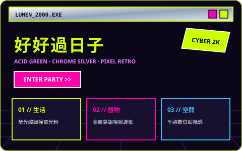<br>[⑭ Y2K 千禧潮流風](./風格圖鑑/14_Y2K千禧潮流風_Y2K_Cyber.md) | <br>[⑮ 手繪拼貼雜誌風](./風格圖鑑/15_手繪拼貼雜誌風_Zine_Collage.md) | 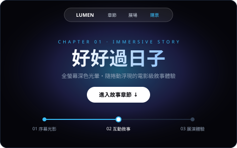<br>[⑯ 沉浸式光影敘事風](./風格圖鑑/16_沉浸式光影敘事風_Immersive_Scrolly.md) |

> [!TIP]
> 點進上方任一個風格連結，裡面都有該風格的**詳細特徵表、專屬 `PRD.md` 範例、產生 `DESIGN.md` 的 Prompt，以及關鍵字拆解教學**。

---

## 怎麼把風格變成 DESIGN.md（搭配 PRD.md）？

選好風格後，除了直接點進上面任一個風格實戰頁複製專屬 `PRD.md` 與 Prompt，也可以依照這個通用公式，把「給 AI 的關鍵字」交給 AI 一併產出 `DESIGN.md` 與 `PRD.md`：

<details>
<summary>📋 通用 Prompt：把任一種風格變成 DESIGN.md ＋ PRD.md</summary>

```text
我的專案是【你的專案主題】，目標對象是【你的目標客群】。
我選擇的風格是【風格名稱】，關鍵字：【貼上該風格給 AI 的關鍵字】。

請幫我產出兩份檔案（直接給出完整內容，不要反問我問題）：

第一份：DESIGN.md（設計規範，管網站長什麼樣子）
1. 上方 YAML：name、colors、typography、rounded、spacing、components（至少主要按鈕、次要按鈕、卡片）。
2. 下方章節：Overview、Colors、Typography、Layout、Shapes、Voice & Content Strategy、Components、Do's and Don'ts。
3. 字型請依這個風格挑選最適合的「英文字型＋繁體中文字型」組合（並在 Typography 寫明 Google Fonts CDN 載入方式）。
4. Do's and Don'ts 至少寫 3 條「這個風格不能做的事」。

第二份：PRD.md（需求與文案素材，管網站有哪些區塊與文字）
1. 頁面區塊架構（導覽列、主視覺、核心內容三張卡片、聯絡資訊與頁尾）。
2. 符合上述風格語氣的真實感繁體中文文案素材。
```

</details>

（不知道有哪些中英文字型可選，可先看〈[05. 網頁中英文字型與圖示指南](./05_網頁中英文字型與圖示指南.md)〉。）

> [!TIP]
> **分工口訣**：`DESIGN.md` 管**視覺風格**（皮），`PRD.md` 管**區塊與文案素材**（骨肉）。兩份都準備好，AI 做網頁時就不會因為缺少內容而反問你，也不會自己亂編不合風格的文字。

**也可以混搭**：以一種風格為主，再借另一種的一個特色。例如「編輯雜誌風為主，商品區用便當盒格狀排列」。但**最多混兩種**，混太多就沒有風格了。

---

## 常見錯誤

- **只說「有質感」、「高級一點」**：AI 只能猜。改用風格名稱＋關鍵字。
- **選了跟用途衝突的風格**：例如醫療網站用新粗野主義，使用者會不信任。回去看風格地圖。
- **把 AI 公版當成風格**：紫藍漸層、到處發光、每個東西都包成卡片，不是任何一種風格，只是 AI 的習慣。

## 自我檢核

- [ ] 我能看圖說出至少 8 種風格的名稱與特徵。
- [ ] 我能依照網站的用途，在四象限風格地圖上找到適合的方向。
- [ ] 我已經從 16 個風格實戰頁中挑出一個，複製它的 `PRD.md` 並用關鍵字產出了 `DESIGN.md`。

---

[下一章：04. 建立與驗證自己的 DESIGN.md →](./04_建立與驗證自己的DESIGN_md.md)
