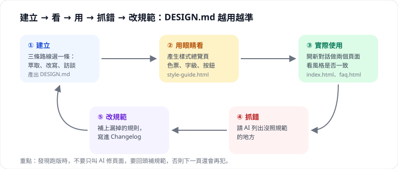

# 04. 建立與驗證自己的 DESIGN.md

> 有了方向，接下來要把 DESIGN.md 寫完整，並確認它真的有用。這一章提供三種建立方式，以及一個「看 → 用 → 抓錯 → 改規範」的驗證流程。

---

## 觀念：DESIGN.md 越用越準



第一版的 DESIGN.md 一定有漏洞。重點不是一次寫完美，而是：

1. **建立**：選一條路線寫出第一版。
2. **用眼睛看**：請 AI 把規範畫成樣式總覽頁。
3. **實際使用**：開新對話，用它做兩個頁面。
4. **抓錯**：找出 AI 沒照規範做的地方。
5. **改規範**：把漏掉的規則補進 DESIGN.md，而不是只修頁面。

---

## 步驟 1：三條路線，選一條建立

| 路線 | 適合 | 你需要準備 |
| :--- | :--- | :--- |
| **A. 從網站萃取** | 改版既有網站，或有很喜歡的參考網站 | 網址或截圖 |
| **B. 改寫現成範本** | 想借用成熟品牌的質感 | 第 03 章的風格比稿結果，或 awesome-design-md 的範本 |
| **C. 和 AI 訪談** | 全新專案，什麼都還沒有 | 本單元的 [DESIGN_template.md](./DESIGN_template.md) |

### 路線 A：從網站萃取

<details>
<summary>📋 Prompt</summary>

```text
附件是【我要改版的網站／我很喜歡的網站】的截圖（或網址：【網址】）。
請分析它的顏色、字型、圓角、間距、陰影與主要元件，整理成一份 DESIGN.md（官方格式：YAML Token＋各章節）。
如果是參考別人的網站：請保留版面節奏與氣質，但主色要換成【我的品牌色】，字型要包含繁體中文。
最後列出「你不確定、需要我確認」的地方。
```

</details>

### 路線 B：改寫現成範本

<details>
<summary>📋 Prompt</summary>

```text
附件 source-DESIGN.md 是我參考的設計規範。請保留它的版面氣質與資訊密度，改寫成適合我的專案：【專案主題】。
規則：
1. 品牌主色與強調色一定要換掉，不能沿用原品牌。
2. 字型請依專案風格搭配適合的「英文字型＋繁體中文字型」（若專案有 AGENTS.md 請依其字型庫挑選，並寫明網頁 CDN 載入方式）。
3. Do's and Don'ts 針對我的專案重新寫至少 3 條。
4. 最後附上「和原範本的差異」清單。
```

</details>

### 路線 C：和 AI 訪談

1. 複製上表的範本檔，改名為 `DESIGN.md`。
2. 把它交給 AI：

<details>
<summary>📋 Prompt</summary>

```text
附件 DESIGN.md 是空白範本。請扮演我的品牌設計顧問，每次只問我 3 個問題，
例如：網站做什麼、給誰用、希望訪客有什麼感覺、喜歡和討厭的參考網站、偏好的顏色。
問完後依照範本的格式填完整份 DESIGN.md，保留原本的章節結構。
```

</details>

> [!TIP]
> 回答「**討厭什麼**」和回答「喜歡什麼」一樣重要，它會直接變成 Do's and Don'ts。例如：「討厭那種花花綠綠、到處都是動畫的網站。」

---

## 步驟 2：用眼睛看——產生樣式總覽頁

DESIGN.md 是文字，光看色碼很難知道配起來好不好看。先請 AI 把它畫出來：

<details>
<summary>📋 Prompt</summary>

```text
請根據 DESIGN.md 產生 style-guide.html 樣式總覽頁（單一檔案），包含：
1. 所有顏色方塊，標示名稱、色碼與用途
2. 各級標題與內文的範例（用中文）
3. 主要按鈕、次要按鈕（含 hover 與停用狀態）、一張卡片、一個輸入框
4. 陰影與圓角的示範
所有數值都必須來自 DESIGN.md，寫成 :root 的 CSS 變數。
```

</details>

打開 `style-guide.html` 檢查：

- [ ] 顏色放在一起和諧嗎？有沒有某個顏色特別突兀？
- [ ] 中文字型有正確顯示嗎？
- [ ] 灰色的說明文字在背景上看得清楚嗎？

不滿意就**直接改 DESIGN.md 的數值**，再重新產生一次。

---

## 步驟 3：實際使用——開新對話做兩個頁面

<details>
<summary>📋 Prompt：首頁</summary>

```text
請嚴格遵守 DESIGN.md，為【我的專案】製作 index.html 首頁：
固定導覽列、主視覺、三張特色卡片、一段介紹區塊、頁尾。手機版也要正常顯示。
```

</details>

做完首頁後，**開一個新的對話**（讓 AI 忘記剛剛的內容），再做第二頁：

<details>
<summary>📋 Prompt：第二頁</summary>

```text
請嚴格遵守 DESIGN.md，製作 faq.html 常見問題頁：6 題可以展開收合的問答＋聯絡表單。
導覽列與頁尾要和 index.html 完全一致。
```

</details>

> [!IMPORTANT]
> **為什麼要開新對話？** 同一個對話裡，AI 會「記得」剛才的樣式，看不出 DESIGN.md 有沒有用。開新對話還能做出一致的頁面，才代表你的 DESIGN.md 寫得夠清楚。

---

## 步驟 4 與 5：抓錯，然後改規範

<details>
<summary>📋 Prompt：請 AI 稽核</summary>

```text
請比對 index.html 與 faq.html 是否符合 DESIGN.md，用表格列出：
1. DESIGN.md 裡沒有定義、卻被使用的顏色、字型、圓角
2. 兩頁之間導覽列、頁尾、按鈕不一致的地方
3. 違反 Do's and Don'ts 的地方
先不要修改任何檔案。
```

</details>

看到問題後，**回頭補規範**：

| 你看到的問題 | 改 DESIGN.md 的哪裡 | 補上的規則 |
| :--- | :--- | :--- |
| 連結變成瀏覽器預設的亮藍色 | Colors、Do's and Don'ts | 所有文字連結使用 primary，滑鼠移上加底線 |
| 兩頁的卡片圓角不一樣 | Components | 所有卡片一律使用 rounded.lg |
| 某個區塊突然變成冷灰色背景 | Colors | 區塊交替只能用 surface 與 surface-alt |
| 手機版三張卡片擠成一排 | Layout | 寬度小於 768px 時，所有格狀排版改為單欄 |

補完後請 AI 依新規範修正兩個頁面，並在 DESIGN.md 最下面記錄修改原因：

```markdown
## Changelog
- v1.1：補上連結顏色規則（FAQ 頁出現瀏覽器預設的藍色連結）
- v1.2：補上手機版格狀排版改單欄的規則
```

---

## 選做：用官方工具檢查格式

電腦有安裝 Node.js 的話，可以用 Google 官方的命令列工具檢查 DESIGN.md：

```bash
# 檢查格式錯誤與顏色對比
npx @google/design.md lint DESIGN.md

# 比較兩個版本的差異
npx @google/design.md diff DESIGN.md DESIGN-v2.md
```

---

## 建好之後怎麼用？

| 工具 | 用法 |
| :--- | :--- |
| Claude（對話） | 開始設計時附上 DESIGN.md，說「請嚴格遵守附件的設計規範」 |
| Claude Code、Cursor 等 | 放在專案根目錄，下指令時說「依照 DESIGN.md」 |
| Google Stitch | 在設計系統面板匯入，所有畫面自動套用 |
| pen.dev | 請 AI 把 DESIGN.md 轉成變數 |
| 設計師、工程師 | 當成規格書，直接照著色碼表與元件規則做 |

---

## 作業繳交

- [ ] 最終版 `DESIGN.md`（至少包含 Colors、Typography、Components、Do's and Don'ts，並有 Changelog）
- [ ] `style-guide.html` 樣式總覽頁
- [ ] 用新對話做出的 `index.html` 與 `faq.html`
- [ ] 一段說明：你選了哪種風格、為什麼適合你的目標對象

---

## 常見錯誤

- **AI 做錯就只叫它修頁面**：下一頁還會再錯。要把規則補進 DESIGN.md。
- **在同一個對話裡測試**：看不出 DESIGN.md 是否真的有效。
- **沒有記錄 Changelog**：之後忘了為什麼這樣改，團隊也看不懂。

## 自我檢核

- [ ] 我用其中一條路線建立了 DESIGN.md。
- [ ] 我產生過樣式總覽頁，並依照看到的結果修改數值。
- [ ] 我在新對話中做出兩個風格一致的頁面。
- [ ] 我至少補過一次規範，並寫進 Changelog。

---

[下一章：05. 網頁中英文字型與圖示指南 →](./05_網頁中英文字型與圖示指南.md)
