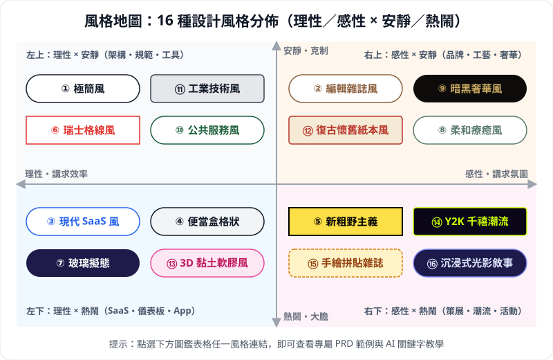
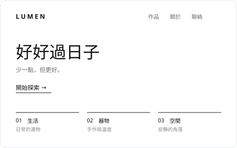
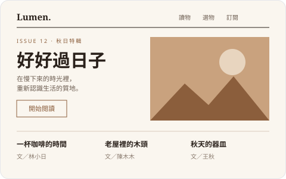
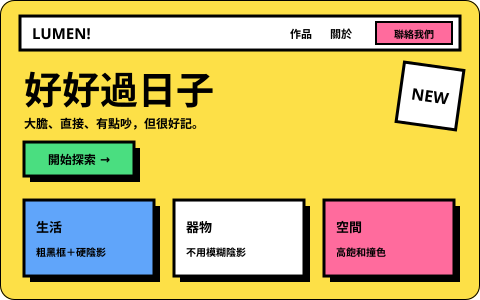
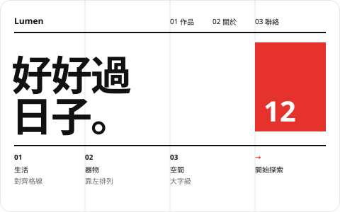
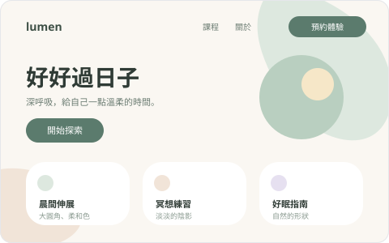
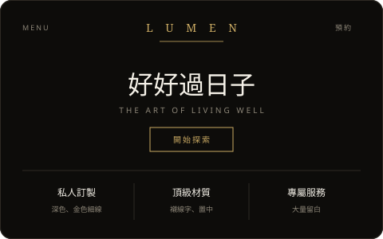
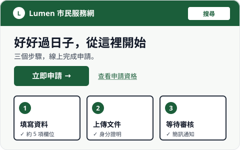

# 建立自己的 DESIGN.md：認識設計風格，寫出 AI 看得懂的規範

## 這個單元在解決什麼問題？

請 AI 做網頁時，常常遇到兩個問題：

1. **不知道要什麼風格**：只會說「有質感一點」、「高級一點」，AI 只能猜，結果就是千篇一律的公版。
2. **每一頁長得不一樣**：沒有固定的規則，AI 每次都重新發揮。

這個單元幫你解決這兩件事：先**認識常用的設計風格**，知道怎麼跟 AI 描述；再把選好的風格寫成 **DESIGN.md**，讓 AI 每一頁都遵守同一套規則。

---

## 先看一眼：10 種常用風格

| | | |
| :---: | :---: | :---: |
|  ① 極簡風 |  ② 編輯雜誌風 |  ③ 現代 SaaS 風 |
|  ④ 便當盒格狀 |  ⑤ 新粗野主義 |  ⑥ 瑞士格線風 |
|  ⑦ 玻璃擬態 |  ⑧ 柔和療癒風 |  ⑨ 暗黑奢華風 |
|  ⑩ 公共服務風 | | |

每種風格的特徵、適合的用途，以及可以直接貼給 AI 的關鍵字，都在第 02 章。

---

## 學習地圖

- [01. 認識 DESIGN.md](./01_認識DESIGN_md.md)：DESIGN.md 是什麼、上下兩層各寫什麼，並做一次有規範與沒規範的對照實驗。
- [02. 常用設計風格圖鑑](./02_常用設計風格圖鑑.md)：★ 10 種風格的圖解、適合用途與給 AI 的關鍵字。
- [03. 參考靈感網站與風格比稿](./03_參考靈感網站與風格比稿.md)：去哪裡找靈感、怎麼看出網站的風格，並請 AI 一次做三種風格比稿。
- [04. 建立與驗證自己的 DESIGN.md](./04_建立與驗證自己的DESIGN_md.md)：三條建立路線，以及「看 → 用 → 抓錯 → 改規範」的驗證流程。
- [05. 網頁中英文字型與圖示指南](./05_網頁中英文字型與圖示指南.md)：繁體中文與英文字型推薦、10 種風格中英混排速查表，以及 Google Icons 設定。
- [DESIGN_template.md](./DESIGN_template.md)：可以直接複製使用的範本（官方格式，附中文說明）。

---

## 學完你會有

- 一份屬於你專案的 `DESIGN.md`
- 一張樣式總覽頁 `style-guide.html`
- 用同一份規範、在不同對話做出的兩個一致的頁面

做好的 DESIGN.md 可以直接帶到 Claude Design、Google Stitch、pen.dev 等單元使用。
