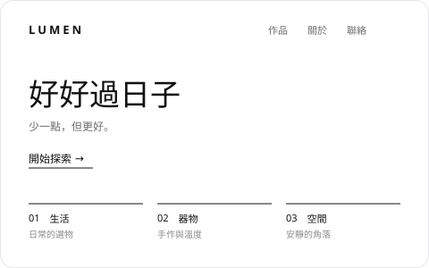

# ① 極簡風（Minimalism）

> **一句話：少即是多，只留下真正必要的元素，靠留白與比例說話。**



| 項目 | 規格特徵 |
| :--- | :--- |
| **象限位置** | 理性 × 安靜（重秩序、零多餘裝飾） |
| **最適合** | 建築／室內設計作品集、設計工作室、高價單品介紹 |
| **不適合** | 資訊極多的新聞入口或促銷型電商（會顯得過於空洞） |
| **核心配色** | 純白 `#FFFFFF` ＋ 極深灰 `#111111` ＋ 中灰 `#6B6B6B`，最多 1 個低飽和重點色 |
| **字型搭配** | 細到中等字重的無襯線字（`Inter` ＋ `Noto Sans TC` 字重 300–500） |
| **形狀與線條** | 幾乎不用圓角（0–4px）與陰影，改用 `1px` 細線與大量留白區隔區塊 |

---

## 📄 專屬 `PRD.md` 範例（白隅空間 Blank Corner）

<details>
<summary>點此展開複製 PRD.md：白隅空間 Blank Corner（建築與室內設計事務所）</summary>

```markdown
# PRD：白隅空間 Blank Corner — 建築與室內設計作品集

## 1. 網站簡介
- **品牌名稱**：白隅空間 Blank Corner
- **專案定位**：呈現住宅、商空改建案例與預約設計諮詢的極簡作品集官網
- **目標對象**：30–50 歲重視空間光線、材質細節與極簡生活美學的屋主
- **核心轉換目標**：點擊「預約空間諮詢」填寫聯絡需求

## 2. 頁面區塊與文案內容

### ① 導覽列（Header）
- 左側品牌名稱：BLANK CORNER 白隅空間
- 右側導覽連結：精選作品、設計理念、預約諮詢

### ② 主視覺區（Hero）
- 主標語：把光線與留白，還給日常居住的尺度
- 副標語：台北建築與室內設計事務所，專注於住宅、藝廊與靜謐商業空間。
- 文字型主要連結按鈕：預約空間諮詢 →

### ③ 三件精選作品（無框線純列表／三欄）
1. **01｜陽明山霧屋住宅**｜2025 · 私人住宅｜清水模、北美白橡木與自然採光天井
2. **02｜大安區靜謐茶室**｜2025 · 商業空間｜灰泥牆面與低矮實木長桌的對話
3. **03｜新竹光廊藝術書屋**｜2024 · 文化場域｜鋼構書架與極簡動線的重組

### ④ 事務所資訊與頁尾（Footer）
- 工作室地址：台北市大安區青田街 12 巷 6 號
- 聯絡信箱：studio@blankcorner.example
- 版權宣告：© 2026 BLANK CORNER
```

</details>

---

## 🤖 產生 `DESIGN.md` 的參考 Prompt

複製下方 Prompt，連同上面的 `PRD.md` 一起交給 AI，即可產出標準雙層格式的 `DESIGN.md`：

```text
請讀取附件 PRD.md，為「白隅空間 Blank Corner」產出一份極簡風（Minimalism）的 DESIGN.md
（上方 YAML Token ＋ 下方 10 個標準 Markdown 章節）。

設計關鍵字與規則：
- 核心關鍵字：極簡主義、大量留白（section 間距 120px 以上）、黑白灰單色系、1px 細線分隔、零陰影、直角或微圓角（0-4px）、細字重標題（Noto Sans TC 300-400）
- 繁體中文字型：標題與內文皆使用 Inter ＋ Noto Sans TC（附 Google Fonts CDN）
- 避坑規則：不要陰影、不要彩色背景卡片、不要滿版背景大圖壓字、不要任何漸層或裝飾性圖示
```

### 🔑 這個 Prompt 的關鍵字教學：為什麼這樣寫？

| 關鍵字 | AI 讀到它會做什麼 | 不寫會出現什麼問題 |
| :--- | :--- | :--- |
| **大量留白（section 間距 120px）** | 拉開區塊距離與行距，產生呼吸感 | AI 預設會把區塊塞得很緊密，看起來像一般簡報 |
| **1px 細線分隔、零陰影** | 用 `border-top: 1px solid #E5E5E5` 分區 | AI 很習慣在卡片上加 `box-shadow`，破壞極簡冷靜感 |
| **細字重標題（300–400）** | 讓中文字看起來輕盈優雅 | AI 預設標題都會用粗體 700–900，失去建築畫冊氣質 |
| **黑白灰單色系** | 嚴格限制色彩數量，只用深灰與白 | 避免 AI 自己補上藍色按鈕或橘色標籤 |
| **不要彩色背景卡片** | 保持通透純白底，文字直接放在頁面上 | 否則每個作品都會被包成一個灰色圓角盒子 |

---

[⬅️ 返回 03. 常用設計風格圖鑑](../03_常用設計風格圖鑑.md)
