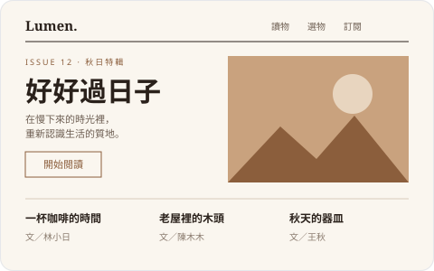

# ② 編輯雜誌風（Editorial）

> **一句話：像翻開一本質感生活雜誌，文字排版與大張照片都很講究。**



| 項目 | 規格特徵 |
| :--- | :--- |
| **象限位置** | 感性 × 安靜（重溫度、故事感與紙本閱讀節奏） |
| **最適合** | 咖啡館、陶藝／選品品牌、深度旅遊、獨立媒體與部落格 |
| **不適合** | 需要高效率操作的後台工具或即時儀表板 |
| **核心配色** | 紙張米白 `#FAF6EF` ＋ 深咖啡墨字 `#2A211B` ＋ 暖棕重點色 `#8B5E3C` |
| **字型搭配** | 標題用優雅襯線字（`Playfair Display` ＋ `Noto Serif TC`），內文用無襯線字（`Noto Sans TC`） |
| **形狀與線條** | 小圓角（2–6px）或直角；用 `1px` 細線代替陰影；照片比例大 |

---

## 📄 專屬 `PRD.md` 範例（島嶼陶器 Shima Pottery）

<details>
<summary>點此展開複製 PRD.md：島嶼陶器 Shima Pottery（大稻埕手作陶藝工作坊）</summary>

```markdown
# PRD：島嶼陶器 Shima Pottery — 大稻埕手作陶藝體驗與選物頁

## 1. 網站簡介
- **品牌名稱**：島嶼陶器 Shima Pottery
- **專案定位**：大稻埕手作陶藝工作坊體驗預約與日常器皿選物頁
- **目標對象**：25–45 歲喜歡手感器物、想體驗週末拉坏或挑選居家餐具的人
- **核心轉換目標**：點擊「預約週末體驗」查看課程時段

## 2. 頁面區塊與文案內容

### ① 導覽列（Header）
- 左側品牌名稱：島嶼陶器 Shima Pottery
- 右側導覽連結：體驗課程、器皿選物、工作室資訊
- 右側按鈕：預約週末體驗

### ② 主視覺區（Hero）
- 刊頭眉標：ISSUE 04 · 大稻埕器物誌
- 主標語：把泥土的溫度，放進每天的餐桌
- 副標語：走進大稻埕紅磚老屋二樓，跟著陶藝師親手捏製一只日常茶杯，或挑選一件能陪你很久的手作器皿。
- 主要按鈕：預約週末體驗
- 次要按鈕：瀏覽本季器皿

### ③ 熱門陶藝體驗（3 張圖文卡片）
1. **手捏日常馬克杯（2.5 小時）**｜NT$ 1,280｜新手友善，從土坯塑形到刻字上釉一次完成
2. **電動拉坏小花器（2 小時）**｜NT$ 1,450｜體驗轉盤拉坏的手感，附贈一束乾燥尤加利葉
3. **雙人餐桌器皿組（3 小時）**｜NT$ 2,600｜一人一皿一碗，推薦情侶或好友一起創作

### ④ 工作室資訊與頁尾（Footer）
- 地址：台北市大同區迪化街一段 142 巷 8 號 2 樓
- 開放時間：週四至週日 11:00–19:00（採預約制）
- 版權宣告：© 2026 島嶼陶器 Shima Pottery
```

</details>

---

## 🤖 產生 `DESIGN.md` 的參考 Prompt

```text
請讀取附件 PRD.md，為「島嶼陶器 Shima Pottery」產出一份編輯雜誌風（Editorial）的 DESIGN.md
（上方 YAML Token ＋ 下方 10 個標準 Markdown 章節）。

設計關鍵字與規則：
- 核心關鍵字：編輯雜誌風、暖色紙張底（#FAF6EF）、襯線大標題、大張留白照片比例、1px 細線分隔、小圓角（4px）、左右不對稱雜誌編排、眉標（Eyebrow）加上期刊編號
- 繁體中文字型：標題使用 Playfair Display ＋ Noto Serif TC（700），內文使用 Plus Jakarta Sans ＋ Noto Sans TC（附 Google Fonts CDN）
- 避坑規則：不要純白與純黑、不要任何陰影（elevation: none）、不要高飽和亮色、不要大圓角膠囊卡片
```

### 🔑 這個 Prompt 的關鍵字教學：為什麼這樣寫？

| 關鍵字 | AI 讀到它會做什麼 | 不寫會出現什麼問題 |
| :--- | :--- | :--- |
| **暖色紙張底 `#FAF6EF`** | 把背景做成類似生活雜誌紙張的柔和米白 | 預設 `#FFFFFF` 會讓頁面顯得像冷冰冰的科技網站 |
| **襯線大標題（Noto Serif TC）** | 標題換成有筆觸的宋體／明體 | 全站預設黑體會失去「刊物」與「手作」的文藝氣質 |
| **眉標（Eyebrow）＋ 期刊編號** | 在大標題上方加上一行小字（如 `ISSUE 04`） | 瞬間營造出像《Kinfolk》或《小日子》雜誌的封面感 |
| **左右不對稱雜誌編排** | Hero 採左文右圖或大圖配側欄文字 | 不寫的話 AI 會全部做成標準「文字置中」的公版首頁 |
| **不要任何陰影** | 強迫用細框線與底色微差區隔區塊 | 陰影會破壞平面印刷刊物的純粹感 |

---

[⬅️ 返回 03. 常用設計風格圖鑑](../03_常用設計風格圖鑑.md)
