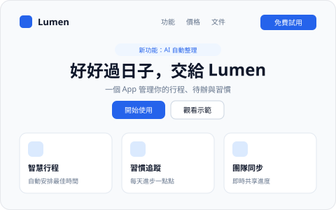

# ③ 現代 SaaS 風（Modern SaaS）

> **一句話：乾淨、專業、高信任度，讓訪客三秒看懂產品能幫他解決什麼問題。**



| 項目 | 規格特徵 |
| :--- | :--- |
| **象限位置** | 理性 × 熱鬧（強調功能、效率與行動轉換） |
| **最適合** | AI 工具、軟體服務、雲端工具、效率型 App 官網 |
| **不適合** | 手作職人、生活餐飲等需要情感與溫度的品牌 |
| **核心配色** | 淺灰白 `#F8FAFC` ＋ 深藍黑字 `#0F172A` ＋ 品牌信任藍 `#2563EB` |
| **字型搭配** | 幾何無襯線字（`Plus Jakarta Sans` ＋ `Noto Sans TC`），標題加粗（700） |
| **形狀與陰影** | 中等圓角（8–12px）；`1px` 淡邊框 `#E2E8F0` ＋ 非常輕柔的陰影 |

---

## 📄 專屬 `PRD.md` 範例（秒讀 ReadSnap）

<details>
<summary>點此展開複製 PRD.md：秒讀 ReadSnap（AI 讀書摘要與知識卡片工具）</summary>

```markdown
# PRD：秒讀 ReadSnap — AI 讀書摘要與知識卡片工具

## 1. 網站簡介
- **品牌名稱**：秒讀 ReadSnap
- **專案定位**：幫助學習者把 PDF、長文章一鍵轉成結構化重點與複習卡片的網頁工具
- **目標對象**：大學生、研究生、需要快速消化專業資料的知識工作者
- **核心轉換目標**：點擊「免費開始使用」體驗建立第一份筆記

## 2. 頁面區塊與文案內容

### ① 導覽列（Header）
- 左側品牌名稱：秒讀 ReadSnap
- 右側導覽連結：核心功能、方案價格、常見問題
- 右側按鈕：免費開始使用

### ② 主視覺區（Hero）
- 產品更新徽章：v2.4 支援繁體中文 PDF 精準摘要
- 主標語：30 秒讀懂長文章，自動整理成你的知識卡片
- 副標語：貼上網頁連結或上傳論文 PDF，AI 幫你抽出核心觀點、重點金句與複習測驗題，不再看了就忘。
- 主要按鈕：免費開始使用
- 次要按鈕：查看示範卡片

### ③ 三大核心功能（3 張附圖示卡片）
1. **長文秒速拆解**：支援網頁、PDF 與逐字稿，自動產出三層重點大綱
2. **一鍵轉成閃卡**：依照記憶曲線排程，每天花 5 分鐘複習重要概念
3. **跨資料夾關聯**：自動標記相關筆記與出處頁碼，寫報告找引用不費力

### ④ 方案資訊與頁尾（Footer）
- 免費方案：每月 20 篇摘要與無限張個人閃卡
- 客服信箱：support@readsnap.example
- 版權宣告：© 2026 秒讀 ReadSnap
```

</details>

---

## 🤖 產生 `DESIGN.md` 的參考 Prompt

```text
請讀取附件 PRD.md，為「秒讀 ReadSnap」產出一份現代 SaaS 風（Modern SaaS）的 DESIGN.md
（上方 YAML Token ＋ 下方 10 個標準 Markdown 章節）。

設計關鍵字與規則：
- 核心關鍵字：現代 SaaS（Linear / Stripe 質感）、淺灰白底（#F8FAFC）、深藍黑文字（#0F172A）、信任藍主按鈕（#2563EB）、置中大標搭配產品更新徽章、1px 細邊框搭配極淡陰影、中等圓角（8-12px）、功能卡片附單色線條圖示
- 繁體中文字型：標題使用 Plus Jakarta Sans ＋ Noto Sans TC（700），內文使用 Inter ＋ Noto Sans TC（400）（附 Google Fonts CDN）
- 避坑規則：嚴禁紫藍漸層背景、嚴禁霓虹發光按鈕（glow）、不要過度誇張的立體陰影
```

### 🔑 這個 Prompt 的關鍵字教學：為什麼這樣寫？

| 關鍵字 | AI 讀到它會做什麼 | 不寫會出現什麼問題 |
| :--- | :--- | :--- |
| **現代 SaaS（Linear / Stripe 質感）** | 採用高資訊清晰度、克制留白的版面比例 | 只寫「科技感」，AI 會做成滿滿發光線條的過時頁面 |
| **嚴禁紫藍漸層、嚴禁發光按鈕** | 強制擋掉 AI 最常出現的廉價「AI 公版味」 | AI 遇到軟體主題幾乎 90% 會自動塞紫藍漸層 |
| **淺灰白底＋1px 細邊框** | 讓白色卡片在 `#F8FAFC` 背景上自然浮現 | 比單純全白背景更有層次，卻又不會顯得髒亂 |
| **置中大標搭配更新徽章** | 做出經典的 SaaS Hero（小膠囊標籤＋大標題＋雙按鈕） | 訪客進站第一眼就能抓到重點行動（CTA） |
| **功能卡片附單色線條圖示** | 統一使用 Lucide / Material 等乾淨線條圖示 | 避免 AI 用五顏六色的 Emoji（🚀🔥💡）取代圖示 |

---

[⬅️ 返回 03. 常用設計風格圖鑑](../03_常用設計風格圖鑑.md)
