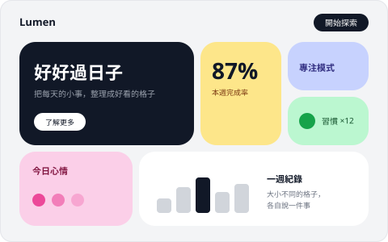

# ④ 便當盒格狀（Bento Grid）

> **一句話：像日式便當盒一樣，用大小不同的圓角方塊整齊拼出所有重點，一格裝一件事。**



| 項目 | 規格特徵 |
| :--- | :--- |
| **象限位置** | 理性 × 熱鬧（高密度整理、模組化呈現資訊） |
| **最適合** | 產品功能總覽、個人數位名片、收支或健康數據儀表板 |
| **不適合** | 需要從頭到尾連貫閱讀的長篇故事或散文 |
| **核心配色** | 淺灰底 `#F3F4F6` ＋ 潔白卡片 `#FFFFFF` ＋ 1 個深色焦點主格 `#111827` ＋ 1–2 個柔和點綴色 |
| **字型搭配** | 無襯線粗體（`Outfit` ＋ `Noto Sans TC`），數據數字可搭配 `JetBrains Mono` 放大 |
| **形狀與間距** | 大圓角（16–24px）；所有格子的間距（`gap`）完全一致（如 `16px`） |

---

## 📄 專屬 `PRD.md` 範例（PocketFin 口袋帳房）

<details>
<summary>點此展開複製 PRD.md：PocketFin 口袋帳房（自由工作者收支追蹤工具）</summary>

```markdown
# PRD：PocketFin 口袋帳房 — 自由工作者收支與訂閱管理儀表板

## 1. 網站簡介
- **品牌名稱**：PocketFin 口袋帳房
- **專案定位**：把接案收入、扣款訂閱提醒與年度預估稅金，裝進一個畫面的極簡財務看板
- **目標對象**：自由接案者、一人工作室、斜槓創作者
- **核心轉換目標**：點擊「免費建立我的帳本」開始記帳

## 2. 頁面區塊與文案內容

### ① 導覽列（Header）
- 左側品牌名稱：PocketFin 口袋帳房
- 右側導覽連結：功能方格、資料安全、收費方式
- 右側按鈕：免費建立帳本

### ② 便當盒總覽主視覺（Bento Hero，4–5 個大小格子拼成一屏）
- **主格（佔 2 欄寬，深色重點格）**：
  - 標語：接案收入與扣款，一格看懂本月財務
  - 副標：專為自由工作者設計的財務便當盒，不用學複式會計。
  - 按鈕：免費建立我的帳本
- **右上格（數據亮點）**：本月實收 `NT$ 68,500`（較上月 `+18%`）
- **中右格（訂閱提醒）**：3 筆即將續訂提醒（Adobe、Figma、Notion）
- **左下格（稅金試算）**：自動預留 10% 報稅預備金
- **右下格（多幣別支援）**：支援 USD / TWD 即時匯率換算

### ③ 頁尾（Footer）
- 安心承諾：銀行級 TLS 加密、隨時一鍵匯出 Excel
- 版權宣告：© 2026 PocketFin 口袋帳房
```

</details>

---

## 🤖 產生 `DESIGN.md` 的參考 Prompt

```text
請讀取附件 PRD.md，為「PocketFin 口袋帳房」產出一份便當盒格狀（Bento Grid）的 DESIGN.md
（上方 YAML Token ＋ 下方 10 個標準 Markdown 章節）。

設計關鍵字與規則：
- 核心關鍵字：便當盒格狀版面（Apple Bento Grid 風格）、淺灰背景（#F3F4F6）、大小不等但邊緣嚴格對齊的圓角方塊（col-span / row-span 混排）、大圓角（20px）、一致的格距（gap: 16px）、其中一格使用深色反差背景（#111827）當視覺焦點、放大粗體數據數字、手機版（<768px）全部改為單欄堆疊
- 繁體中文字型：標題使用 Outfit ＋ Noto Sans TC（700），數據數字使用 JetBrains Mono（附 Google Fonts CDN）
- 避坑規則：每格只放一個重點資訊（不要塞超過三行文字）、不要每個格子都用不同亮色以免變彩虹拼盤
```

### 🔑 這個 Prompt 的關鍵字教學：為什麼這樣寫？

| 關鍵字 | AI 讀到它會做什麼 | 不寫會出現什麼問題 |
| :--- | :--- | :--- |
| **col-span / row-span 混排** | 做出有大有小、有橫有直的 CSS Grid 拼圖 | 只寫「卡片排版」，AI 會做出三張一模一樣寬度的卡片 |
| **其中一格使用深色反差背景** | 製造明確的視覺重心，引導視線先看主要 CTA | 全部格子都是白色會沒有主次之分 |
| **一致的格距（gap: 16px）與大圓角 20px** | 呈現像 Apple 發表會圖表般舒服的模組感 | 圓角和間距不統一會看起來像拼貼失敗的表格 |
| **放大粗體數據數字** | 把 `NT$ 68,500`、`+18%` 做成高視覺張力的字級 | 數據跟說明文字一樣大，失去儀表板快速掃描的效果 |
| **手機版（<768px）改為單欄** | 確保響應式排版不會在手機上擠成一團 | Bento 格子在窄螢幕很容易跑版或文字被截斷 |

---

[⬅️ 返回 03. 常用設計風格圖鑑](../03_常用設計風格圖鑑.md)
