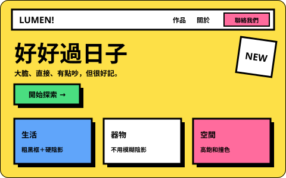

# ⑤ 新粗野主義（Neo-Brutalism）

> **一句話：粗黑框、不模糊的黑色硬陰影加上高飽和撞色，大膽直接、讓人過目不忘。**



| 項目 | 規格特徵 |
| :--- | :--- |
| **象限位置** | 感性 × 熱鬧（極高記憶點、強視覺衝擊） |
| **最適合** | 音樂祭、潮流品牌、創意工作坊、年輕世代活動宣傳頁 |
| **不適合** | 銀行、醫療、律師事務所等需要穩重信任感的網站 |
| **核心配色** | 亮黃 `#FDE047`、電光粉 `#FF6B9D`、天藍 `#60A5FA`、螢光綠 `#4ADE80` ＋ 純黑線框 `#000000` |
| **字型搭配** | 極粗無襯線字（`Space Grotesk` ＋ `Noto Sans TC` 字重 800–900） |
| **形狀與陰影** | 零圓角或微圓角（0–4px）；`3px solid #000000` 粗黑框；`6px 6px 0px #000000` 無模糊硬陰影 |

---

## 📄 專屬 `PRD.md` 範例（夜浪聲景 NightWave）

<details>
<summary>點此展開複製 PRD.md：夜浪聲景 NightWave（台北夏日戶外音樂祭）</summary>

```markdown
# PRD：夜浪聲景 NightWave — 台北夏日戶外音樂與光影祭

## 1. 網站簡介
- **品牌名稱**：夜浪聲景 NightWave 2026
- **專案定位**：結合獨立樂團演出與夜間市集的兩日戶外音樂祭售票頁
- **目標對象**：18–35 歲喜歡音樂祭、獨立樂團與潮流文化的年輕族群
- **核心轉換目標**：點擊「立即搶購早鳥票」前往購票

## 2. 頁面區塊與文案內容

### ① 導覽列（Header）
- 左側活動名稱：NIGHTWAVE! 2026
- 右側導覽連結：演出陣容、時間表、市集攤位
- 右側按鈕：立即搶購早鳥票

### ② 主視覺區（Hero）
- 活動貼紙標籤：2026.08.15–16 · 大佳河濱公園
- 主標語：在夏夜河岸，把音量開到最大
- 副標語：16 組獨立樂團 × 3 座戶外舞台 × 40 攤深夜美食市集，連續兩晚不間斷演出。
- 主要按鈕：搶購早鳥票 →
- 次要按鈕：看完整陣容

### ③ 三大活動亮點（3 張撞色卡片）
1. **雙主舞台 Live 演出**｜從城市民謠到迷幻電子，集結 16 組話題音樂人
2. **河岸光影裝置**｜12 公尺即時聲波互動大螢幕，隨節奏變色
3. **深夜選物市集**｜人氣餐車、特調飲品與獨立插畫周邊

### ④ 票務資訊與頁尾（Footer）
- 票價快訊：單日早鳥票 NT$ 1,400｜雙日聯票 NT$ 2,400
- 版權宣告：© 2026 NIGHTWAVE FESTIVAL
```

</details>

---

## 🤖 產生 `DESIGN.md` 的參考 Prompt

```text
請讀取附件 PRD.md，為「夜浪聲景 NightWave 2026」產出一份新粗野主義（Neo-Brutalism）的 DESIGN.md
（上方 YAML Token ＋ 下方 10 個標準 Markdown 章節）。

設計關鍵字與規則：
- 核心關鍵字：新粗野主義（Neo-Brutalism / Gumroad 風格）、高飽和撞色（亮黃 #FDE047 底配粉紅 #FF6B9D 與亮綠 #4ADE80 卡片）、全元件 3px 純黑粗邊框（#000000）、無模糊的黑色硬陰影（box-shadow: 6px 6px 0 #000000）、零圓角（border-radius: 0px）、極粗黑體大字（900）、微傾斜貼紙標籤（rotate）與按鈕 hover 下壓位移效果
- 繁體中文字型：標題使用 Space Grotesk ＋ Noto Sans TC（900），內文使用 Noto Sans TC（700）（附 Google Fonts CDN）
- 避坑規則：絕對不要柔和模糊陰影、不要大圓角、不要低飽和莫蘭迪色或漸層
```

### 🔑 這個 Prompt 的關鍵字教學：為什麼這樣寫？

| 關鍵字 | AI 讀到它會做什麼 | 不寫會出現什麼問題 |
| :--- | :--- | :--- |
| **3px 純黑粗邊框 `#000000`** | 讓導覽列、按鈕、卡片都有強烈漫畫框線感 | 預設 `1px` 淺灰框完全沒有粗野主義的視覺力度 |
| **無模糊的黑色硬陰影（6px 6px 0 #000）** | 畫出像剪紙貼在畫面上的立體位移陰影 | 若只寫「陰影」，AI 會做成柔焦灰陰影，整組風格直接失效 |
| **零圓角（0px）＋ 極粗黑體（900）** | 呈現銳利、直接、有吼叫感的街頭海報氣場 | 圓角與細字會把這股張力磨平 |
| **高飽和撞色（亮黃／電光粉／亮綠）** | 做出活潑刺眼、高回頭率的年輕感配色 | 避開過度安全的白灰底色 |
| **按鈕 hover 下壓位移效果** | 滑鼠移上時按鈕往右下移動並縮短陰影，模擬實體按鍵 | 增加網頁的互動趣味，符合街機／海報感 |

---

[⬅️ 返回 03. 常用設計風格圖鑑](../03_常用設計風格圖鑑.md)
