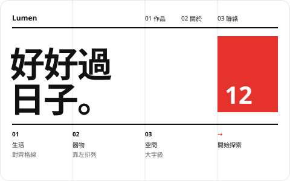

# ⑥ 瑞士格線風（Swiss Style）

> **一句話：嚴謹的直線網格、超大的粗體字與強烈單一紅，用「排版本身」當作設計。**



| 項目 | 規格特徵 |
| :--- | :--- |
| **象限位置** | 理性 × 安靜（強調結構、秩序與建築級排版張力） |
| **最適合** | 設計展覽、建築事務所、字體／出版機構、文化雙年展 |
| **不適合** | 追求可愛、親民、生活療癒感的親子或寵物品牌 |
| **核心配色** | 純白 `#FFFFFF` ＋ 純黑 `#0A0A0A` ＋ 經典瑞士紅 `#E5322D` |
| **字型搭配** | 粗黑無襯線字（`Inter` ＋ `Noto Sans TC` 字重 700–900），搭配 `IBM Plex Mono` 數字編號 |
| **形狀與網格** | 完全直角（`0px`）；顯露的 `1px–2px` 黑色直線網格；標題超大、嚴格靠左對齊 |

---

## 📄 專屬 `PRD.md` 範例（漢字秩序 TypeGrid 2026）

<details>
<summary>點此展開複製 PRD.md：漢字秩序 TypeGrid 2026（當代平面與字體設計展）</summary>

```markdown
# PRD：漢字秩序 TypeGrid 2026 — 台灣當代平面與字體設計雙年展

## 1. 網站簡介
- **品牌名稱**：TYPEGRID 2026 漢字秩序
- **專案定位**：呈現年度策展主題、三大展區導覽與線上購票的當代設計展官網
- **目標對象**：平面設計師、設計系學生、藝術與字體文化愛好者
- **核心轉換目標**：點擊「購買展覽門票」預訂展期時段

## 2. 頁面區塊與文案內容

### ① 導覽列（Header）
- 左側展名：TYPEGRID 2026
- 右側導覽連結：01 展覽介紹、02 展區地圖、03 講座活動
- 右側按鈕：購買展覽門票

### ② 主視覺區（Hero）
- 左側超大標題：漢字的網格與秩序
- 右側資訊欄：2026.10.10 – 12.20｜台北松菸四號倉庫｜策展人：林序哲
- 主要按鈕：購買展覽門票

### ③ 三大展區單元（網格編號 01 / 02 / 03）
1. **01 / 鉛字到螢幕**｜台灣半世紀來的活版印刷與螢幕字體演進史
2. **02 / 結構實驗室**｜拆解 120 組當代漢字造字網格與比例系統
3. **03 / 城市指標系統**｜公共捷運、街道招牌中的資訊視覺化設計

### ④ 頁尾（Footer）
- 開放時間：每日 10:00–18:00（週一休館）
- 主辦單位：台灣字體秩序協會 © 2026
```

</details>

---

## 🤖 產生 `DESIGN.md` 的參考 Prompt

```text
請讀取附件 PRD.md，為「漢字秩序 TypeGrid 2026」產出一份瑞士國際主義格線風（Swiss Style）的 DESIGN.md
（上方 YAML Token ＋ 下方 10 個標準 Markdown 章節）。

設計關鍵字與規則：
- 核心關鍵字：瑞士國際主義風格（Swiss Typographic Style）、外顯式 1px 黑色直線網格（Visible Grid）、紅黑白三色（#FFFFFF、#0A0A0A、#E5322D）、完全直角（0px）、超大粗體靠左對齊標題、明顯的等寬數字編號（01 / 02 / 03）、非對稱欄位比例（例如左 8 欄大標右 4 欄摘要）
- 繁體中文字型：標題使用 Inter ＋ Noto Sans TC（800-900），編號使用 IBM Plex Mono（附 Google Fonts CDN）
- 避坑規則：嚴禁圓角、嚴禁陰影、不要置中對齊標題、不要第四種裝飾色或漸層
```

### 🔑 這個 Prompt 的關鍵字教學：為什麼這樣寫？

| 關鍵字 | AI 讀到它會做什麼 | 不寫會出現什麼問題 |
| :--- | :--- | :--- |
| **外顯式 1px 黑色直線網格** | 直接用黑色實線畫出明顯的欄位格線 | 網格被隱藏起來後，頁面會變回普通極簡風 |
| **紅黑白三色（#E5322D）** | 全站只用黑、白，並將瑞士紅集中於單一亮點 | 色彩太多會破壞瑞士平面海報的俐落感 |
| **超大粗體靠左對齊標題** | 讓文字本身成為最大的視覺主角，不靠圖片撐場面 | AI 常習慣把展覽頁的標題置中，失去瑞士風格特色 |
| **明顯的等寬數字編號（01/02/03）** | 加上 `IBM Plex Mono` 編號與日期標籤 | 補強國際主義的「系統感」與「工程紀律」 |
| **嚴禁圓角與陰影** | 全站所有色塊與按鈕都維持鋒利的 90 度直角 | 圓角一出現就會讓格線感瞬間鬆散掉 |

---

[⬅️ 返回 03. 常用設計風格圖鑑](../03_常用設計風格圖鑑.md)
