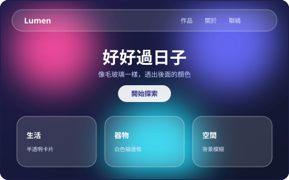

# ⑦ 玻璃擬態（Glassmorphism）

> **一句話：像一片漂浮的毛玻璃，半透明卡片透出背後流動的彩色光暈。**



| 項目 | 規格特徵 |
| :--- | :--- |
| **象限位置** | 理性 × 熱鬧（科技未來感、空間層次感） |
| **最適合** | 音樂／聲音 App、空間運算介面、AI 工具的局部浮動面板 |
| **不適合** | 需要大量長文閱讀的頁面，或白底官網（透不出光暈效果） |
| **核心配色** | 深靛夜底 `#0B0F19` ＋ 藍紫光暈球 `#6366F1` / `#06B6D4` ＋ 半透明白卡片 `rgba(255,255,255,0.1)` |
| **字型搭配** | 乾淨無襯線字（`Plus Jakarta Sans` ＋ `Noto Sans TC`），純白 `#FFFFFF` 與淺灰 `#CBD5E1` 高對比文字 |
| **形狀與材質** | 中大圓角（16–20px）；`1px solid rgba(255,255,255,0.2)` 玻璃邊緣高光 ＋ `backdrop-filter: blur(16px)` |

---

## 📄 專屬 `PRD.md` 範例（Aether 聲境）

<details>
<summary>點此展開複製 PRD.md：Aether 聲境（AI 空間音訊與專注環境音 App）</summary>

```markdown
# PRD：Aether 聲境 — AI 空間音訊與深度專注環境音平台

## 1. 網站簡介
- **品牌名稱**：Aether 聲境
- **專案定位**：依據時間、天氣與使用者專注狀態，即時混音自然聲景的數位音訊應用
- **目標對象**：遠距工作者、設計師、容易受外界噪音干擾的深度閱讀者
- **核心轉換目標**：點擊「開啟線上試聽播放器」立即體驗混音

## 2. 頁面區塊與文案內容

### ① 浮動玻璃導覽列（Header）
- 左側品牌名稱：AETHER 聲境
- 右側導覽連結：聲景圖書館、空間音訊、訂閱方案
- 右側按鈕：開啟播放器

### ② 主視覺區（Hero）
- 狀態指示標籤：LIVE · 台北雨夜聲景生成中
- 主標語：戴上耳機，走進一座不被打擾的聲音空間
- 副標語：結合 3D 雙耳空間音訊與環境白噪音，幫你在 3 分鐘內進入心流狀態。
- 主要按鈕：開啟線上試聽播放器
- 次要按鈕：探索 24 種聲景

### ③ 三大聲景模式卡片（3 張半透明玻璃卡片）
1. **午夜森林雨聲**｜42 Hz α波混音｜雨滴落葉與遠處雷鳴，適合夜間寫作
2. **老宅木屋壁爐**｜溫暖白噪音｜柴火劈啪聲與窗外微風，降低焦慮感
3. **深海無重力空間**｜低頻環境共振｜過濾人聲干擾，適合寫程式與思考

### ④ 頁尾（Footer）
- 支援平台：Web、macOS、iOS 跨裝置同步
- 版權宣告：© 2026 Aether Sound Lab
```

</details>

---

## 🤖 產生 `DESIGN.md` 的參考 Prompt

```text
請讀取附件 PRD.md，為「Aether 聲境」產出一份玻璃擬態（Glassmorphism）的 DESIGN.md
（上方 YAML Token ＋ 下方 10 個標準 Markdown 章節）。

設計關鍵字與規則：
- 核心關鍵字：玻璃擬態（macOS / visionOS 毛玻璃質感）、深靛夜背景（#0B0F19）搭配 2-3 顆柔和模糊的青藍與靛紫光暈背景球、半透明白色卡片（rgba(255,255,255,0.08)）、backdrop-filter: blur(16px)、1px 半透明白色高光邊框（rgba(255,255,255,0.2)）、大圓角（16-20px）、純白與淺灰高對比文字（確保 WCAG AA 可讀性）
- 繁體中文字型：標題使用 Plus Jakarta Sans ＋ Noto Sans TC（700），內文使用 Inter ＋ Noto Sans TC（400）（附 Google Fonts CDN）
- 避坑規則：玻璃材質只用在導覽列、卡片與浮動面板（不要整頁文字都浮在複雜圖片上）、不可使用灰色暗沉文字導致看不清楚
```

### 🔑 這個 Prompt 的關鍵字教學：為什麼這樣寫？

| 關鍵字 | AI 讀到它會做什麼 | 不寫會出現什麼問題 |
| :--- | :--- | :--- |
| **背景柔和模糊光暈球** | 在卡片後方畫出幾個漸層色光球，讓玻璃透出顏色 | 如果背景只是純色一片，毛玻璃會完全看不出效果 |
| **backdrop-filter: blur(16px)** | 真正讓背後光暈產生「霧面毛玻璃」散射質感 | 只用半透明顏色沒有 blur，看起來只是髒髒的半透明灰塊 |
| **1px 半透明白色高光邊框** | 模擬真實玻璃邊緣的反光厚度 | 缺少邊框高光，半透明卡片會直接融進深色背景裡 |
| **純白與淺灰高對比文字** | 保證字體在半透明背景上依然清晰好讀 | 玻璃擬態最常失敗的地方就是文字對比不足 |
| **只用在導覽列與卡片** | 克制使用玻璃層，維持畫面乾淨秩序 | 濫用多重玻璃疊玻璃會讓畫面變得混亂且效能差 |

---

[⬅️ 返回 03. 常用設計風格圖鑑](../03_常用設計風格圖鑑.md)
