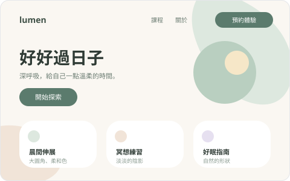

# ⑧ 柔和療癒風（Soft & Organic）

> **一句話：低飽和的大自然配色、圓潤的造型與寬鬆留白，讓人一打開網頁就感到放鬆。**



| 項目 | 規格特徵 |
| :--- | :--- |
| **象限位置** | 感性 × 安靜（親切、溫柔、零壓迫感） |
| **最適合** | 心理諮商、瑜伽、芳療、診所、健康習慣養成 App |
| **不適合** | 強調限時搶購、高緊張感促銷或金融交易介面 |
| **核心配色** | 燕麥米白 `#FAF7F2` ＋ 鼠尾草綠 `#5B7B6D` ＋ 淡粉橘／暖沙色點綴 ＋ 深橄欖字 `#2D332F` |
| **字型搭配** | 圓潤親切的無襯線字（`DM Sans` ＋ `Zen Maru Gothic` 或 `Noto Sans TC`） |
| **形狀與線條** | 大圓角（20–24px）、全圓角膠囊按鈕（`999px`）、柔和有機弧形色塊、極淡暖陰影 |

---

## 📄 專屬 `PRD.md` 範例（森息呼吸 Mori Breath）

<details>
<summary>點此展開複製 PRD.md：森息呼吸 Mori Breath（城市芳療瑜伽與靜心空間）</summary>

```markdown
# PRD：森息呼吸 Mori Breath — 城市芳療瑜伽與正念舒壓工作坊

## 1. 網站簡介
- **品牌名稱**：森息呼吸 Mori Breath
- **專案定位**：提供下班後伸展瑜伽、植物芳療與呼吸靜心課程的預約官網
- **目標對象**：25–42 歲容易肩頸緊繃、睡不好、想找回生活節奏的上班族
- **核心轉換目標**：點擊「預約初次體驗」選擇合適的舒壓課程

## 2. 頁面區塊與文案內容

### ① 導覽列（Header）
- 左側品牌名稱：森息呼吸 Mori Breath
- 右側導覽連結：課程介紹、芳療空間、常見問題
- 右側按鈕：預約初次體驗

### ② 主視覺區（Hero）
- 主標語：給忙碌的一天，留出 60 分鐘安靜呼吸
- 副標語：在檜木與真正薰衣草的香氣裡，透過溫和伸展與引導式冥想，慢慢放下身體的緊繃。
- 主要按鈕：預約初次體驗
- 次要按鈕：瀏覽本週課表

### ③ 三種溫和課程（3 張圓角卡片）
1. **下班修復陰瑜伽**｜週二、四 19:30｜零基礎友善，深度放鬆骨盆與下背壓力
2. **植物芳療呼吸課**｜週三 20:00｜結合森林系複方精油與腹式呼吸引導
3. **週末晨間靜心伸展**｜週六 09:30｜喚醒身體循環，為假日開啟平靜序曲

### ④ 空間與聯絡（Footer）
- 空間地址：台中市西區存中街 45 號
- 開放時段：週二至週日 09:00–21:00
- 版權宣告：© 2026 森息呼吸 Mori Breath
```

</details>

---

## 🤖 產生 `DESIGN.md` 的參考 Prompt

```text
請讀取附件 PRD.md，為「森息呼吸 Mori Breath」產出一份柔和療癒風（Soft & Organic）的 DESIGN.md
（上方 YAML Token ＋ 下方 10 個標準 Markdown 章節）。

設計關鍵字與規則：
- 核心關鍵字：柔和療癒風、低飽和自然大地色系（燕麥米白 #FAF7F2 底、鼠尾草綠 #5B7B6D 主色、暖陶土粉淡點綴）、大圓角卡片（20-24px）、全圓角膠囊按鈕（999px）、背景點綴柔和的有機弧形色塊（organic blob）、非常輕柔的暖色陰影、舒適寬鬆的行高（1.8）
- 繁體中文字型：標題與內文使用 DM Sans ＋ Zen Maru Gothic（或 Noto Sans TC）（附 Google Fonts CDN）
- 避坑規則：不要銳利直角（0px）、不要純黑邊框或純黑文字、不要高飽和鮮豔亮色、不要有壓迫感的促銷倒數或緊湊排版
```

### 🔑 這個 Prompt 的關鍵字教學：為什麼這樣寫？

| 關鍵字 | AI 讀到它會做什麼 | 不寫會出現什麼問題 |
| :--- | :--- | :--- |
| **低飽和自然大地色系** | 選用不刺眼的莫蘭迪綠、燕麥米與暖沙色 | 預設亮綠色會變得像提神飲料或運動品牌，不夠療癒 |
| **大圓角（20–24px）＋ 膠囊按鈕** | 消去所有尖銳稜角，營造溫柔安全感 | 直角與小圓角會讓人感覺理性冰冷 |
| **有機弧形色塊（organic blob）** | 用柔和波浪或卵石形狀替代生硬幾何框 | 讓整體畫面多了一股植物與呼吸般的流動感 |
| **Zen Maru Gothic（圓體字）** | 標題與按鈕呈現溫暖圓潤筆畫 | 配合大圓角卡片，讓整體視覺氣質更一致 |
| **不要純黑邊框與促銷語氣** | 保護舒緩平靜的心理感受 | 避免 AI 寫出「立即搶購」等破壞放鬆氛圍的字眼 |

---

[⬅️ 返回 03. 常用設計風格圖鑑](../03_常用設計風格圖鑑.md)
