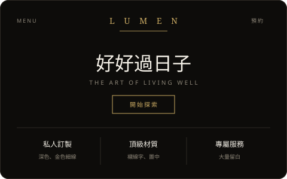

# ⑨ 暗黑奢華風（Dark Luxury）

> **一句話：深邃黑底、細緻香檳金與寬鬆字距，安靜且毫不費力地展現高級感。**



| 項目 | 規格特徵 |
| :--- | :--- |
| **象限位置** | 感性 × 安靜（低調、神秘、專屬禮遇感） |
| **最適合** | 精品珠寶、單一麥芽酒莊／餐酒館、高級私廚、頂級香氛 |
| **不適合** | 平價促銷電商、親子育兒、需要高效率查表的功能網站 |
| **核心配色** | 近黑曜石 `#0D0C0A` ＋ 香檳金 `#C9A962` ＋ 象牙米白字 `#F5F1E8` |
| **字型搭配** | 古典襯線字（`Cormorant Garamond` ＋ `Noto Serif TC`），英文小標全大寫拉寬字距 |
| **形狀與細節** | 直角（`0px`）；`1px` 金色細線框按鈕與分隔線；大幅度上下留白 |

---

## 📄 專屬 `PRD.md` 範例（琥珀時光 Amber & Cask）

<details>
<summary>點此展開複製 PRD.md：琥珀時光 Amber & Cask（預約制威士忌品酩室與私廚）</summary>

```markdown
# PRD：琥珀時光 Amber & Cask — 預約制威士忌品酩室與私廚

## 1. 網站簡介
- **品牌名稱**：AMBER & CASK 琥珀時光
- **專案定位**：提供包桶威士忌品鑑、搭餐私廚預約與 VIP 會員藏酒服務的專屬官網
- **目標對象**：35–55 歲重視私密空間、微醺儀式感與頂級餐酒搭配的品味客群
- **核心轉換目標**：點擊「預約私密品酩席」申請包廂時段

## 2. 頁面區塊與文案內容

### ① 導覽列（Header）
- 左側品牌名稱：AMBER & CASK
- 右側導覽連結：精選酒藏、季節私廚、預約席次

### ② 主視覺區（Hero）
- 英文眉標：PRIVATE TASTING ROOM · EST. 2019
- 主標語：時間與橡木桶，醞釀夜色裡的琥珀微光
- 副標語：每晚僅接待四組預約貴賓，在低語的爵士樂裡品飲單一桶原酒與主廚炭烤料理。
- 主要按鈕：預約私密品酩席

### ③ 三大典藏體驗（3 個金色細框區塊）
1. **高年份單桶原酒品鑑**｜蘇格蘭斯佩賽區 18 年至 30 年限量原酒
2. **季節炭火搭配私廚**｜以台灣在地熟成牛排與海鮮呼應泥煤與雪莉桶香氣
3. **專屬私人存酒櫃**｜會員可享恆溫恆濕酒窖託管與客製酒標服務

### ④ 頁尾（Footer）
- 地點：台北市信義區松仁路私密巷弄（預約確認後提供門牌）
- 營業時間：週三至週日 19:00–01:00
- 版權宣告：© 2026 AMBER & CASK TAIPEI
```

</details>

---

## 🤖 產生 `DESIGN.md` 的參考 Prompt

```text
請讀取附件 PRD.md，為「琥珀時光 Amber & Cask」產出一份暗黑奢華風（Dark Luxury）的 DESIGN.md
（上方 YAML Token ＋ 下方 10 個標準 Markdown 章節）。

設計關鍵字與規則：
- 核心關鍵字：暗黑奢華風、近黑曜石背景（#0D0C0A）、象牙米白文字（#F5F1E8）、低飽和香檳金點綴（#C9A962）、襯線標題置中對齊、英文眉標全大寫拉寬字距（letter-spacing: 0.25em）、直角（0px）、1px 金色細線框按鈕、極大留白（section 間距 128px）
- 繁體中文字型：標題使用 Cormorant Garamond ＋ Noto Serif TC（600），內文使用 Manrope ＋ Noto Sans TC（附 Google Fonts CDN）
- 避坑規則：嚴禁俗氣亮黃金色、嚴禁霓虹發光或紫色漸層、不要大圓角、不要把每個項目塞成圓角卡片
```

### 🔑 這個 Prompt 的關鍵字教學：為什麼這樣寫？

| 關鍵字 | AI 讀到它會做什麼 | 不寫會出現什麼問題 |
| :--- | :--- | :--- |
| **近黑 `#0D0C0A` ＋ 象牙米白 `#F5F1E8`** | 用帶有暖意炭黑配柔和米白字 | 純黑 `#000` 配純白 `#FFF` 在螢幕上過於刺眼，像科技產品而非高級餐廳 |
| **低飽和香檳金 `#C9A962`** | 表現精品手錶與酒莊的低調奢華 | 若只寫「金色」，AI 容易用亮黃色 `#FFD700` 顯得俗氣 |
| **英文眉標全大寫拉寬字距** | 做出像奢華飯店、精品香水官網的頂部標頭 | 瞬間提升版面呼吸感與高級典雅氣息 |
| **1px 金色細線框按鈕（直角）** | 按鈕改為透明底加金色細框，hover 才填滿 | 實心彩色大圓角按鈕會看起來像一般特賣網站 |
| **極大留白（128px）** | 每個區塊留足黑底空間，營造「VIP 專屬從容感」 | 擁擠的排版是高級感最大的殺手 |

---

[⬅️ 返回 03. 常用設計風格圖鑑](../03_常用設計風格圖鑑.md)
