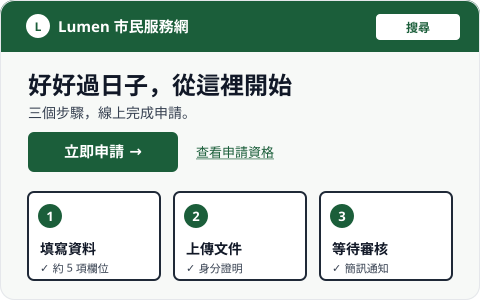

# ⑩ 公共服務風（Accessible / Civic）

> **一句話：高對比、大字體、步驟清楚，讓從年輕人到阿公阿嬤都能一眼看懂、順利完成操作。**



| 項目 | 規格特徵 |
| :--- | :--- |
| **象限位置** | 理性 × 安靜（最高可讀性、極強公信力、無障礙優先） |
| **最適合** | 政府補助平台、醫院掛號系統、學校官網、銀行與大眾公共服務 |
| **不適合** | 靠視覺氛圍或藝術留白取勝的潮流／精品形象頁 |
| **核心配色** | 純白底 `#FFFFFF` ＋ 深墨灰字 `#1F2937` ＋ 穩重深綠 `#1B5E3A`（全站對比度 ≥ 4.5:1 符合 WCAG AA） |
| **字型搭配** | 清晰高辨識無襯線字（`Noto Sans TC`），內文至少 `16px–18px`、行高 `1.75` |
| **形狀與互動** | 小圓角（6–8px）；明顯實線邊框；文字連結一律有底線；步驟卡片帶數字編號；狀態同時用圖示＋文字標示 |

---

## 📄 專屬 `PRD.md` 範例（台南市民綠生活補助入口網）

<details>
<summary>點此展開複製 PRD.md：台南市民綠生活補助入口網（節能家電汰換申辦）</summary>

```markdown
# PRD：台南市民綠生活補助入口網 — 節能家電汰換線上申辦

## 1. 網站簡介
- **網站名稱**：台南市民綠生活補助入口網
- **專案定位**：讓市民快速查詢節能冷氣／冰箱補助資格、準備文件並線上送出申請的公部門便民服務網
- **目標對象**：20–75 歲台南市市民，包含不太熟悉複雜網頁操作的長輩與家庭主婦
- **核心轉換目標**：點擊「開始線上申請」進入步驟式表單

## 2. 頁面區塊與文案內容

### ① 導覽列（Header）
- 左側機關名稱：台南市綠生活補助服務網
- 右側導覽連結：補助資格查詢、應備文件清單、常見問答
- 右側按鈕：查詢申請進度

### ② 主視覺與快速公告區（Hero）
- 狀態提醒橫幅：受理中｜2026 年度補助經費尚餘 65%（至 12/31 截止）
- 主標語：老舊冷氣冰箱換一級節能，最高補助 NT$ 5,000
- 副標語：只要準備身分證、電費單與購買發票，三步驟線上送件，審核通過直接匯入帳戶。
- 主要按鈕：立即線上申請
- 次要文字連結（加底線）：<u>查看完整應備文件清單</u>

### ③ 申辦三步驟（清楚編號步驟卡片）
1. **步驟 1：確認一級能效**｜購買能源效率第 1 級冷氣或冰箱，並請店家協助回收舊機
2. **步驟 2：拍照上傳文件**｜準備身分證正反面、最新一期電費單與購買發票照片
3. **步驟 3：填寫帳戶領款**｜線上填寫申請人銀行帳號，約 14 個工作天核撥入帳

### ④ 頁尾（Footer）
- 諮詢專線：06-299-1111 分機 8024（週一至週五 08:30–17:30）
- 主辦機關：臺南市政府環境保護局 © 2026
```

</details>

---

## 🤖 產生 `DESIGN.md` 的參考 Prompt

```text
請讀取附件 PRD.md，為「台南市民綠生活補助入口網」產出一份公共服務無障礙風（Accessible / Civic）的 DESIGN.md
（上方 YAML Token ＋ 下方 10 個標準 Markdown 章節）。

設計關鍵字與規則：
- 核心關鍵字：公共服務與無障礙設計（GOV.UK / 數位發展部服務指南風格）、超高文字對比度（WCAG AA 以上）、純白背景（#FFFFFF）搭配深墨灰字（#1F2937）與穩重深綠（#1B5E3A）、內文字級至少 17px、明確的步驟編號卡片（步驟 1/2/3）、所有文字連結強制加上底線（underline）、按鈕高度至少 48px 方便點擊、狀態提示必須「圖示＋文字」同時出現
- 繁體中文字型：全站使用 Noto Sans TC（標題 700，內文 400-500，數字搭配 JetBrains Mono）（附 Google Fonts CDN）
- 避坑規則：不要淺灰模糊小字（text-muted 也要達到可讀對比度）、不要只靠顏色區分對錯（例如只有紅框沒有文字提示）、不要複雜的懸浮動畫或半透明背景
```

### 🔑 這個 Prompt 的關鍵字教學：為什麼這樣寫？

| 關鍵字 | AI 讀到它會做什麼 | 不寫會出現什麼問題 |
| :--- | :--- | :--- |
| **GOV.UK / 公共服務無障礙風** | 採用條理極度分明、單欄易掃描的版面結構 | 避免做成花俏的行銷廣告頁，喪失政府單位可信度 |
| **所有文字連結強制加上底線** | 讓長輩或視障輔助工具一眼認出哪裡可以點擊 | 現代網頁常拿掉底線，導致不熟網路的人不知道那是連結 |
| **內文 ≥ 17px、按鈕高度 ≥ 48px** | 確保手機觸控目標夠大、老花眼也能輕鬆看清楚 | AI 預設內文常給 `14px`，長輩閱讀非常吃力 |
| **狀態提示「圖示＋文字」並用** | 避免色盲使用者看不出紅綠燈號差別 | 只用綠色圓點代表「受理中」，會對部分使用者造成困擾 |
| **不要淺灰模糊小字** | 嚴格要求說明文字也保持高對比 | AI 很愛把副標或提示文字設成 `#9CA3AF`，在白底上很難看清 |

---

[⬅️ 返回 03. 常用設計風格圖鑑](../03_常用設計風格圖鑑.md)
