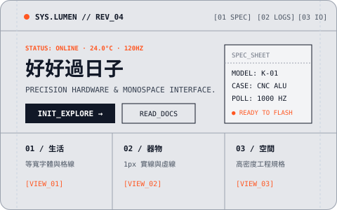

# ⑪ 工業技術風（Technical / Monospace）

> **一句話：等寬字體、1px 虛線表格與儀器狀態燈號，像打開一份精密的硬體工程規格書。**



| 項目 | 規格特徵 |
| :--- | :--- |
| **象限位置** | 理性 × 安靜（高密度規格感、精準工程美學） |
| **最適合** | 開發者工具、AI 模型發布頁、客製化機械鍵盤／合成器等硬體官網、開源技術文件 |
| **不適合** | 溫馨生活雜貨、親子教育、追求柔軟浪漫氛圍的品牌 |
| **核心配色** | 工業冷灰 `#E5E7EB` ＋ 碳黑 `#111827` ＋ 儀表板警示橘 `#FF5722`（或螢光綠 `#10B981` 燈號） |
| **字型搭配** | 全站英文／數據大量使用等寬字體（`JetBrains Mono` / `Space Mono`）＋ `Noto Sans TC` |
| **形狀與細節** | 零圓角（`0px`）；`1px` 實線與虛線交錯的技術框線；常見 `[01]`、`REV_04`、`● ONLINE` 等工程標記 |

---

## 📄 專屬 `PRD.md` 範例（Krono-01 模組化機械鍵盤）

<details>
<summary>點此展開複製 PRD.md：Krono-01 模組化機械鍵盤與音訊旋鈕</summary>

```markdown
# PRD：Krono-01 — 模組化 CNC 鋁合金機械鍵盤與數位旋鈕

## 1. 網站簡介
- **產品名稱**：KRONO-01 // LABS
- **專案定位**：展示全鋁合金CNC加工鍵盤的結構規格、韌體支援與限量預購的硬體產品頁
- **目標對象**：工程師、硬體玩家、音樂製作人與追求桌面精密工具的極客族群
- **核心轉換目標**：點擊「PRE-ORDER BATCH 02」預訂第二批限量套件

## 2. 頁面區塊與文案內容

### ① 工程導覽列（Header）
- 左側系統標記：`● SYS.KRONO-01 // REV_02`
- 右側索引連結：`[01 硬體規格]`、`[02 軸體開關]`、`[03 QMK 韌體]`

### ② 主視覺與右側規格表（Hero）
- 狀態列：`STATUS: BATCH_02 OPEN · 65% COMPACT · 1000HZ POLLING`
- 主標語：為寫程式與創作而生的精密敲擊儀器
- 副標語：整塊 6063 航太鋁合金切削外殼，搭載可熱插拔霍爾磁軸與雙編碼器旋鈕，支援開源韌體即時改鍵。
- 主要按鈕：`INIT_PREORDER ($249) →`
- 次要按鈕：`DOWNLOAD_CAD_SPEC`

### ③ 三大硬體模組（3 欄技術表格卡片）
1. **`01 / CNC 鋁合金殼體`**｜陽極氧化冷灰塗層、 Gasket 矽膠避震結構、總重 1,850g
2. **`02 / 霍爾磁軸與旋鈕`**｜0.1mm 觸發行程可調、雙段阻尼 CNC 金屬旋鈕
3. **`03 / 開源 VIA 網頁改鍵`**｜免安裝驅動程式，Chrome 瀏覽器直連即時燒錄鍵位

### ④ 頁尾（Footer）
- 韌體版本：`FIRMWARE v2.1.4 (MIT LICENSE)`
- 聯絡窗口：`io@krono-labs.example`
```

</details>

---

## 🤖 產生 `DESIGN.md` 的參考 Prompt

```text
請讀取附件 PRD.md，為「Krono-01 模組化機械鍵盤」產出一份工業技術／工程規格書風（Technical / Monospace）的 DESIGN.md
（上方 YAML Token ＋ 下方 10 個標準 Markdown 章節）。

設計關鍵字與規則：
- 核心關鍵字：工業技術風（Teenage Engineering / Nothing Tech 精密儀器質感）、冷灰金屬底色（#E5E7EB）搭配淺灰規格框（#F3F4F6）、純黑細框線（1px solid #111827）與 1px 虛線分隔（dashed）、零圓角（0px）、高辨識工業橘狀態點綴（#FF5722）、大量使用等寬字體（Monospace）與中括號編號標籤（[01] / STATUS: ONLINE）
- 繁體中文字型：英文與數據使用 JetBrains Mono，中文使用 Noto Sans TC（附 Google Fonts CDN）
- 避坑規則：嚴禁大圓角卡片、嚴禁柔和漸層或發光效果、不要感性修辭或模糊陰影
```

### 🔑 這個 Prompt 的關鍵字教學：為什麼這樣寫？

| 關鍵字 | AI 讀到它會做什麼 | 不寫會出現什麼問題 |
| :--- | :--- | :--- |
| **Teenage Engineering 精密儀器質感** | 模擬實體合成器、電子計算機面板的排版邏輯 | 不寫這組參考詞，AI 只會做成普通的黑底程式碼終端機 |
| **1px 實線與虛線（dashed）分隔** | 畫出像工程藍圖、規格單的嚴謹格線 | 讓卡片看起來像「硬體檢驗表」，瞬間與 SaaS 軟體區隔 |
| **工業橘點綴（#FF5722）＋ 狀態燈號** | 用 `●` 小圓點配橘色顯示硬體即時狀態 | 冷灰單色太單調，一顆小橘點是工業設計的靈魂 |
| **等寬字體＋中括號標籤 `[01]`** | 所有標籤、按鈕與數據字距一致、整齊對齊 | 讓技術規格與數據呈現極高的專業說服力 |
| **冷灰金屬底（#E5E7EB）** | 呈現陽極氧化鋁或工程紙張的質感 | 避開純白網站感，也避開過於常見的黑底暗黑風 |

---

[⬅️ 返回 03. 常用設計風格圖鑑](../03_常用設計風格圖鑑.md)
