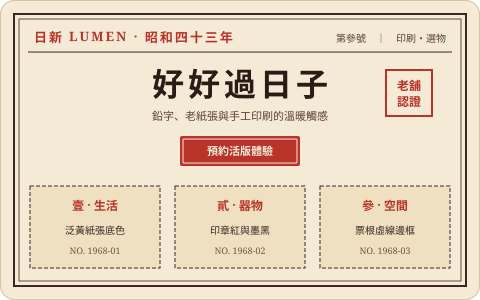

# ⑫ 復古懷舊紙本風（Retro / Vintage Print）

> **一句話：泛黃紙張底色、印章紅、雙層邊框與鉛字排版，充滿老台灣街角印刷舖的時光溫度。**



| 項目 | 規格特徵 |
| :--- | :--- |
| **象限位置** | 感性 × 安靜（懷舊故事感、百年傳承工藝感） |
| **最適合** | 台灣在地百年老店、活版印刷／獨立書店、昭和喫茶店、傳統糕餅與精釀品牌 |
| **不適合** | AI 科技產品、雲端工具、金融數位銀行 |
| **核心配色** | 古董泛黃紙 `#F4EAD5` ＋ 濃墨深褐 `#2A1B15` ＋ 硃砂印章紅 `#B8332A` ＋ 次要米黃卡片 `#EFE0C1` |
| **字型搭配** | 濃郁古風襯線／明體（`Noto Serif TC` 字重 700–900）＋ 傳統直式或經典橫式標點 |
| **形狀與細節** | 微圓角或直角（0–2px）；雙層復古印刷外框（內細外粗）；票根虛線邊框；印章方印與中文大寫數字（壹、貳、參） |

---

## 📄 專屬 `PRD.md` 範例（日新印刷所 Jih-Hsin Press）

<details>
<summary>點此展開複製 PRD.md：日新印刷所 Jih-Hsin Press（1968 活版印刷體驗與紙品店）</summary>

```markdown
# PRD：日新印刷所 Jih-Hsin Press — 傳承三代的鉛字活版印刷體驗館

## 1. 網站簡介
- **品牌名稱**：日新印刷所 Jih-Hsin Press（創立於 1968）
- **專案定位**：介紹台灣繁體中文鉛字收藏、活版印刷明信片體驗預約與文具選物官網
- **目標對象**：喜歡紙本溫度、復古文化、手作體驗的文青與海內外旅人
- **核心轉換目標**：點擊「預約活版體驗」選擇週末工作坊場次

## 2. 頁面區塊與文案內容

### ① 刊頭導覽列（Header）
- 左側商號：日新印刷所 · 昭和四十三年創業
- 右側連結：鉛字博物館、體驗預約、紙品選物

### ② 主視覺區（Hero）
- 右側印章標記：老舖認證
- 主標語：每一枚鉛字，都壓印著紙張的呼吸
- 副標語：台北太原路巷弄裡最後一間繁體中文鑄字與活版印刷工坊，邀你親手撿字、上墨、壓印一張屬於自己的名片。
- 主要按鈕：預約活版體驗

### ③ 三大工坊體驗（3 張票根虛線框卡片）
1. **壹 · 拾字名片體驗**｜NO. 1968-01｜親手在鉛字架尋找姓名，用圓盤機壓印 20 張棉紙名片
2. **貳 · 活版節氣明信片**｜NO. 1968-02｜雙色套印經典銅版插畫與二十四節氣詩句
3. **參 · 百年老紙選物櫃**｜NO. 1968-03｜日本竹尾美術紙、手工筆記本與黃銅印章收藏

### ④ 商號資訊與頁尾（Footer）
- 商號地址：台北市大同區太原路 97 巷 13 號
- 營業時間：週三至週日 10:00–18:00
- 版權宣告：日新印刷所 謹製 © 2026
```

</details>

---

## 🤖 產生 `DESIGN.md` 的參考 Prompt

```text
請讀取附件 PRD.md，為「日新印刷所 Jih-Hsin Press」產出一份復古懷舊紙本風（Retro / Vintage Print）的 DESIGN.md
（上方 YAML Token ＋ 下方 10 個標準 Markdown 章節）。

設計關鍵字與規則：
- 核心關鍵字：復古懷舊紙本風（台灣老舖／昭和活版印刷質感）、泛黃古董紙背景（#F4EAD5）、深咖啡墨字（#2A1B15）、硃砂印章紅（#B8332A）、頁面外圍加上雙層復古印刷線框（外粗 2px 內細 1px）、票根虛線邊框卡片（dashed border）、方形紅印章裝飾、使用「壹、貳、參」與復古票號編排
- 繁體中文字型：全站主要標題與按鈕使用 Noto Serif TC（700），編號使用 Space Mono（附 Google Fonts CDN）
- 避坑規則：嚴禁純白或純黑、嚴禁現代霓虹色或漸層、不要大圓角膠囊或模糊陰影
```

### 🔑 這個 Prompt 的關鍵字教學：為什麼這樣寫？

| 關鍵字 | AI 讀到它會做什麼 | 不寫會出現什麼問題 |
| :--- | :--- | :--- |
| **泛黃紙底 `#F4EAD5` ＋ 硃砂紅 `#B8332A`** | 重現老報紙、舊車票與紅印泥的經典懷舊色盤 | 若寫「暖色系」，AI 只會給你現代咖啡店的淺米白 |
| **雙層復古印刷線框（外粗內細）** | 在容器周圍畫出老式包裝盒與公文書的套框感 | 立刻讓網站看起來像一張印出來的實體海報 |
| **票根虛線邊框＋方印章裝飾** | 用 CSS `border-style: dashed` 和紅色方框模擬實體票券與落款印章 | 增強故事感與互動細節，且完全不需額外圖片 |
| **「壹、貳、參」與傳統漢語詞彙** | 在文案與編號中融入老店氣韻 | 避免在昭和老舖網頁出現不搭調的英文數位按鈕詞 |
| **全站襯線體（Noto Serif TC）** | 模擬鉛字印刷的筆畫雕琢感 | 現代黑體會讓整個老店靈魂瞬間消失 |

---

[⬅️ 返回 03. 常用設計風格圖鑑](../03_常用設計風格圖鑑.md)
