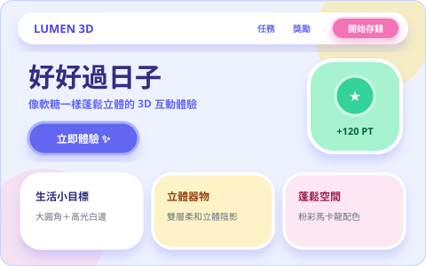

# ⑬ 3D 黏土軟膠風（Claymorphism / 3D Soft UI）

> **一句話：像軟糖與黏土一樣蓬鬆立體的圓潤元件，充滿親切、好玩、想戳一下的手感。**



| 項目 | 規格特徵 |
| :--- | :--- |
| **象限位置** | 理性 × 熱鬧（友善引導、遊戲化互動感） |
| **最適合** | 青少年／兒童教育 App、遊戲化記帳／儲蓄工具、新手入門學習平台 |
| **不適合** | 嚴肅新聞媒體、醫療報告、B2B 企業採購後台 |
| **核心配色** | 粉彩淺靛紫底 `#EEF2FF` ＋ 潔白卡片 `#FFFFFF` ＋ 馬卡龍珊瑚粉 `#F472B6`、薄荷綠 `#34D399`、靛藍 `#4F46E5` |
| **字型搭配** | 飽滿圓潤無襯線字（`Fredoka` 或 `Outfit` ＋ `Noto Sans TC` 字重 700–900） |
| **形狀與陰影** | 超大圓角（24–32px）與膠囊按鈕；內外雙層陰影（外層彩色柔和投影 ＋ 內層白色高光與底緣微暗陰影，營造 3D 鼓起效果） |

---

## 📄 專屬 `PRD.md` 範例（怪獸存錢筒 MonSave）

<details>
<summary>點此展開複製 PRD.md：怪獸存錢筒 MonSave（青少年遊戲化記帳存錢 App）</summary>

```markdown
# PRD：怪獸存錢筒 MonSave — 遊戲化每日記帳與儲蓄任務 App

## 1. 網站簡介
- **品牌名稱**：怪獸存錢筒 MonSave
- **專案定位**：把每天記帳、存零用錢變成餵養 3D 小怪獸的趣味理財網頁應用
- **目標對象**：12–25 歲學生族群、剛開始學理財的小資新手
- **核心轉換目標**：點擊「領養我的存錢怪獸」免費開啟帳戶

## 2. 頁面區塊與文案內容

### ① 膠囊導覽列（Header）
- 左側品牌名稱：MonSave 怪獸存錢筒
- 右側導覽連結：養成任務、儲蓄罐子、家長安心鎖
- 右側按鈕：領養小怪獸

### ② 主視覺區（Hero）
- 成就徽章：`今日連續記帳 +120 PT`
- 主標語：每天記一筆小花費，把夢想存成一隻胖怪獸
- 副標語：不用看懂複雜的圓餅圖！完成每日儲蓄小目標，就能幫你的虛擬夥伴解鎖新造型與小屋家具。
- 主要按鈕：領養我的存錢怪獸 ✨
- 次要按鈕：看怪獸圖鑑

### ③ 三大趣味玩法卡片（3 張 3D 軟膠馬卡龍卡片）
1. **3 秒語音／貼圖記帳**｜點兩下就記好今天的飲料錢，完全不費力
2. **夢想心願罐子**｜想買 Switch 還是去畢業旅行？設定目標進度條看得到
3. **好友存錢挑戰賽**｜邀請同學一起 30 天不喝手搖飲挑戰，共同解鎖徽章

### ④ 頁尾（Footer）
- 安全機制：不綁定銀行扣款，純手動趣味記帳最安心
- 版權宣告：© 2026 MonSave Studio
```

</details>

---

## 🤖 產生 `DESIGN.md` 的參考 Prompt

```text
請讀取附件 PRD.md，為「怪獸存錢筒 MonSave」產出一份 3D 黏土軟膠風（Claymorphism）的 DESIGN.md
（上方 YAML Token ＋ 下方 10 個標準 Markdown 章節）。

設計關鍵字與規則：
- 核心關鍵字：3D 黏土軟膠風（Claymorphism / Tactile 3D UI）、粉彩淺藍紫背景（#EEF2FF）、馬卡龍色系卡片（白、淡黃 #FEF3C7、淡粉 #FCE7F3）、超大圓角（24-30px）、3D 蓬鬆雙層陰影（同時設定 outer drop-shadow 與 inner top-left highlight / bottom-right shadow，讓卡片像氣球般鼓起）、3px 淺色高光白邊、飽滿粗圓體字
- 繁體中文字型：標題使用 Fredoka ＋ Noto Sans TC（800），內文使用 Noto Sans TC（500）（附 Google Fonts CDN）
- 避坑規則：不要銳利直角、不要純黑硬邊框（那會變新粗野主義）、不要深沉暗黑背景
```

### 🔑 這個 Prompt 的關鍵字教學：為什麼這樣寫？

| 關鍵字 | AI 讀到它會做什麼 | 不寫會出現什麼問題 |
| :--- | :--- | :--- |
| **outer shadow ＋ inner highlight 雙層陰影** | 寫出模擬光線打在立體軟糖上的 CSS `box-shadow`（含 `inset` 內陰影） | 只有外陰影的只是普通扁平圓角卡片，沒有「3D 蓬鬆立體感」 |
| **超大圓角（24–30px）** | 讓每個按鈕與卡片都圓滾滾、像捏出來的黏土 | 圓角太小會失去可愛柔軟的立體造型 |
| **馬卡龍低壓迫粉彩色系** | 搭配粉藍、鵝黃、草莓粉與薄荷綠 | 避開刺眼螢光色，保持童趣與溫暖 |
| **不要純黑硬邊框** | 改用白色高光邊框來強化體積感 | 只要加上黑框就會立刻變成平面的卡通或新粗野主義 |
| **飽滿粗圓體字（Fredoka）** | 讓英文數字與中文一樣圓潤可愛 | 纖細字體放在蓬鬆的 3D 卡片上會顯得格格不入 |

---

[⬅️ 返回 03. 常用設計風格圖鑑](../03_常用設計風格圖鑑.md)
