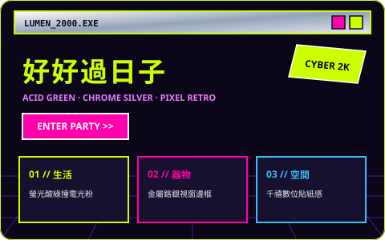

# ⑭ Y2K 千禧潮流風（Y2K / Acid Cyber）

> **一句話：鉻銀金屬光澤、螢光酸綠撞電光粉與千禧像素視窗，致敬 2000 年代大膽前衛的街頭數位美學。**



| 項目 | 規格特徵 |
| :--- | :--- |
| **象限位置** | 感性 × 熱鬧（狂野前衛、次文化潮流、極強社群擴散力） |
| **最適合** | 街頭服飾潮牌、電競比賽、地下音樂／電音派對、年輕世代快閃企劃 |
| **不適合** | 長輩服務、醫院診所、傳統企業 B2B 官網 |
| **核心配色** | 賽博深紫黑 `#0B0719` ＋ 螢光酸綠 `#CCFF00` ＋ 電光粉 `#FF00AA` ＋ 鉻銀金屬漸層 `#E2E8F0`→`#94A3B8` |
| **字型搭配** | 寬體未來感英文（`Syne` / `Space Grotesk`）＋ 粗黑中文（`Noto Sans TC` 900）＋ 像素或等寬英文點綴 |
| **形狀與細節** | 銳利直角或斜切角；千禧復古視窗標題列（含右上角方塊按鈕）；透視雷射網格線；斜貼紙徽章與跑馬燈文字 |

---

## 📄 專屬 `PRD.md` 範例（CYBER-TPE 2000）

<details>
<summary>點此展開複製 PRD.md：CYBER-TPE 2000（西門町千禧滑板與街頭電音派對）</summary>

```markdown
# PRD：CYBER-TPE 2000 — 西門町千禧復古滑板與街頭電音派對

## 1. 網站簡介
- **活動名稱**：CYBER-TPE 2000
- **專案定位**：集結街頭滑板挑戰賽、Y2K 二手古著市集與地下 DJ 派對的一日街頭文化節
- **目標對象**：16–28 歲喜愛街頭穿搭、滑板文化、Y2K 美學與電音派對的 Z 世代
- **核心轉換目標**：點擊「ENTER PARTY >>」搶購限量入場手環

## 2. 頁面區塊與文案內容

### ① 千禧視窗導覽列（Retro OS Window Bar）
- 視窗檔名：`CYBER_TPE_2000.EXE`
- 右側連結：`LINEUP`、`SKATE_JAM`、`POP-UP`
- 右上裝飾：最小化／關閉復古方塊按鈕

### ② 主視覺區（Hero）
- 斜角貼紙標籤：`LIMITED EDITION // 2000`
- 主標語：重返 2000 年夏夜的西門街頭
- 副標語：霓虹滑板坡道 × 6 組電音 DJ × 30 攤千禧古著與貼紙藝術家快閃，一晚限定。
- 主要按鈕：`ENTER PARTY >>`
- 次要按鈕：`VIEW TIMETABLE`

### ③ 三大現場企劃（3 張高對比邊框卡片）
1. **`01 // 霓虹街頭滑板賽`**｜現場搭設透明壓克力道具與螢光斜坡，報名即贈限定貼紙組
2. **`02 // 千禧古著與飾品市集`**｜重金屬銀飾、CCD 相機、復古運動外套挖寶專區
3. **`03 // 地下碎拍 DJ 舞台`**｜20:00 準時開炸，Bass 與 Hyperpop 不間斷放送

### ④ 頁尾跑馬燈與資訊（Footer）
- 活動時間地點：`2026.07.18 (SAT) 15:00–23:00 @ 西門町電影公園`
- 版權宣告：`© 2026 CYBER-TPE CREW`
```

</details>

---

## 🤖 產生 `DESIGN.md` 的參考 Prompt

```text
請讀取附件 PRD.md，為「CYBER-TPE 2000」產出一份 Y2K 千禧潮流風（Y2K / Acid Cyber）的 DESIGN.md
（上方 YAML Token ＋ 下方 10 個標準 Markdown 章節）。

設計關鍵字與規則：
- 核心關鍵字：Y2K 千禧未來風（Acid Graphics / Retro OS 美學）、深紫黑背景（#0B0719）搭配透視紫色網格背景線、螢光酸綠（#CCFF00）與電光粉（#FF00AA）高反差撞色、鉻銀金屬漸層（Chrome Silver）復古視窗標題列、直角邊框（0px）、斜角貼紙標籤（rotate）與水平捲動跑馬燈（Marquee）文字條
- 繁體中文字型：英文大標使用 Syne，中文使用 Noto Sans TC（900），系統介面文字使用 Space Mono（附 Google Fonts CDN）
- 避坑規則：不要保守的企業藍白灰、不要大圓角可愛卡片、深色底上的文字必須用亮白或螢光綠維持高可讀性
```

### 🔑 這個 Prompt 的關鍵字教學：為什麼這樣寫？

| 關鍵字 | AI 讀到它會做什麼 | 不寫會出現什麼問題 |
| :--- | :--- | :--- |
| **Acid Graphics（酸性設計）＋ 螢光酸綠** | 精準抓到 `#CCFF00` 與電光粉這種 Z 世代街頭色系 | 只寫「未來感」，AI 會做成冷冰冰的科幻電影藍色 |
| **Retro OS 復古視窗標題列** | 畫出像 Windows 98 / 2000 的銀灰色標題欄與方塊鈕 | 立刻帶來極具辨識度的千禧年數位懷舊趣味 |
| **透視紫色網格＋跑馬燈（Marquee）** | 在背景加上 3D 地平線網格與動態跑馬燈字條 | 讓靜態網頁一秒具備地下派對海報的律動感 |
| **斜角貼紙標籤（rotate）** | 讓「LIMITED」標籤歪斜貼在角落 | 打破水平垂直工整結構，製造街頭叛逆感 |
| **Syne 寬體英文 ＋ Space Mono** | 英文顯得前衛扁寬、介面文字像系統檔案 | 是 Y2K 平面海報最經典的字體語彙 |

---

[⬅️ 返回 03. 常用設計風格圖鑑](../03_常用設計風格圖鑑.md)
